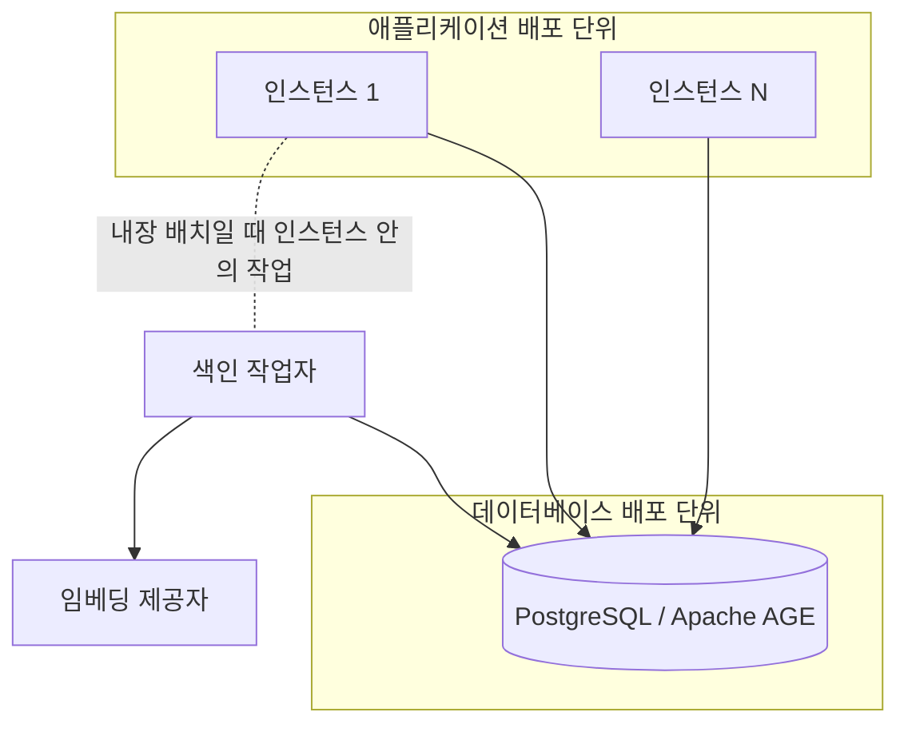
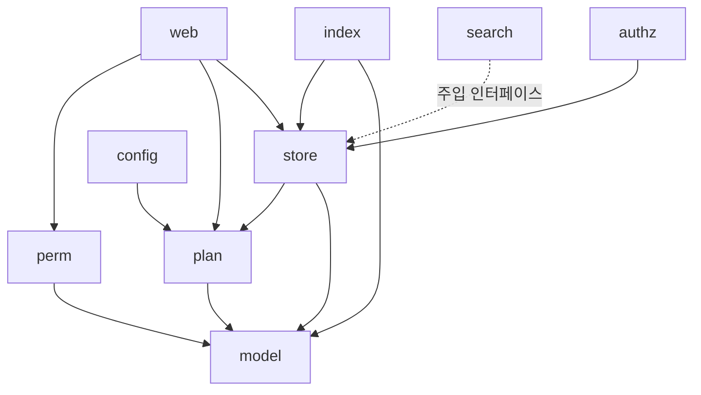

# 아키텍처와 구성 요소

시스템 경계, 구현 기술, 패키지 의존, HTTP 진입점과 DB 연결 자원의 정본이다.

[설계 전체](../SDD.md) · [요구사항과 설계 대응](traceability.md) · [신규 개발 계획](../development-plan/architecture.md)

## 구현 기술 기준

구현 언어는 Go로 확정하고 기준 버전을 1.27.1로 둔다. `go.mod`의 `go 1.27.1` 지시문과 저장소 루트 `AGENTS.md`가 이 기준을 계약으로 둔다. 개발·CI·검증에는 Go 1.27.1 도구 체인을 사용한다. `Effective Go`를 기준으로 삼고, `gofmt` 적용, 짧은 소문자 패키지 이름, 발생 지점 가까이에서의 오류 처리, 자원 획득 직후 `defer` 해제가 그대로 적용된다.

`Effective Go`가 다루지 않는 최신 관용구는 Modern Go Guidelines를 따른다. 이 도구가 대상 Go 버전에서 쓸 수 있는 표준 라이브러리 관용구를 판마다 제시하므로, 판이 올라가며 생긴 관용구를 문서에 옮겨 적어 두고 낡히는 대신 코드를 쓸 때 도구에서 확인한다. 이 문서가 확정하는 것은 기준 버전과 그 출처이며 개별 관용구 목록이 아니다.

기준 버전을 1.27.1로 두는 이유는 사용자가 프로젝트 언어 기준으로 확정했기 때문이다. [HTTP 진입점](architecture.md#http-진입점)이 표준 라이브러리만 쓰기로 한 근거인 메서드 일치와 경로 와일드카드는 1.22에 들어와 1.27.1에 포함된다.

이 선택은 [`SRS.md`](../SRS.md)가 정한 것이 아니라 이 문서의 설계 결정이다. [`SRS.md`](../SRS.md)는 구현 언어를 정하지 않았으므로 요구사항 변경이 아니며, 언어를 바꾸면 이 문서의 「구성 요소 설계」만 다시 쓰면 된다.

[`SRS.md`](../SRS.md)가 이미 확정해 그대로 쓰는 기술은 다음과 같다. 이 문서가 다시 선택하지 않는다.

| 기술             | 확정 위치                                        |
|------------------|--------------------------------------------------|
| PostgreSQL       | `NFR-AGENT_CONTEXT-001`, [SRS 데이터 저장 제약](../SRS.md#데이터-저장-제약)    |
| Apache AGE       | `NFR-AGENT_CONTEXT-001`, [SRS 그래프 모델](../SRS.md#그래프-모델)         |
| pgvector         | [SRS 임베딩 저장](../SRS.md#임베딩-저장)                                  |
| Streamable HTTP  | `FR-AGENT_CONTEXT-095`, [SRS transport와 프로토콜](../SRS.md#transport와-프로토콜) |
| OAuth 2.1 + PKCE | `FR-AGENT_CONTEXT-090`, [SRS 프로토콜 매핑](../SRS.md#프로토콜-매핑)        |

라이브러리 선택은 근거가 있는 것만 확정한다. HTTP 진입점, 데이터베이스 드라이버와 인가 서버는 이 문서와 [인증 설계](authentication.md#인가-서버)가 기술적 근거를 밝혀 정했고, 남은 선택은 [설계 미정 사항](traceability.md#설계-미정-사항)에 둔다.

구현에서 SDK·라이브러리·모듈의 API나 동작을 사용할 때는 적용 판의 공식 문서와 API reference를 확인한다. 버전별 동작이나 호환성에 기대어 아키텍처 결정을 내리면 공식 출처를 [`reference.md`](../reference.md)에 기록한다. 공식 문서가 확인되지 않는 동작은 검증 전까지 확정된 계약으로 다루지 않는다.

## 외부 경계

현재 외부 진입점은 사용자·운영자의 웹 브라우저다. 웹 계정 세션·그래프 관리가 저장 계층에 연결되고 색인 작업자는 임베딩 제공자를 호출한다. 검색·감사·평가는 내부 패키지와 실행기가 소유한다.

목표 직접 연결에서는 에이전트 호스트의 내장 MCP 클라이언트가 표준 OAuth 인가 후 보호된 도구를 호출한다. 호스트별 별도 중계 프로그램은 두지 않는다. OAuth 발견·최초 인가·코드 교환 경로는 등록했으며 보호 MCP의 조립과 실제 호스트 인수는 후속 범위다.

## 배포 형상

[`SRS.md`](../SRS.md)의 [SRS 배포 단위](../SRS.md#배포-단위)가 확정한 요구사항을 배포 경계로 옮긴다.

| 배포 단위    | 포함                                  | 확장 방식                                  |
|--------------|---------------------------------------|--------------------------------------------|
| 애플리케이션 | 웹 페이지, MCP 리소스 서버, 인가 서버 | 인스턴스를 늘린다                          |
| 데이터베이스 | PostgreSQL과 Apache AGE               | 이 문서의 범위 밖이며 운영 구성으로 정한다 |
| 색인 작업자  | 임베딩 생성과 재시도                  | 애플리케이션 안에 두거나 분리해 늘린다     |

색인 작업자를 배포 단위 표에 두면서도 위 그림에서 두 배포 단위 밖에 그린 이유는 배치가 선택이기 때문이다. 애플리케이션 안의 작업으로 두면 애플리케이션 배포 단위에 속하고, 분리하면 독립 배포 단위가 된다. [`SRS.md`](../SRS.md)가 요구한 것은 색인이 요청 경로 밖에서 처리된다는 것뿐이고 두 배치 모두 그것을 만족한다.

## 인스턴스 무상태성

컨텍스트·관계·임베딩·쓰기 결과·요청 빈도·서명 키·폐기 목록과 색인 작업은 공유 DB에 둔다. 웹 세션은 서명된 쿠키로 전달하고 검증 캐시·로그인 시도 예산·작업 자리는 재시작 가능한 지역 상태로 구분한다.

직접 연결 구현 시 인가 계열·회전형 갱신 상태·행위자 등록도 공유 DB에 둔다. MCP `2026-07-28`의 revision·기능은 요청별 메타데이터로 판정하며 발견 이력과 서버의 프로토콜 세션 상태를 저장하지 않는다.

## 배치 조합

색인 작업자는 `INDEX_WORKER_PLACEMENT=embedded|external`로 선택하며 기본값은 `embedded`다. 주기 작업은 모든 인스턴스에 내장하되 자문 잠금으로 회차당 하나만 실행한다. 웹 인증·세션과 공개 키는 애플리케이션에 둔다. OAuth 발견·인가·최초 코드 교환도 같은 애플리케이션에 두며 보호 MCP의 배치는 후속 범위다.

## 패키지 경계

| 패키지   | 책임                                                                                       | 의존                                       |
|----------|--------------------------------------------------------------------------------------------|--------------------------------------------|
| `model`  | 컨텍스트·관계·그래프의 타입·계층별 필수 속성과 등록 키 검증                                        | 없음                                       |
| `plan`   | 계정 플랜 항목의 기본값과 한도 판정                                                        | `model`                                    |
| `store`  | 그래프와 테이블에 닿는 모든 질의와 기록, 그래프 불변식 규칙 실행. `graph_id`를 필수 인자로 받는다 | `model`, `plan`                         |
| `perm`   | 직접 부여와 팀 상속으로 계산한 유효 등급으로 연산별 등급을 검사한다                        | `model`                                    |
| `index`  | 색인 작업 소비·재시도와 본문·질의의 임베딩 제공자 호출                                     | `model`, `store`                           |
| `authz` | 계정 등록·비밀번호 검증, 웹 세션 발급·검증·폐기, JWKS·OAuth 발견·사전 등록·인가 코드·최초 토큰 교환·Bearer 보호 인증·갱신 회전 | `model`, `store` |
| `search` | 네 채널 실행, 질의 적응형 라우팅, 순위 역수 합 결합, 근거 경로 보존 선택, 예산 적용 | `model` (저장·임베딩 호출은 주입 인터페이스) |
| `web`    | 관리 화면 여섯 종·인증 및 인가 동의 화면의 처리와 렌더링                                                               | `model`, `perm`, `plan`, `store`           |
| `config` | 배포 구성 값의 읽기와 검증                                                                 | `plan`                                     |

현재 업무 패키지는 아홉 개다. 목표 추가 패키지는 아래 별도 표에서 정한다. 업무 패키지의 의존은 이 표를 기준으로 하며 [설계 경계 검증](testing.md#테스트-계층)의 테스트가 표와 실제 import를 양방향으로 대조한다. 표에 없는 의존이 생기거나 표에 적은 의존이 사라지면 그 테스트가 실패한다.

업무 감사 기록 전용 패키지를 따로 두지 않는다. 진단 파일은 목표 `diagnostic` 패키지의 별도 책임이다. 관리 연산 기록과 웹 감사 기록은 그것을 만든 쓰기와 같은 트랜잭션 안에서 남아야 하고, 그 트랜잭션은 `store`가 연다. 기록을 다른 패키지에 두면 그 패키지가 트랜잭션을 넘겨받아야 하는데 그것은 [접근 계층](architecture.md#접근-계층)이 막은 우회 경로다. 보존 기간 정리도 같은 이유로 [주기 작업](operations.md#주기-작업)과 함께 `store`에 둔다.

`store`가 `plan`에 의존하는 이유는 누적 한도의 판정 시점 때문이다. [계정 플랜 값](authorization.md#계정-플랜-값)의 누적 단위 한도는 값을 늘리는 쓰기와 같은 트랜잭션에서 판정해야 하며, 접근 계층 밖에서 읽은 값으로 판정하면 한도 직전의 그래프에 동시 요청이 둘 다 통과한다. 그래서 한도 항목의 정의와 판정 함수를 소유한 `plan`을 `store`가 부른다. `plan`은 저장소를 호출하지 않으므로 방향은 한쪽으로 남는다.

`perm`과 `search`가 `store`를 직접 import하지 않는 것은 둘이 필요한 기능을 인터페이스로 받기 때문이다. `perm`은 유효 등급 조회를, `search`는 채널 질의와 질의 임베딩을 인터페이스로 선언하고 조립 지점이 구현을 넣는다. 실행 시점의 호출 방향은 표와 같고, 덕분에 두 패키지의 단위 테스트가 데이터베이스와 임베딩 제공자 없이 돈다. `search`가 `index`를 부르지 않는 것도 같은 이유이며, 임베딩 제공자 호출의 소유는 여전히 `index` 하나다.

`index`가 `model`에 의존하는 이유는 작업 확보 범위를 그래프로 좁힐 수 있어야 하기 때문이다. [SRS 검증](../SRS.md#검증)의 측정은 잰 그래프의 색인이 끝난 상태에서 시작해야 하는데, 가리지 않고 확보하면 공유 데이터베이스에 남은 다른 그래프의 대기 작업까지 처리하게 되어 측정 시작 상태가 회차마다 달라진다. 범위를 지정하려면 그래프 식별자 타입이 필요하고 그 타입은 `model`이 소유한다. 운영 경로의 색인 작업자는 여전히 그래프를 가리지 않는다.

`model`이 아무것에도 의존하지 않는 이유는 [SRS 컨텍스트 모델](../SRS.md#컨텍스트-모델)이 논리 모델을 그래프 구조와 무관하게 정의했기 때문이다. 타입과 검증 규칙이 저장 방식을 몰라야 `TBD-AGENT_CONTEXT-038`의 비그래프 기준선을 같은 타입으로 구성할 수 있다.

패키지 이름을 `context`로 두지 않는 이유는 표준 라이브러리와 겹치기 때문이다. 컨텍스트 타입을 담는 패키지는 `model`로 두고, 표준 `context.Context`는 모든 패키지가 그대로 쓴다.

의존은 한 방향으로만 흐른다. `store`가 위쪽 패키지를 부르지 않으므로 접근 계층이 업무 규칙을 알지 못하고, 그 덕에 [격리 강제의 구현](data.md#격리-강제의-구현)이 요구한 응답 재검사를 모든 호출자에 대해 같게 적용할 수 있다.

`config`가 `plan`만 가리키는 이유는 구성 값이 조립 시점에 각 패키지로 주입되고 실행 중에는 참조되지 않기 때문이다. `plan`만 예외인 것은 `ACCOUNT_PLAN_LIMITS`를 기동 전에 해석하려면 항목 정의가 필요해서다.

`model`로 들어가는 간선은 타입 의존이다. 계층별 검증과 식별자 형식을 쓰는 패키지가 그것을 부른다.

임베딩 제공자 호출의 소유를 `index` 하나로 두는 근거는 다음과 같다. 의미 유사도 채널은 `work_context` 텍스트의 벡터가 있어야 하고 그 벡터는 저장된 본문과 같은 모델로 만들어져야 하는데, 제공자를 두 패키지가 각자 부르면 접속 정보와 모델 구성을 두 곳에서 주입받고 [SRS 임베딩 모델](../SRS.md#임베딩-모델)이 요구한 "같은 모델과 같은 차원"을 지키는 책임도 나뉜다. `index`는 `search`를 부르지 않으므로 이 간선이 순환을 만들지 않는다.

## 접근 계층

`store`가 [격리 강제의 구현](data.md#격리-강제의-구현)이 말한 단일 접근 계층이다. 세 가지를 지킨다.

| 규칙                                   | 구현                                                              |
|----------------------------------------|-------------------------------------------------------------------|
| 모든 그래프 질의가 `graph_id`를 받는다 | 내보내는 함수의 첫 인자를 `graph_id`로 고정한다                   |
| 반환 전 `graph_id`를 대조한다          | 결과를 조립하는 한 지점에서 정점과 간선의 값을 요청 값과 비교한다 |
| 우회 경로를 만들 수 없다               | 데이터베이스 연결과 질의 실행기를 패키지 밖으로 내보내지 않는다   |

연결을 내보내지 않는 것이 핵심이다. `store` 밖의 어떤 패키지도 데이터베이스 핸들을 손에 넣을 수 없으므로, 우회하려면 `store`에 새 함수를 추가해야 하고 그 추가는 리뷰와 격리 위반 테스트를 지나야 한다.

## 데이터베이스 연결

`TBD-AGENT_CONTEXT-041`을 확정한다. 드라이버와 풀은 `pgx`의 `pgxpool`을 쓴다.

근거는 Apache AGE가 연결마다 준비를 요구한다는 것이다. openCypher를 호출하려면 확장을 적재하고 `search_path`에 `ag_catalog`를 넣어야 하며, 이 설정은 연결에 붙는다. 풀에서 꺼낸 연결마다 매번 설정 질의를 보내면 왕복이 두 배가 되므로, 연결이 만들어질 때 한 번만 실행할 자리가 필요하다. `pgxpool.Config`의 `AfterConnect`가 연결이 수립된 뒤 풀에 추가되기 전에 호출되는 자리로 문서에 정의되어 있어 여기에 정확히 대응한다. 원문은 [`reference.md`](../reference.md)에 있다.

풀의 연결 수 하한은 코드에서 정하고 접속 문자열이 `pool_max_conns`를 주면 그 값을 따른다. `pgxpool`의 기본값은 CPU 수와 4 중 큰 값인데, 웹·MCP·색인 작업자·[주기 작업](operations.md#주기-작업)이 이 풀 하나를 나눠 쓰고 홉 확장이나 후보 조립처럼 한 요청이 연결을 겹쳐 잡는 경로가 있어 코어가 적은 배포에서 서로를 기다린다. 나머지 풀 값은 `pgxpool`의 기본값을 쓴다.

연결 하나를 쥔 채 같은 풀에서 연결을 더 기다리는 경계는 시작하기 전에 자기가 동시에 쥘 최대 연결 수를 저장소에서 예약한다. 요청 단위 일관 읽기의 동기화 스냅숏은 조정 연결 하나와 경계 안의 읽기 트랜잭션 셋으로 4개를, 쓰기 멱등성의 예약 트랜잭션은 그 트랜잭션과 도메인 연산이 한 번에 하나씩 실행하는 풀 읽기로 2개를 예약한다. 컨텍스트 생성·갱신·폐기·복구도 충돌 재조회가 쓰기 트랜잭션과 풀 읽기를 겹쳐 쓰므로 시작 전에 2개를 예약한다. 멱등성 트랜잭션 안의 저장점은 바깥 예약을 공유하며 중복 예약하지 않는다. 예약 없이 두면 풀 상한만큼의 요청이 첫 연결을 쥔 채 서로의 두 번째 연결을 기다린다. 연결 예약이 없으면 요청 제한 시간이나 취소까지 멈추고, 같은 풀을 쓰는 웹·색인 작업자·[주기 작업](operations.md#주기-작업)도 함께 멈춘다.

예약 총량은 풀 상한에서 스냅숏 한 요청의 점유 4를 뺀 값이고, 4보다 작으면 4로 둔다. 연결을 기다리는 경계는 예약보다 적게 쥐고 있으므로, 예약한 경계들이 실제로 쥔 연결의 합은 풀 상한보다 작다. 따라서 기다리는 연결은 비어 있거나 연결 하나만 쓰고 돌려주는 요청이 쥐고 있어 대기가 끝난다. 예약하지 않는 요청의 몫으로 연결 4개를 남긴다. 예약을 기다리는 동안에는 연결을 쥐지 않으며, 요청 컨텍스트가 끝나면 대기를 멈추고 그 원인을 오류로 돌려준다. 동기화 스냅숏은 경계 안에서 동시에 여는 읽기 트랜잭션을 3개로 제한한다. 그보다 많은 읽기는 같은 요청의 앞선 읽기가 끝나기를 기다리므로 예약보다 많은 연결을 쥐지 않는다. 스냅숏 한 요청이 예약 총량 안에 들어야 하므로 `pool_max_conns`는 4 이상이어야 하고, 저장소는 그보다 작은 값으로 준비하지 않는다.

동기화 스냅숏의 읽기 안에서 발생한 임베딩 접근 기록은 해당 읽기에 모으고, 그 읽기 전용 트랜잭션을 종료해 연결을 반환한 뒤 풀 연결 하나로 처리한다. 접근 기록이 끝날 때까지 읽기 자리는 반납하지 않으므로 새 읽기가 반환한 연결의 몫을 먼저 차지하지 않는다. 각 자리는 읽기 연결 또는 접근 기록 연결 하나만 사용하고, 조정 연결과 세 자리의 실제 최대 점유는 예약한 4개를 넘지 않는다. 접근 기록의 실패와 취소는 해당 읽기 호출의 오류로 전달하며, 오류 경로에서도 연결과 자리를 반환한다. 중첩 읽기는 바깥 읽기에 기록을 모아 같은 종료 경계를 사용한다.

AGE가 돌려주는 `agtype`은 PostgreSQL 기본 타입이 아니다. `store`가 이 값을 문자열로 받아 `model`의 타입으로 해석하며, 해석 코드를 한곳에 두어 탐색 결과를 다루는 지점을 하나로 유지한다.

## HTTP 진입점

표준 라이브러리 `net/http`의 `ServeMux`를 사용한다. 현재 경로는 다음과 같다.

| 경로 | 메서드 | 소유 |
|---|---|---|
| `/login`, `/register` | GET, POST | 웹·계정 인증 |
| `/logout` | POST | 웹 세션 |
| `/jwks.json` | GET | 서명 공개 키 |
| `/.well-known/oauth-protected-resource/mcp`, `/.well-known/oauth-authorization-server` | GET, HEAD | 고정 OAuth 발견 |
| `/authorize` | GET, POST | 웹 세션·명시적 동의와 인가 코드 |
| `/token` | POST | OAuth 최초 코드 교환과 갱신 회전 |
| `/graphs`, `/graphs/{graph_id}` | GET | 웹 |
| `/graphs/{graph_id}/access`, `/graphs/{graph_id}/deletion` | GET, POST | 웹 |
| `/graphs/{graph_id}/audit` | GET | 웹 |
| `/operator/restores` | GET, POST | 웹 |
| `/healthz`, `/readyz` | GET | 상태 확인·TLS 판정 밖 |

보호 MCP·연결 관리의 후속 경로는 [호스트 직접 연결 전환 설계](architecture.md#호스트-직접-연결-전환-설계)를 따른다. 인가 화면은 웹 인터페이스와 서버 어댑터를 통해 authz를 호출하며 `web`에서 `authz`를 import하지 않는다. 코드 교환·갱신 회전·Bearer 공유 폐기는 별도의 좁은 저장 인터페이스로 주입하며 DB 핸들을 노출하지 않는다. Bearer 검증 결과 전달과 HTTP 오류 사상은 authz의 ProtectBearer가 제공한다. MCP-02의 newMCPHandler가 이를 MCP Principal로 옮기고 application의 선택 /mcp 슬롯을 TLS 판정 아래에 연결한다. mcp.NewHandler는 14종 처리기를 모두 요구하므로 현재 main은 임시 처리기로 경로를 활성화하지 않으며 MCP-06의 newMCPWriteHandlers는 여덟 쓰기에 현재 등급·플랜·저장/거부 기록·재생 실행기를 주입한다. MCP-07의 newMCPReadHandlers는 다섯 읽기에 현재 등급·플랜·그래프/노드/홉/관계와 검색기를 주입하고 저장 오류·구성원 참조 이름을 맞춘다. 기동 경로의 전체 업무 조립은 ARCH-07·MCP-09에서 인수한다. 등록하지 않은 경로도 TLS 검사를 거치고 `404`를 반환한다.

## 버전 요구

[`SRS.md`](../SRS.md)의 [SRS 데이터 저장 제약](../SRS.md#데이터-저장-제약)이 PostgreSQL과 Apache AGE 버전을 상세 설계로 넘겼다. 두 확장의 공식 호환 범위를 확인해 정하고, [구현 기술 기준](architecture.md#구현-기술-기준)이 정한 Go 하한을 함께 적는다.

| 구성 요소  | 요구            | 근거                                                                     |
|------------|-----------------|--------------------------------------------------------------------------|
| Go         | 1.27.1          | 사용자가 정한 프로젝트 기준이며 [HTTP 진입점](architecture.md#http-진입점)이 요구하는 기능을 포함한다 |
| PostgreSQL | 13 이상 18 이하 | 아래 두 확장 제약의 교집합                                               |
| Apache AGE | 1.8.0 이상      | PostgreSQL 11~18을 지원한다                                              |
| pgvector   | 0.7.0 이상      | PostgreSQL 13 이상을 요구하며 `halfvec`와 이진 양자화가 0.7.0에 들어왔다 |

하한이 13인 이유는 pgvector가 그 아래를 지원하지 않기 때문이다. 상한이 18인 이유는 Apache AGE가 그 위를 지원하지 않기 때문이다. pgvector 0.7.0 이상을 요구하는 것은 `SUG-AGENT_CONTEXT-9`가 채택한 압축 선택지가 그 판에서 들어왔기 때문이며, 압축을 쓰지 않아도 선택지를 열어 두려면 필요하다.

정확한 버전을 명세에 박지 않고 범위로 두는 이유는 [SRS 임베딩 모델](../SRS.md#임베딩-모델)이 모델명을 고정하지 않은 것과 같다. 하나를 고르면 근거 없이 고정되고, 범위만 정하면 검증할 수 있는 제약이 남는다. 운영에 쓸 버전은 배포 구성으로 고정하며, [SRS 검증](../SRS.md#검증)의 통제 조건이 비교 사이에 환경을 바꾸지 말라고 이미 요구하므로 재현성은 그쪽에서 지켜진다.

현재 개발 이미지는 Apache AGE 1.8.0과 PostgreSQL 18 조합에 고정한다. 다음 PG18 호환 공식 안정판으로 올리는 일은 이 범위 안의 배포 갱신이지만, `SUG-AGENT_CONTEXT-21`이 채택한 홉 탐색 구현 비교와 전체 데이터베이스 통합 검증을 다시 통과해야 한다. 개발 스냅숏은 공식 안정판을 대신하지 않는다.

DB 이미지의 재빌드에서도 같은 pgvector를 사용하도록 `Dockerfile`은 PGDG 패키지 `postgresql-18-pgvector=0.8.6-1.pgdg13+1`을 완전한 버전으로 고정한다. 이 이미지는 개발·운영 구성이 공용한다. 판을 올릴 때에는 고정값과 검증 기대값·문서를 함께 갱신한다. 이는 [SRS 검증](../SRS.md#검증)의 같은 조건 비교를 위한 개발 형상이며 운영 버전 요구 범위를 좁히지 않는다. 해당 패키지를 저장소에서 더 이상 제공하지 않으면 빌드를 실패시키며 최신 판으로 자동 대체하지 않는다.

## 비기능 요구사항의 성립 근거

| 요구사항                | 성립시키는 설계 요소                                                            |
|-------------------------|---------------------------------------------------------------------------------|
| `NFR-AGENT_CONTEXT-001` | [버전 요구](architecture.md#버전-요구)의 네 구성 요소 범위                                               |
| `NFR-AGENT_CONTEXT-002` | 원천의 `source_ref`, 파생의 `valid_from`·`valid_to`, `version`과 `SUPERSEDES`   |
| `NFR-AGENT_CONTEXT-003` | 노드와 참조를 평평하게 반환하는 응답 구성, `entry_distance`, `matched_channels` |
| `NFR-AGENT_CONTEXT-004` | 사용 사례별로 나눠 재는 검색 지표와 채널별 기여 기록                            |
| `NFR-AGENT_CONTEXT-005` | 저장 방식에 의존하지 않는 `model`과 채널 단위로 끌 수 있는 `search`             |
| `NFR-AGENT_CONTEXT-006` | [SRS 예산](../SRS.md#예산)의 문자 수 산정과 결합 전에 기록하는 채널별 지표                        |
| `NFR-AGENT_CONTEXT-007` | 적용·거부를 모두 남기는 `operation_log`와 보존 기간 하한                        |
| `NFR-AGENT_CONTEXT-008` | 상태 전이를 갖는 파생·관계·수명주기와 그 전이를 남기는 기록                     |
| `NFR-AGENT_CONTEXT-009` | 본문과 개인 식별 정보를 뺀 집계 지표                                            |
| `NFR-AGENT_CONTEXT-010` | 모든 컨텍스트의 `created_by`·`created_by_agent`와 관계의 확정 주체              |
| `NFR-AGENT_CONTEXT-011` | 트랜잭션 안의 버전 비교와 자동 병합 없는 충돌 거부                              |
| `NFR-AGENT_CONTEXT-012` | 인스턴스 밖에 둔 상태와 프로토콜 세션 부재                                      |
| `NFR-AGENT_CONTEXT-013` | 자격 증명 원문 미저장·로그 배제, 갱신 회전·재사용 계열 폐기 (직접 연결 구현 예정) |

## 목표 추가 패키지와 조립

직접 연결과 진단 파일 구현을 위해 다음 두 패키지를 추가한다. 현재 소스가 존재한다는 뜻은 아니다. 기존 아홉 업무 패키지와 함께 목표 애플리케이션 패키지는 열한 개다.

| 패키지 | 책임 | 허용하는 프로젝트 내부 의존 |
|---|---|---|
| `mcp` | 공식 SDK 전송·도구 등록, 인증 계정 전달·행위자 결합, 입력과 도메인 결과 매핑 | `model`, `perm`, `plan`; 저장·검색·등록 기능은 주입 인터페이스 |
| `diagnostic` | 허용 필드 기반 이벤트, 종류별 파일 기록·회전·정리·실패 출력 | 없음; 업무 타입·DB 핸들을 받지 않는다 |

`cmd/server`가 저장소·인가 서비스·검색·MCP·웹·기록기를 조립한다. 각 업무 패키지에는 필요한 기능의 좁은 인터페이스만 주입하고 상위 패키지를 직접 호출하지 않는다. 진단 이벤트 전달도 인터페이스를 사용하여 저장소·인증 서비스가 파일 경로나 기록기 내부 상태를 알지 않도록 한다. 업무 감사 기록은 계속 `store`의 도메인 트랜잭션에 두며 진단 패키지로 옮기지 않는다. 마이그레이션·평가·감사와 분리 색인 실행기 `cmd/indexer`는 애플리케이션의 패키지 수에 포함하지 않는다.

[분야별 책임](../SDD.md#분야별-설계-문서)과 패키지는 일대일 대응이 아니다. 예를 들어 데이터·권한·수명주기는 동일한 `store` 트랜잭션에서 만날 수 있으나 계약별 정본은 각각의 문서로 유지한다.

## 호스트 직접 연결 전환 설계

현재 서비스는 웹 관리·계정 세션·저장·검색·색인과 평가 실행기를 유지한다. 목표 구성에서는 호스트 내장 MCP 클라이언트가 공개 HTTPS URL을 등록하고 표준 OAuth 인가 뒤 MCP `2026-07-28`의 요청별 메타데이터로 도구 목록·호출을 실행한다. 서버는 `server/discover`를 제공하며 호스트의 사전 발견 호출은 선택이다. 호스트는 자격 증명의 안전한 저장·복원·갱신과 도구 승인을 담당하고 서버는 계정·등급·행위자 결합·멱등성·도메인 검증을 담당한다.

- 전송·도구·쓰기 외피: [MCP 설계](mcp.md).
- 발견·최초 인가·회전·폐기: [인증 설계](authentication.md).
- 정확한 호스트 판·콜백과 인수 조건: [첫 Codex CLI 시험](testing.md#첫-codex-cli-상호운용-시험).
- 목표 저장 추가·변환과 이전 연결 데이터 보존: [스키마 적용](data.md#스키마-적용).

전용 프로젝트 클라이언트나 호스트별 프로토콜 어댑터를 만들지 않는다. 목표 채택·문서 작성은 호스트 지원이나 연결 문제의 해결 완료를 증명하지 않는다.
