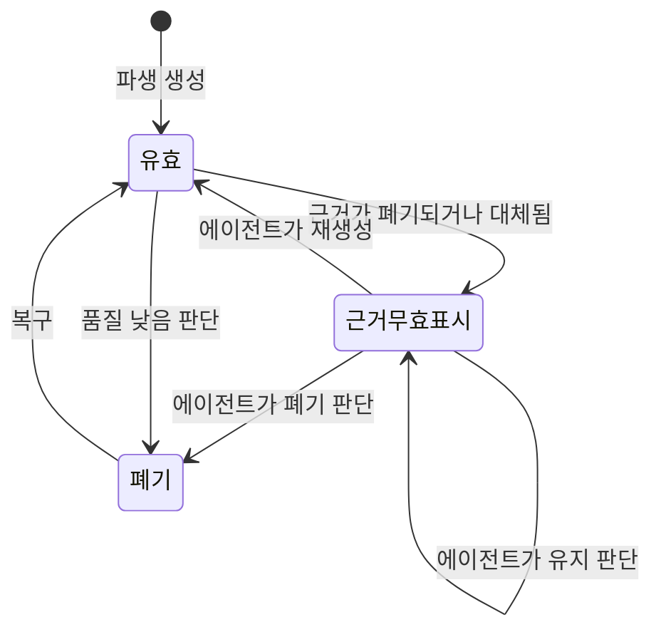
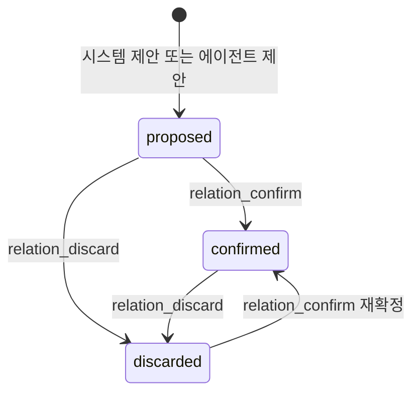
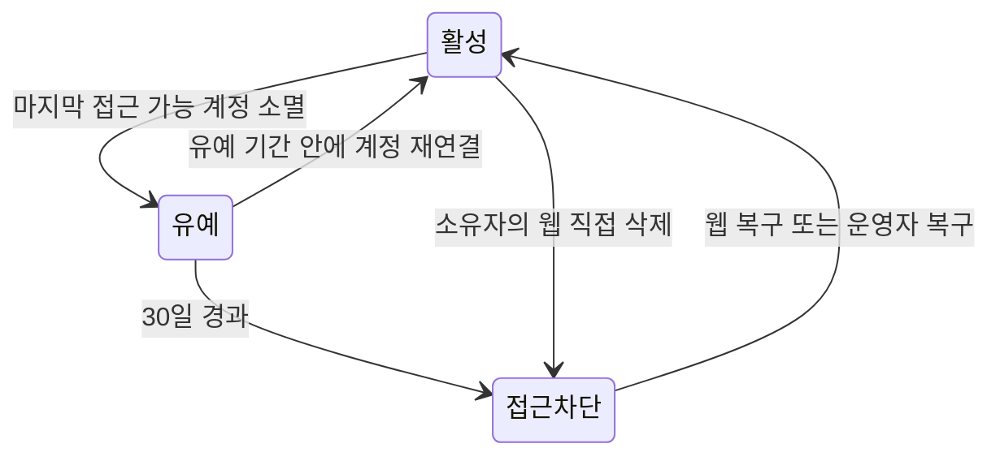
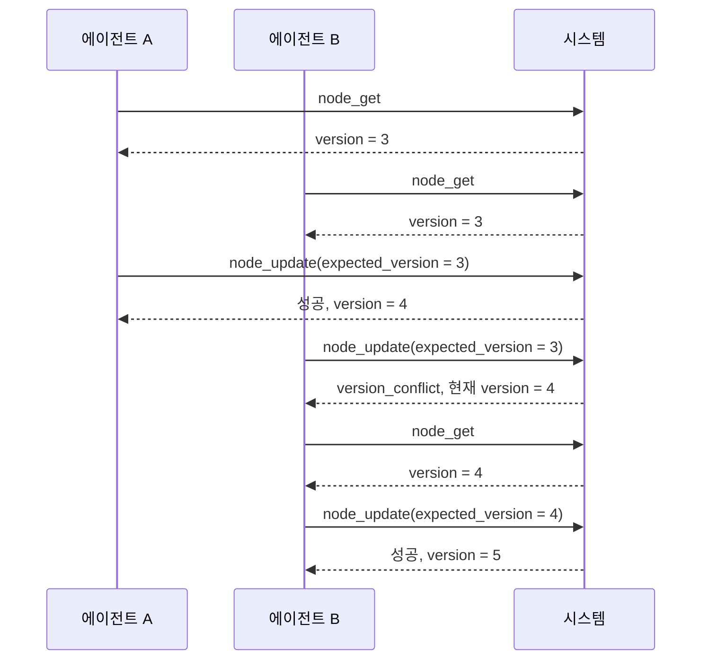

# 컨텍스트·사건·관계의 수명주기

파생 근거, 사건 재구성, 관계 제안·확정, 삭제·복구, 감사와 쓰기 트랜잭션·잠금의 정본이다.

[설계 전체](../SDD.md) · [요구사항과 설계 대응](traceability.md)

## 파생 생성과 근거 무효화

파생은 에이전트만 만들고 시스템의 주기적 자동 생성은 없다. 시스템이 하는 일은 근거가 사라졌을 때 표시하는 것뿐이다.

`근거무효표시`에서 자동으로 폐기하지 않는 것이 확정된 규칙이다. 근거가 사라졌다고 파생이 틀린 것은 아니므로 시스템은 표시만 하고 판단은 에이전트가 관리 연산으로 한다. [SRS 허용 조건](../SRS.md#허용-조건)이 표시만 두고 방치하지 말라고 했으므로 재생성·폐기·유지 중 하나를 골라 기록한다.

`유지`가 상태를 바꾸지 않고 자기 자신으로 돌아오는 이유는 그것이 연산이기 때문이다. 아무것도 하지 않은 것과 유지를 판단한 것은 기록에서 구분된다.

근거 무효 표시는 근거가 폐기·대체될 때 시스템이 전파한다. 폐기 트랜잭션 안에서 그 컨텍스트를 `derived_from`으로 가리키는 파생을 찾아 표시를 켠다. 연쇄로 퍼지지 않으며 한 단계만 간다.

## 사건 재구성

병합과 분할은 새 연산이 아니라 확정된 관리 연산의 조합이다.

| 재구성 | 연산 조합                                                                               |
|--------|-----------------------------------------------------------------------------------------|
| 병합   | 남길 사건의 구성원과 시간 범위를 갱신하고, 흡수된 사건과 그에 붙은 확정 관계를 폐기한다 |
| 분할   | 새 사건을 추가하고 원래 사건의 구성원과 시간 범위를 갱신한다                            |

한 재구성을 이루는 연산들은 같은 판단 입력으로 묶어 기록한다. 기록에서 묶이지 않으면 나중에 어느 갱신과 어느 폐기가 한 판단이었는지 알 수 없어 복구 판정이 성립하지 않는다.

폐기된 사건에 붙어 있던 확정 관계를 함께 폐기하는 것은 같은 트랜잭션에서 한다. 관계만 남으면 폐기된 사건을 끝으로 갖는 관계가 되어 탐색이 사라진 노드를 가리킨다.

필요한 관계는 남은 사건에 다시 확정한다. 관계에는 갱신이 없으므로 양 끝을 바꾸는 것은 폐기 후 새 확정이며, `relation_confirm`이 멱등이라 재확정이 곧 복구다.

## 관계 후보 제안과 확정

시스템 제안은 사건을 만들거나 구성원과 시간 범위를 갱신할 때 일어난다. 같은 트랜잭션에 넣지 않고 저장이 끝난 뒤 별도로 수행한다. 제안이 실패해도 사건 저장을 되돌릴 이유가 없고, `relates_to` 신호가 임베딩 유사도라 색인이 끝나야 계산할 수 있기 때문이다.

[`SRS.md`](../SRS.md)의 [SRS 사건 관계 후보 제안](../SRS.md#사건-관계-후보-제안)이 신호마다 계산 시점이 갈린다고 확정했다. 실행 지점을 정한다.

| 신호            | 실행 지점                                            | 입력                                  |
|-----------------|------------------------------------------------------|---------------------------------------|
| 시간 인접       | 사건 저장 트랜잭션이 커밋된 뒤 같은 요청 처리 안에서 | 대상 사건의 `event_start`·`event_end` |
| 구성원 부분집합 | 위와 같다                                            | 대상 사건의 `member_refs`             |
| 임베딩 유사도   | 색인 작업자가 그 사건의 색인을 성공으로 끝낸 뒤      | `context_embedding`의 벡터            |

시간 인접과 구성원 부분집합을 요청 처리 안에 두는 이유는 방아쇠와 입력이 같은 자리에 있기 때문이다. 방아쇠가 사건의 저장이고 입력이 그 사건의 속성뿐이라, 커밋 뒤에 그대로 이어서 계산하면 된다. 실패는 응답을 바꾸지 않고 지표로만 남긴다.

임베딩 유사도를 색인 작업자에 두는 이유는 [색인 작업 큐](indexing.md#색인-작업-큐)가 이미 그 시점을 알고 있기 때문이다. 색인이 끝나는 자리가 유사도를 계산할 수 있게 되는 자리이므로, 별도의 감시나 주기 작업 없이 그 자리에서 제안을 이어 만들 수 있다. 색인 실패로 벡터가 없으면 제안도 없고, 재시도가 성공하면 그때 제안이 생긴다.

세 신호 모두 주기 작업으로 두지 않는다. [주기 작업](operations.md#주기-작업)이 시간 경과가 방아쇠인 처리만 모으기로 확정했는데, 제안의 방아쇠는 사건 저장과 색인 완료라는 사건이지 시간 경과가 아니다. 보존 기간이 지난 제안의 정리만 시간이 방아쇠이며 그것은 이미 아홉 작업에 들어 있다.

`part_of`의 구성원 부분집합은 진부분집합만 본다. 두 사건의 구성원이 같으면 방향이 양쪽 다 성립해 신호가 어느 쪽이 전체인지 말해주지 않기 때문이며, 근거는 [`SRS.md`](../SRS.md)의 같은 절에 있다. 구현에서는 한쪽의 `member_refs`가 다른 쪽에 모두 포함되고 개수가 더 적은 경우만 후보로 올린다.

임계값과 후보 수 상한은 배포 구성으로 받는다. 값은 [배포 구성](operations.md#배포-구성)의 표에 있고 이 문서는 값을 적지 않는다. 후보 수 상한은 한 사건이 한 번의 제안에서 만들 수 있는 `proposed` 관계의 수를 신호별로 제한하며, 상한을 넘기면 시간 인접은 간격이 짧은 순, 구성원 부분집합은 포함되는 구성원이 많은 순, 임베딩 유사도는 유사도가 높은 순으로 자른다. 자른 뒤 남은 후보는 다음 갱신에서 다시 계산되므로 영구히 사라지지 않는다.

`confirmed`만 홉 탐색과 작업 컨텍스트 흐름의 대상이다. `proposed`는 `relation_list`로만 보이고 탐색에 걸리지 않으므로, 잘못된 제안이 쌓여도 검색 결과를 오염시키지 않는다.

이미 `confirmed`이거나 `discarded`인 정체성은 다시 제안하지 않는다. 폐기한 관계가 다음 갱신에서 후보로 되살아나면 에이전트의 판단이 무시된다.

보존 기간이 지난 `proposed`는 주기 작업이 지운다. 재제안을 막는 대상이 `confirmed`와 `discarded`뿐이므로 정리된 정체성은 여전히 유효하면 다음 갱신에서 다시 올라온다. 판단한 결과는 남고 판단하지 않은 채 묵힌 것만 걷히므로, 정리가 에이전트의 판단을 지우지 않는다.

## 소프트 삭제 수명주기

[`SRS.md`](../SRS.md)의 `FR-AGENT_CONTEXT-032`가 유예 기간의 시작 시각과 계정 연결 판정 기준을 상세 설계로 넘겼다. 여기에서 정한다.

| 항목             | 확정                                                                                              |
|------------------|---------------------------------------------------------------------------------------------------|
| 판정 단위        | 컨텍스트 그래프                                                                                   |
| 접근 가능한 계정 | `graph_grant`의 직접 부여와 `team_member`를 통한 상속으로 유효 등급을 갖는 계정                   |
| 유예 시작 시각   | 마지막 접근 가능 계정이 사라진 트랜잭션의 커밋 시각이며 `context_graph.grace_started_at`에 남긴다 |
| 판정 시점        | 접근 가능한 계정을 줄일 수 있는 연산의 트랜잭션 안에서 대상 그래프 행을 잠그고 계산한다           |
| 대상 연산        | 등급 회수, 팀 구성원 제거와 팀 삭제                                                               |
| 유예 만료 시각   | 유예 시작 시각에 그 시점 생성 계정 플랜의 `GraceDays`를 더해 `context_graph.grace_expires_at`에 남기며, 값이 `0`이면 비워 만료하지 않는다 |
| 재연결 판정      | 유예 중인 그래프에 접근 가능한 계정이 하나라도 생기면 즉시 취소하고 `grace_started_at`과 `grace_expires_at`을 비운다 |
| 만료 처리        | 주기 작업이 `grace_expires_at`이 지난 그래프를 찾아 접근을 차단한다                               |

유예 시작 시각을 커밋 시각으로 두는 이유는 재현 가능해야 하기 때문이다. 주기 작업이 나중에 훑으며 계산하면 작업이 언제 돌았는지가 시작 시각에 섞여 들어가고, 같은 상태에서 다른 만료 시점이 나온다.

판정을 트랜잭션 안에서 하는 이유는 접근 가능한 계정을 줄이는 연산이 셋뿐이기 때문이다. 그 연산이 끝날 때마다 그 그래프에 남은 계정이 있는지 세면 되며, 별도의 감시 작업이 필요 없다. 세기 전에 그래프 행을 잠그는 이유는 [판정의 직렬화](context-lifecycle.md#판정의-직렬화)에 있다.

시작 시각을 `context_graph`의 열에 두는 이유는 판정 단위가 그래프이기 때문이다. 별도의 유예 테이블을 만들면 유예 중인 그래프와 그렇지 않은 그래프를 두 곳에서 관리하게 되고, 취소가 행 삭제가 되어 실패하면 유예가 남는다. 열 하나면 시작이 값을 쓰는 것이고 취소가 값을 비우는 것이라 같은 갱신 경로에서 끝난다.

이 값은 삭제 경로를 구분하는 데도 쓰인다. 소유자의 웹 직접 삭제와 유예 만료에 따른 자동 삭제가 둘 다 `deleted_at`을 남기지만, [복구](operations.md#복구)의 운영자 경로는 자동 삭제된 그래프만 대상으로 한다. `grace_started_at`이 남아 있는 그래프가 자동 삭제된 것이므로 별도의 채널 값을 더하지 않아도 구분된다. 노드의 폐기 채널을 관리 연산 기록으로 판정하는 것과 같은 판단이다.

대상 연산에 팀 구성원 제거와 팀 삭제가 들어가는 이유는 [`SRS.md`](../SRS.md)의 [SRS 접근 가능한 계정과 소유자 부재](../SRS.md#접근-가능한-계정과-소유자-부재)가 판정을 부여된 등급이 아니라 그 등급을 쓸 계정으로 확정했기 때문이다. 소유자 등급을 팀이 가진 그래프에서 구성원을 모두 빼거나 그 팀을 삭제하면 `graph_grant`는 그대로인데 접근 가능한 계정이 0이 된다. 등급 회수만 방아쇠로 두면 두 경로를 놓친다.

계정 소멸은 방아쇠가 아니다. [SRS 계정 소멸](../SRS.md#계정-소멸)이 소멸 경로를 두지 않기로 확정했으므로 계정 행이 사라지는 일이 없다.

재연결에 유예 기간을 다시 시작하는 개념을 두지 않는다. 취소는 유예 상태를 지우는 것이고, 이후 다시 계정이 사라지면 그때의 커밋 시각으로 새 유예가 시작된다.

만료 처리만 주기 작업인 이유는 시간 경과가 방아쇠이기 때문이다. 다른 전이는 모두 어떤 연산이 방아쇠라 그 트랜잭션에서 처리할 수 있다.

보관 기간 값이 바뀌어도 이미 시작된 유예의 만료 시점을 다시 계산하지 않는다. [SRS 플랜 변경](../SRS.md#플랜-변경)이 소급하지 않기로 확정했다. 만료 시각을 유예 시작 트랜잭션에서 계산해 `grace_expires_at`에 남기는 이유가 이것이다. 주기 작업이 실행 시점의 플랜 값으로 계산하면 유예 중에 바뀐 값이 이미 시작된 유예에 소급된다.

재연결 판정은 등급을 쓸 계정이 실제로 생겼는지로 한다. 구성원이 없는 팀이나 삭제된 팀에 등급을 부여해도 접근 가능한 계정은 늘지 않으므로 유예를 취소하지 않는다.

## 폐기와 복구의 채널

폐기는 두 채널로 일어나고 복구는 폐기한 채널로 제한된다.

| 폐기 채널 | 복구 채널      | 판정 방법                                  |
|-----------|----------------|--------------------------------------------|
| 연산      | 연산과 웹 모두 | 현재 삭제 시각 이후에 적용된 같은 대상의 폐기 기록 |
| 웹        | 웹만           | 현재 삭제에 대응하는 적용 폐기 기록이 없음 |

판정을 별도 채널 속성이 아니라 기존 기록으로 유지한다. `operation_log`의 같은 `graph_id`·`context_id`에 대한 `discard`·`applied` 기록 중 `applied_at`이 현재 `deleted_at` 이상인 기록만 복구 근거다. 폐기 시각을 표시한 뒤 기록을 같은 트랜잭션에서 남기므로 현재 폐기의 기록은 이 조건을 만족하고, 복구 뒤 새 웹 삭제보다 앞선 과거 기록은 근거가 되지 않는다. 원천은 판 번호가 1로 고정되어 있으므로 판 번호만으로 삭제 회차를 구분하지 않는다. 별도 채널 속성이나 기록 식별자 참조를 추가하는 방안은 기존 기록과 정점 사이에 또 다른 상태 유지 책임을 만들므로 채택하지 않는다.

복구 판정은 상태 변경 트랜잭션에서 대상 정점을 잠근 뒤 현재 상태를 다시 읽어 수행한다. 사건은 기존 순서대로 그래프 행을 먼저 잠근다. 웹 삭제·복구와 MCP 폐기·복구가 같은 정점 잠금 경계를 사용하며, 복구의 조건부 갱신도 읽은 정확한 `deleted_at`을 대조한다. 처리기 밖의 과거 기록 조회로 복구를 허용하지 않는다.

현재 삭제에 대응하는 적용 폐기 기록은 일반 보존 기간이 지나도 정리하지 않는다. 정리 질의는 기록과 정점의 현재 삭제 상태를 한 명령에서 대조하며, 복구하거나 새 웹 삭제로 이전 폐기 근거가 끝나면 일반 보존 정책에 따라 정리한다. 현재 웹 삭제는 MCP 폐기 기록이 없다는 사실로 판정하므로 웹 감사 기록 정리 뒤에도 MCP 복구를 허용하지 않는다. 이미 삭제된 과거 근거를 추측하여 재생성하지 않으며, 근거가 없으면 웹 대체 채널로 안내한다.

`node_restore`가 웹에서 삭제된 컨텍스트를 대상으로 하면 `not_supported`로 거부하고 웹 페이지를 대체 채널로 알린다. [SRS 그래프와 노드](../SRS.md#그래프와-노드)가 확정한 매핑이다.

## 동시 갱신

버전 비교와 증가는 같은 트랜잭션 안에서 한다. 읽고 비교한 뒤 쓰는 사이에 다른 트랜잭션이 끼어들면 두 갱신이 같은 판 번호를 덮어쓴다.

거부된 요청의 기록은 트랜잭션 밖에서 남긴다. 충돌로 되돌아간 트랜잭션 안에 기록을 넣으면 함께 사라진다.

사건 관계는 이 흐름의 대상이 아니다. 관계에 갱신이 없고 판 번호도 없어 비교할 값이 없으며, 같은 정체성의 재확정은 멱등이라 충돌 개념이 성립하지 않는다.

## 트랜잭션 경계

| 연산               | 한 트랜잭션에 묶는 것                                                                 |
|--------------------|---------------------------------------------------------------------------------------|
| `node_create`      | 멱등성 예약·결과, 정점 생성, 참조 간선 생성, 파생 대체면 `SUPERSEDES` 간선과 근거 무효 표시, 색인 작업 등록, 그래프 행 갱신, 관리 연산 기록 |
| `node_update`      | 멱등성 예약·결과, 갱신이면 버전 검사, 정점 갱신, `body` 변경 시 색인 작업 등록, 그래프 행 갱신, 관리 연산 기록; 유지면 판 번호 검사와 관리 연산 기록 |
| `node_discard`     | 멱등성 예약·결과, 버전 검사 없이 `deleted_at` 표시, 근거 무효 표시 전파, 그래프 행 갱신, 관리 연산 기록 |
| `node_restore`     | 멱등성 예약·결과, `deleted_at` 해제, 그래프 행 갱신, 관리 연산 기록                     |
| `graph_create`     | 멱등성 예약·결과, 한도가 있으면 계정 행 잠금·그래프 수 판정, 그래프 행 생성, 생성 계정에 소유자 등급 부여 |
| `graph_update`     | 멱등성 예약·결과, 버전 검사, 그래프 행 갱신                                            |
| `relation_confirm` | 멱등성 예약·결과, 정체성 조회, 없으면 간선 생성, 있으면 상태 확인, `content_revision` 증가, 관리 연산 기록 |
| `relation_discard` | 멱등성 예약·결과, 상태 확인, `deleted_at` 표시, `content_revision` 증가, 관리 연산 기록   |

관리 연산 기록을 같은 트랜잭션에 넣는 이유는 [SRS 그래프와 노드](../SRS.md#그래프와-노드)가 "컨텍스트 관리 연산의 적용 실패 또는 연산 기록 실패"를 함께 `internal`로 매핑하고 "트랜잭션을 되돌려 부분 적용을 남기지 않는다"고 확정했기 때문이다. 적용은 됐는데 기록이 없으면 `NFR-AGENT_CONTEXT-007`의 검증 근거에 구멍이 생긴다.

색인 작업 등록도 같은 트랜잭션이다. [SRS 색인 처리](../SRS.md#색인-처리)가 확정했고 [색인 작업 큐](indexing.md#색인-작업-큐)가 그것을 데이터베이스 테이블로 구현한 이유다.

거부된 연산의 기록은 트랜잭션 밖에서 남긴다. 버전 충돌로 거부하면 트랜잭션이 되돌아가므로 안에 넣은 기록도 함께 사라진다. [SRS 감사 범위](../SRS.md#감사-범위)가 거부된 연산도 기록 대상으로 확정했으므로 거부가 확정된 뒤 별도로 기록한다.

적용 기록의 `target_version`은 적용 결과 판 번호로, 거부 기록의 `target_version`은 거부 시점 대상 판 번호로 남긴다. 거부는 상태를 바꾸지 않으므로 대상 판 번호가 곧 연산 시점 값이며, 대상이 확인되지 않아 판 번호가 없을 때만 1로 둔다.

복구 연산의 기록 종류는 `update`다. [`SRS.md`](../SRS.md)가 확정한 연산 종류 다섯에 복구가 없고 복구는 `deleted_at`을 지우는 수정이므로, 폐기와 구분되는 갱신으로 남긴다.

`graph_create`가 그래프 행 생성과 소유자 등급 부여를 묶는 이유는 둘 중 하나만 남으면 접근할 수 없는 그래프가 생기기 때문이다. [SRS 접근 가능한 계정과 소유자 부재](../SRS.md#접근-가능한-계정과-소유자-부재)가 소유자를 최소 하나 유지하라고 확정한 것을 생성 시점에서 지키는 것이다.

그래프 행 갱신은 `last_activity_at`과 `stored_chars`를 함께 바꾸는 한 번의 갱신이다. [`SRS.md`](../SRS.md)의 [SRS 컨텍스트 그래프 속성](../SRS.md#컨텍스트-그래프-속성)이 두 값을 시스템이 관리한다고 확정했으나 어느 연산이 언제 바꾸는지는 정하지 않았으므로 여기에서 정한다.

| 연산             | `last_activity_at` | `stored_chars`         |
|------------------|--------------------|------------------------|
| `node_create`    | 현재 시각          | `body` 길이만큼 더한다 |
| `node_update`    | 현재 시각          | 길이 차이만큼 더한다   |
| `node_discard`   | 현재 시각          | `body` 길이만큼 뺀다   |
| `node_restore`   | 현재 시각          | `body` 길이만큼 더한다 |

같은 트랜잭션에 넣는 이유는 두 값이 컨텍스트의 상태에서 나오기 때문이다. 밖에서 갱신하면 커밋과 갱신 사이에 값이 어긋나고, 갱신이 실패하면 되돌릴 방법이 없다. `stored_chars`는 한도 판정의 입력이라 어긋나면 한도가 잘못 적용된다.

원천 중복으로 기존 컨텍스트를 돌려주는 경로는 갱신하지 않는다. [컨텍스트 저장과 색인](indexing.md#컨텍스트-저장과-색인)의 1a단계가 2~4단계를 건너뛰므로 새로 저장된 것이 없고, 활동으로 볼 것도 저장량이 는 것도 아니다.

컨텍스트 생성·갱신·폐기·복구는 같은 그래프 행 갱신에서 `content_revision`도 증가시킨다. 참조 간선 생성은 컨텍스트 생성과 같은 트랜잭션에 들어 있으므로 별도 증가하지 않고 한 번만 증가한다. 관계 확정·폐기는 위 표의 트랜잭션 안에서 증가시키며, 이미 확정된 같은 정체성을 반환하는 멱등 경로는 상태 변화가 없어 증가시키지 않는다. 색인 작업자는 임베딩을 공개하는 트랜잭션에서, 재색인은 색인 대상에서 빠진 계층의 임베딩을 지우는 트랜잭션에서 증가시킨다. 두 경로 모두 의미 유사도 채널의 후보를 바꾸기 때문이다. 이 경계가 [요청 단위 일관 읽기 구현 비교](search.md#요청-단위-일관-읽기-구현-비교)의 내용 판 후보가 놓치는 검색 상태 변화를 없앤다.

폐기와 복구를 활동으로 세는 이유는 그것이 그 그래프에서 일어난 변화이기 때문이다. [`SRS.md`](../SRS.md)가 "컨텍스트가 추가·수정된 시점"으로 적었고 폐기와 복구는 `deleted_at`을 바꾸는 수정이므로, 목록에서 최근 활동으로 드러나는 편이 그래프 목록의 목적에 맞는다.

같은 그래프에 동시에 쓰는 요청은 이 갱신에서 직렬화된다. 새 경합 지점이 생기는 것은 아니다. [판정의 직렬화](context-lifecycle.md#판정의-직렬화)가 이미 같은 행을 잠그기로 했고 저장 트랜잭션은 외부 호출 없이 짧게 끝나며, [SRS 색인 처리](../SRS.md#색인-처리)가 임베딩 생성을 트랜잭션 밖으로 뺀 것이 여기에서 이득으로 돌아온다.

## 판정의 직렬화

쓰기 트랜잭션의 격리 수준은 PostgreSQL의 기본값인 Read Committed를 쓴다. 낙관적 잠금이 컨텍스트와 그래프의 갱신 충돌을 이미 막고 있고, 나머지 쓰기 연산은 자기가 읽은 행만 고치므로 더 높은 수준이 필요하지 않다. 작업 컨텍스트 흐름의 읽기는 `FR-AGENT_CONTEXT-152`의 비교 결과에 따라 읽기 전용 `REPEATABLE READ` 동기화 스냅숏을 쓴다. 쓰기 트랜잭션의 격리 수준은 바꾸지 않는다.

여러 행의 상태를 세거나 검사하는 판정은 같은 트랜잭션 안에서 수행하는 것만으로 성립하지 않는다. Read Committed에서는 다른 트랜잭션의 미커밋 변경을 보지 못하므로, 두 회수가 서로 상대가 남아 있다고 판정하거나 두 생성이 같은 남은 한도를 보고 함께 통과할 수 있다. 다음 판정은 단위별 기준 행을 먼저 잠근다.

| 판정                  | 방아쇠 연산                              | 잠글 대상                            |
|-----------------------|------------------------------------------|--------------------------------------|
| 마지막 소유자         | 등급 회수, 소유권 이전                   | 대상 그래프의 `context_graph` 행     |
| 등급 변경 행위자      | 웹 등급 부여·회수                       | 대상 그래프의 `context_graph` 행     |
| 마지막 접근 가능 계정 | 등급 회수, 팀 구성원 제거, 팀 삭제       | 영향을 받는 모든 `context_graph` 행 |
| 관계 정체성과 순환    | 관계 확정, 자동 후보 제안                | 대상 그래프의 `context_graph` 행     |
| 사건과 관계 상태 전이 | 사건 갱신·폐기·복구, 관계 확정·폐기      | 대상 그래프의 `context_graph` 행     |
| 계정당 그래프 수      | 그래프 생성 시 한도가 있는 경우         | 생성 계정의 `account` 행             |

마지막 소유자와 마지막 접근 가능 계정 판정은 단위가 그래프이므로 `context_graph` 행을 잠근다. 세는 대상은 `graph_grant`와 `team_member`에 흩어져 있지만 판정은 그래프마다 내려지므로, 그래프 행 하나를 잠그면 그 그래프에 대한 판정이 한 번에 하나만 진행된다. 세는 행들을 각각 잠그려 하면 아직 존재하지 않는 조합까지 잠가야 해서 대상이 정해지지 않는다.

웹 등급 부여·회수도 그래프 잠금을 얻은 뒤 같은 트랜잭션에서 행위자의 유효 소유자 등급을 다시 계산한다. 직접 부여와 활성 팀 상속을 함께 확인하며, 잠금 대기 중 등급을 잃은 요청은 대상 변경과 감사 기록 없이 거부한다. 화면에서 미리 계산한 소유자 여부는 이 재확인을 대신하지 않는다.

계정당 그래프 수는 생성 계정의 `account` 행을 `FOR UPDATE`로 잠근 뒤, 별도 명령으로 활성 소유 그래프 수를 세고 증가 후 한도를 검사한다. 잠금을 기다린 요청의 집계는 앞선 생성의 커밋을 본다. 그래프와 소유자 등급을 같은 트랜잭션에서 저장하며, 멱등성 트랜잭션 안에서는 저장점을 해제해도 계정 잠금을 바깥 트랜잭션의 커밋까지 유지한다. 멱등성 자문 잠금은 계정·키 단위이므로 서로 다른 키의 생성에 대한 이 잠금을 대신하지 않는다. 한도가 없으면 계정 잠금과 집계를 생략한다.

팀 구성원 제거와 팀 삭제는 여러 그래프를 건드린다. 그 팀이 등급을 가진 모든 그래프의 행을 `graph_id` 오름차순으로 잠근다. 순서를 고정하지 않으면 두 팀이 같은 두 그래프를 반대 순서로 잠가 교착에 빠진다.

이 판정용 잠금은 해당 판정이 필요한 연산에만 건다. 컨텍스트 생성과 조회에는 접근 가능한 계정을 세기 위한 잠금을 추가하지 않는다. 컨텍스트 쓰기의 그래프 행 갱신은 [트랜잭션 경계](context-lifecycle.md#트랜잭션-경계)의 활동 시각·저장량 갱신에 따른 직렬화를 그대로 따른다. 그래프 생성의 계정 잠금은 같은 계정의 한도 판정만 직렬화하며 다른 계정의 생성은 서로 기다리지 않는다.

관계 정체성과 순환이 표에 있는 이유는 막을 수단이 없기 때문이다. 원천 중복은 부분 유일 인덱스로 막지만 AGE 간선에는 유일 인덱스를 걸 수 없어, 정체성 조회 뒤 생성하는 사이에 같은 (유형, from, to)의 확정이 겹치면 간선이 여러 개 생긴다. 순환 검사도 같은 성질이다. 확정하려는 간선이 아직 커밋되지 않았으므로 A→B와 B→A를 동시에 확정하면 두 검사가 서로를 보지 못하고 둘 다 통과한다. 둘 다 그래프 단위 판정이므로 이미 쓰는 그래프 행을 그대로 잠근다.

확정으로 가는 경로가 둘이라는 점도 여기에 속한다. 없는 관계를 새로 확정하는 것과 폐기·제안 상태의 관계를 확정으로 되돌리는 것이 모두 확정 간선을 만들므로 같은 순환 검사를 지난다. 한쪽만 검사하면 폐기와 재확정의 조합으로 순환이 들어온다.

사건 폐기는 [사건 재구성](context-lifecycle.md#사건-재구성)과 `FR-AGENT_CONTEXT-076`에 따라 양 끝에 닿은 확정 관계를 같은 트랜잭션에서 폐기한다. 관계 확정·폐기와 같은 그래프 행을 상태 확인과 AGE 갱신 전에 잠가, 앞선 커밋의 관계 상태를 읽고 정리한다. 폐기가 먼저 커밋되면 뒤따른 관계 확정은 폐기된 끝점으로 거부되고, 관계 폐기는 이미 폐기된 상태로 거부된다. 잠금 대기 전에 사건을 읽었다면 잠금을 얻은 뒤 다시 읽어 현재 본문·판·폐기 상태를 사용한다. 웹의 사건 삭제·복구도 같은 경계를 따른다.

사건 갱신과 복구도 그래프 행을 AGE 정점 갱신 전에 잠근다. 사건 갱신이 정점을 먼저 잡고 사건 폐기가 그래프를 먼저 잡으면 서로의 잠금을 기다리는 교착이 생기므로 순서를 맞춘다. 갱신의 기대 판 검사는 잠금 뒤 현재 판을 기준으로 유지하며, 관계에는 판 번호나 자동 재시도를 추가하지 않는다. 모든 계층의 삭제·복구는 대상 정점 행도 잠근 뒤 현재 폐기 상태와 채널 근거를 다시 읽는다. 원천·파생은 이 판정을 위해 그래프 잠금을 추가하지 않고, 사건은 그래프 다음 정점 순서를 지킨다. 멱등성 예약 안에서는 저장점을 해제해도 바깥 커밋까지 잠금을 유지한다. 재폐기·재복구의 상태 오류와 갱신의 낙관적 충돌 계약은 유지한다.

원천 중복 판정은 이 표에 없다. 같은 성질의 경합이지만 [인덱스](data.md#인덱스)의 부분 유일 인덱스가 데이터베이스 수준에서 막고 있어 잠금이 필요하지 않다. 막을 수단이 이미 있으면 더하지 않는다.

## 기억 오염 방어

[SRS 방어 계층](../SRS.md#방어-계층)이 확정한 다섯 계층 중 셋은 이미 다른 절에서 구현된다. 남은 둘을 여기에서 정한다.

| 계층      | 구현 위치                                                           |
|-----------|---------------------------------------------------------------------|
| 출처 기록 | [그래프 스키마](data.md#그래프-스키마)의 정점 property와 [관계형 스키마](data.md#관계형-스키마)의 기록 테이블 |
| 격리      | [격리 강제의 구현](data.md#격리-강제의-구현)의 세 장치                                      |
| 출처 구분 | 원천의 `origin_kind` property와 아래 전파 규칙                      |
| 응답 표시 | 흐름 응답의 컨텍스트 항목                                           |
| 사후 탐지 | 아래 되짚기 질의                                                    |

파생과 사건의 출처 구분은 저장하지 않고 응답을 만들 때 계산한다. [SRS 검색과 응답에서의 취급](../SRS.md#검색과-응답에서의-취급)이 "파생의 출처 구분은 근거가 된 원천에서 따라간다"고 확정했으므로, 저장하면 근거가 바뀔 때 같이 갱신해야 하고 빠지면 어긋난다. `DERIVED_FROM`을 따라 원천에 닿아 그 값을 모으는 것이 항상 맞다.

여러 원천에 닿으면 값이 여럿이 된다. 하나로 줄이지 않고 모두 전달한다. 외부 내용과 사용자 발화를 함께 근거로 삼은 파생은 둘 다 알려야 받는 에이전트가 판단할 수 있고, 줄이는 규칙을 정할 근거도 없다.

출처 구분은 순위에 쓰지 않는다. `search`가 이 값을 읽지 않으며 응답 구성 단계에서만 채운다. [SRS 검색과 응답에서의 취급](../SRS.md#검색과-응답에서의-취급)이 순위를 바꾸지 않기로 확정한 것을 계층 분리로 지키는 것이다.

## 사후 탐지

되짚기는 두 방향의 질의다.

| 방향   | 질의                                                                          | 재료                                      |
|--------|-------------------------------------------------------------------------------|-------------------------------------------|
| 거슬러 | 대상 컨텍스트를 만든 연산 기록을 찾고 그 판단 입력에 담긴 컨텍스트로 이동한다 | `operation_log`                           |
| 따라서 | 대상을 `derived_from`으로 가리키는 파생과 구성원으로 갖는 사건을 넓힌다       | `DERIVED_FROM`, `HAS_MEMBER`, 확정된 관계 |

거슬러 가는 쪽이 관계형 질의이고 따라가는 쪽이 그래프 탐색이다. [SRS 질의 경계](../SRS.md#질의-경계)가 확정한 분담을 그대로 따르며 새 규칙을 두지 않는다.

따라가는 탐색은 홉 범위 조회와 같은 규칙을 쓰되 최대 홉 수 제한을 적용하지 않는다. 오염의 전파 범위를 재는 것이 목적이므로 중간에서 끊으면 답이 되지 않는다. 이 질의는 운영자와 소유자의 감사 화면에서만 쓰이고 MCP에 노출하지 않으므로 플랜 한도의 대상이 아니다.

확인된 오염은 폐기로 정리하며 연쇄 폐기를 하지 않는다. 탐색으로 범위를 보여주고 무엇을 폐기할지는 사람이 고른다. [SRS 연쇄 영향 안내](../SRS.md#연쇄-영향-안내)가 삭제 화면에서 영향만 보여주고 함께 지우지 않는 것과 같은 판단이다.

자동 탐지 규칙은 두지 않는다. [`SRS.md`](../SRS.md)가 [SRS 검증](../SRS.md#검증)의 측정 결과를 보고 판단하기로 미확정으로 남겼고 이 문서도 그것을 바꿀 근거가 없다.
