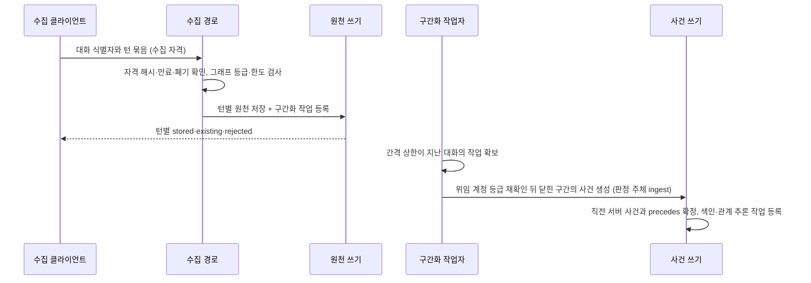

# 대화 수집

수집 경로, 수집 자격, 서버 구간화와 수집 클라이언트의 정본이다. 요구사항은 [SRS 대화 수집](../SRS.md#대화-수집)이, 대화·턴 유일성과 사건 생성 트랜잭션은 [대화 사건과 안내의 수명주기](context-lifecycle.md#대화-사건과-안내의-수명주기)가, 사건 저장 뒤의 관계 판정은 [서버 관계 추론](relation-inference.md)이 소유한다.

[설계 전체](../SDD.md) · [요구사항과 설계 대응](traceability.md)

설계 상태: 2026-11-14 설계 반영. 구현과 검증은 미착수다. 수치는 측정 근거가 없는 시작값이며, 호스트 훅 입력의 일부 필드는 [검증 대기](#설계-대기-항목)다.

## 처리 흐름

에이전트는 이 흐름에 참여하지 않는다. 에이전트의 `node_create`·`node_update` 경로와 [도구 정의](mcp.md#공개-도구-정의의-크기-예산)는 바뀌지 않는다.

## 수집 경로

`POST /ingest/conversation`을 [HTTP 진입점](architecture.md#http-진입점)에 `/mcp`와 구분된 경로로 둔다. MCP 전송·도구 목록·서버 안내에 포함하지 않으며 [대화 수집 구성](operations.md#대화-수집-구성)이 비활성이면 경로를 등록하지 않아 404다.

요청은 TLS 판정, 메서드, 출처, 수집 자격, 본문 상한과 형식, 그래프 등급, 턴별 저장의 순서로 처리한다.

- TLS 판정은 [배포 구성](operations.md#배포-구성)의 기존 규칙을 따른다.
- 웹 세션 쿠키를 인증으로 쓰지 않는다. `Origin` 헤더가 있는 요청은 브라우저 호출로 보고 거부한다.
- 본문은 `application/json`이며 4 MiB를 넘으면 413이다. 알 수 없는 필드와 중복 키는 400이다.

| 요청 필드 | 형식 | 검증 |
|---|---|---|
| `graph_id` | UUIDv7 | 계정이 편집자 이상인 활성 그래프 |
| `conversation_id` | 문자열 | 1~128자, 공백만인 값 금지 |
| `turns` | 배열 | 1~100개, `turn_index` 중복 금지 |
| `turns[].turn_index` | 정수 | 0 이상 |
| `turns[].speaker` | 열거형 | `user`는 `user_utterance`, `agent`는 `agent_output`으로 저장 |
| `turns[].occurred_at` | RFC 3339 UTC | 기존 원천의 발생 시점 검증과 같다 |
| `turns[].body` | 문자열 | 1~8000자. [SRS 입력 검증 세부](../SRS.md#입력-검증-세부)와 같다 |

저장하는 원천의 `source_ref`는 `channel=conversation`, `locator=conversation://<conversation_id>/<turn_index>`이며 서버가 만든다. 대화 식별자는 URI 경로 규칙으로 인코딩한다.

### 턴별 저장과 응답

- 턴마다 에이전트 쓰기와 같은 단일 접근 계층의 원천 생성 트랜잭션을 쓴다. 등급·한도·본문 제약·색인 작업 등록·관리 연산 기록이 같은 경로에서 적용된다.
- 한 턴의 거부는 같은 요청의 다른 턴을 되돌리지 않는다. 재전송이 멱등이므로 묶음 전체의 원자성을 두지 않는다.
- 멱등성은 원천의 그래프·대화·턴 유일 제약으로 판정하며 쓰기 멱등성 저장의 `request_id`는 쓰지 않는다. 에이전트가 같은 대화·턴으로 먼저 만든 원천도 같은 판정을 받는다.
- 새로 저장한 턴이 있으면 같은 트랜잭션에서 [구간화 작업](#구간화-작업-큐)을 등록한다.

| 턴 상태 | 의미 | 함께 주는 값 |
|---|---|---|
| `stored` | 새 원천을 만들었다 | `context_id` |
| `existing` | 같은 턴이 같은 본문으로 이미 있다 | `context_id` |
| `rejected` | 저장하지 않았다 | `reason` |

`reason`은 `body_mismatch`(같은 턴의 본문이 다름), `invalid_argument`, `limit_exceeded` 중 하나다. 응답은 요청의 `turn_index` 순서로 턴마다 한 항목을 주며 본문과 자격 원문을 되돌려주지 않는다.

| 요청 전체 오류 | 상태 |
|---|---|
| 자격 없음·형식 오류·알 수 없는 자격·만료·폐기 | 401. 원인을 구분하지 않는다 |
| 그래프가 없거나 편집자 미만 | 404. 존재 여부를 구분하지 않는다 |
| 본문 형식·필드 오류, `Origin` 포함 | 400 |
| 본문 초과 | 413 |
| 요청 빈도 한도 | [권한·한도](authorization.md)의 기존 한도 응답 |
| 내부 장애 | 500. 재인증 신호로 바꾸지 않는다 |

## 수집 자격

- 발급·목록·폐기는 [연결 관리 화면](web.md#목표-연결-관리-화면)의 동작으로 추가하며 기존 웹 출처·세션 검사를 적용한다. 원문은 발급 응답에서 한 번만 표시한다.
- 원문은 `acs_ing_` 접두사와 암호학적 난수 32바이트의 base64url 표기다. 서버는 SHA-256만 저장한다. 난수가 256비트이므로 느린 해시를 쓰지 않는다.
- 검증기는 [토큰 검증](authentication.md#토큰-검증)의 OAuth Bearer 검증기와 분리한다. 수집 경로는 OAuth 접근 토큰을 받지 않고 `/mcp`와 웹 경로는 수집 자격을 받지 않는다.
- 자격은 그래프에 결합하지 않는다. 자격이 유효해도 권한은 요청이 지정한 그래프에 대한 요청 시점의 계정 등급으로 판정한다.
- 만료는 요청 시점에 판정한다. 비활동 기준은 `issued_at`과 `last_used_at` 중 늦은 쪽에서 30일, 절대 기준은 `issued_at`에서 1년이다. 정리 작업의 실행 여부로 판정을 바꾸지 않는다.
- `last_used_at`은 인증에 성공한 요청에서 기존 값보다 1시간 이상 지났을 때만 갱신한다. 요청마다 쓰지 않기 위한 것이며 비활동 판정의 오차는 1시간 이내다.
- 계정당 활성 자격은 20개이며 계정 범위 잠금 아래 발급 트랜잭션에서 판정한다. 만료·폐기한 자격은 세지 않는다.
- 구분용 이름은 1~64자이며 연결 관리 화면의 표시에만 쓰고 권한이나 식별 판정에 쓰지 않는다.

### 저장 열

`ingest_credential`은 새 migration으로 추가한다. 선택 열 이외에는 `NOT NULL`이다.

| 열 | SQL 타입·NULL | 키·검증 |
|---|---|---|
| `credential_id` | `uuid`, PK | 서버 발급 UUIDv7 |
| `token_hash` | `bytea`, UNIQUE | 원문의 SHA-256, 정확히 32바이트 CHECK |
| `account_id` | `uuid` | 발급 계정 |
| `label` | `text` | 1~64자 CHECK |
| `issued_at` | `timestamptz` | 발급 시각 |
| `last_used_at` | `timestamptz`, 선택 | 마지막 성공 요청 시각. 1시간 단위로 갱신 |
| `revoked_at` | `timestamptz`, 선택 | 폐기 시각. NULL이면 폐기하지 않은 상태 |

계정별 목록과 활성 개수 판정에 `(account_id, issued_at, credential_id)` 인덱스를 둔다. 만료한 행과 폐기한 행은 감사 대조를 위해 지우지 않는다.

### 결합 에이전트 등록

발급 트랜잭션에서 그 자격에 결합한 에이전트 등록을 하나 만든다. [등록 저장 열](mcp.md#등록-저장-열)의 `agent_registration`을 다음과 같이 바꾼다.

- `ingest_credential_id uuid` 선택 열을 더하고 UNIQUE를 둔다.
- `client_id`를 선택 열로 바꾸고, `client_id`와 `ingest_credential_id` 중 정확히 하나만 값이 있다는 CHECK를 둔다. 기존 행은 모두 `client_id`만 가지므로 재작성하지 않는다.
- 결합 등록의 `registration_key`에는 서버가 `credential_id`에서 만든 값을 넣는다.

MCP의 행위자 검증은 접근 토큰의 `client_id`와의 일치를 요구하므로 `client_id`가 NULL인 결합 등록은 `agent_register`로 조회되지 않고 MCP 쓰기의 `agent_id`로 받아들여지지 않는다. 결합 등록은 계정당 활성 등록 128개 상한에 포함하며 상한을 넘으면 발급을 거부한다. 자격의 폐기는 등록 폐기를 같은 트랜잭션에서 수행한다. 만료한 자격의 결합 등록은 수집 경로가 자격 검증에서 먼저 거부하므로 쓰이지 않으며, 연결 관리 화면은 만료 상태로 표시한다. 과거 기여와 감사 기록은 남긴다.

## 서버 구간화

- 원천 저장과 분리해 요청 경로 밖에서 실행한다. 실패는 저장한 원천을 되돌리지 않는다.
- 사건 생성은 에이전트 경로와 같은 사건 쓰기 트랜잭션을 사용한다. 최소 구성·범위 검증·색인 작업과 관계 추론 작업 등록이 같은 조건으로 적용된다.
- 위임 계정은 그 대화에 마지막으로 턴을 저장한 수집 자격의 계정이다. 반영 시점에 편집자 이상인지 다시 확인하고 등급이 없으면 반영하지 않는다.
- 관리 연산 기록의 판정 주체는 `ingest`다. 수집 원천·사건의 `created_by_agent`와 실행 에이전트는 수집 자격에 결합한 등록이다.
- 구간화 대상은 `created_by_agent`가 결합 등록인 원천이다. 에이전트가 만든 원천과 사건은 대상에서 제외한다.

### 구간화 규칙

같은 그래프·대화의 수집 원천을 `turn_index` 오름차순으로 본다. 앞 턴과의 `occurred_at` 간격이 간격 상한을 넘거나 현재 구간의 턴 수가 턴 수 상한에 이르면 그 턴부터 새 구간이다. 모델을 호출하지 않으며 같은 입력은 같은 구간을 만든다.

| 구성 | 시작값 | 비고 |
|---|---|---|
| 간격 상한 | 30분 | 측정 근거가 없는 시작값이다 |
| 턴 수 상한 | 40턴 | 측정 근거가 없는 시작값이다 |

사건은 **닫힌 구간**에만 만든다. 구간은 뒤에 다음 구간이 시작되었거나, 턴 수 상한에 이르렀거나, 마지막 턴의 `recorded_at`에서 간격 상한이 지났을 때 닫힌다. 마지막 조건은 DB 시계로 판정한다. 클라이언트 시계인 `occurred_at`의 오차로 열린 구간을 일찍 닫지 않기 위한 것이다.

닫힌 뒤에만 만드는 이유는 갱신 비용이다. 열린 구간을 사건으로 만들면 턴이 올 때마다 사건이 갱신되어 판·색인·관계 추론 작업이 다시 등록된다. 대신 진행 중인 대화의 마지막 구간은 간격 상한이 지날 때까지 사건이 없다. 그 사이의 턴은 원천으로 저장되어 있으며 색인 대상 구성에 따라 검색된다.

- 사건의 시간 범위는 구성원 턴의 가장 이른 `occurred_at`과 가장 늦은 `occurred_at`이다.
- 같은 대화에서 서버가 만든 직전 구간이 있고 그 사건이 활성이면 [사건 생성 시 앞 사건 지정](context-lifecycle.md#대화-사건과-안내의-수명주기)과 같은 트랜잭션 경로로 `precedes`를 확정한다. `confirmed_source`는 `ingest`이고 `proposed_by`는 `system`이다. 에이전트가 만든 사건과는 잇지 않는다.
- 구성 값을 바꿔도 이미 만든 사건을 다시 나누지 않는다.

### 사건 본문 구성

서버가 만든 사건의 `body`는 구성원 중 `origin_kind`가 `user_utterance`인 턴의 본문 앞부분을 `turn_index` 순서로 줄바꿈으로 이어 만든다. 모델을 호출하지 않으며 같은 구성원은 같은 본문을 만든다.

| 구성 | 시작값 | 비고 |
|---|---|---|
| 발화당 발췌 상한 | 300자 | 측정 근거가 없는 시작값이다 |
| 본문 전체 상한 | 2000자 | [관계 추론의 대상 발췌 상한](relation-inference.md#후보-검색) 시작값과 맞춘 값이다 |

- 전체 상한에 이르면 뒤 발화를 담지 않는다. 문자 수는 유니코드 문자 기준이다.
- 사용자 발화가 없는 구간은 `agent_output` 턴에 같은 규칙을 적용한다.
- 구성원이 바뀌면 같은 규칙으로 본문을 다시 만들고 기존 사건 갱신 경로로 판과 색인을 갱신한다. 에이전트가 갱신하거나 폐기한 사건의 본문은 다시 만들지 않는다.
- 구성 값을 바꿔도 이미 만든 사건의 본문을 다시 만들지 않는다.

사용자 발화만 쓰는 이유는 본문의 쓰임 때문이다. 사건 본문은 색인되고 관계 추론은 앞부분만 발췌하며, 흐름 응답의 예산과 `stored_chars`는 본문 문자 수로 센다. 에이전트 출력은 길고 구성원 원천으로 이미 저장되어 있어 본문에 옮기면 같은 내용이 예산과 저장량을 두 번 쓴다.

이 구성에는 한계가 있다. 에이전트가 내린 결론은 본문에 없어 결론을 찾는 검색은 구성원 원천을 거쳐야 닿는다. 짧은 지시만 있는 구간은 본문의 주제 신호가 약하다. 두 한계의 실제 영향은 측정하지 않았으며 [INGEST-05](../development-plan/conversation-ingestion.md#ingest-05)의 측정 뒤 보완 여부를 판단한다.

### 구간 기록

서버가 만든 사건과 턴 범위의 대응을 `conversation_segment`에 둔다. 다시 처리해도 같은 턴을 두 번 묶지 않고, 직전 서버 사건과 에이전트가 고친 사건을 판정하기 위한 것이다.

| 열 | SQL 타입·NULL | 키·검증 |
|---|---|---|
| `event_context_id` | `uuid`, PK | 서버가 만든 사건 |
| `graph_id` | `uuid` | 대상 그래프 |
| `conversation_id` | `text` | 대화 식별자 |
| `first_turn_index`, `last_turn_index` | `integer` | 구간이 덮는 턴 범위. 같은 그래프·대화에서 범위가 겹치지 않는다 |
| `created_at` | `timestamptz` | 사건 생성 시각 |
| `frozen_at` | `timestamptz`, 선택 | 에이전트가 그 사건을 갱신하거나 폐기한 시각 |

에이전트의 사건 갱신·폐기 트랜잭션은 대상이 이 표에 있으면 `frozen_at`을 채운다. 값이 있는 구간의 사건은 서버가 구성원·시간 범위·본문을 더 바꾸지 않으며, 복구되어도 다시 풀지 않는다. 사건이 `precedes`의 앞 사건으로 쓰이는 것은 활성일 때만이다.

### 늦게 도착한 턴

이미 닫힌 범위에 속하는 `turn_index`의 턴이 뒤늦게 저장되면 다음과 같이 처리한다.

| 경우 | 처리 |
|---|---|
| 범위에 드는 구간이 있고 `frozen_at`이 없다 | 그 사건의 구성원·시간 범위·본문을 갱신한다 |
| 범위에 드는 구간이 없고 더 작은 `turn_index`의 가장 가까운 구간이 있으며 `frozen_at`이 없다 | 그 사건에 더하고 `last_turn_index`를 넓힌다 |
| 대상 구간에 `frozen_at`이 있거나, 대상 구간이 없거나, 구성원이 1000개에 이르렀다 | 사건에 넣지 않고 원천으로만 둔다. 관리 진단에 `segment_frozen` 또는 `segment_unassigned`로 남긴다 |

늦게 도착한 턴으로 구간을 다시 나누지 않는다. 턴 수 상한은 새 구간을 만들 때만 적용한다.

### 구간화 작업 큐

[색인 작업 큐](indexing.md#색인-작업-큐)·[추론 작업 큐](relation-inference.md#추론-작업-큐)와 같은 설계를 쓴다. `conversation_segment_task`는 그래프·대화마다 한 행이다.

| 열 | 설명 |
|---|---|
| `task_id` | UUIDv7 기본 키 |
| `graph_id`, `conversation_id` | 대상 대화. 둘의 쌍이 유일하다 |
| `trigger_account_id`, `trigger_agent_id` | 위임 계정과 결합 등록. 마지막으로 턴을 저장한 자격의 값이다 |
| `attempts` | 시도 횟수 |
| `state` | `pending`, `failed` |
| `last_error` | 고정 사유 코드 |
| `enqueued_at`, `next_attempt_at` | DB 시계 기준 등록 시각과 다음 확보 시각 |
| `correlation_id` | 등록 요청의 상관 식별자 |

- 등록은 새 턴을 저장한 원천 쓰기 트랜잭션에서 upsert로 한다. `next_attempt_at`은 등록 시각에 간격 상한을 더한 값이며, 같은 대화에 턴이 더 오면 다시 미뤄진다. 따라서 작업자는 대화가 간격 상한만큼 멈춘 뒤 한 번 실행된다.
- 작업자는 `FOR UPDATE SKIP LOCKED`로 확보하고 리스 시각으로 미룬 뒤 커밋한다. 구간 계산은 읽기 스냅숏에서 하고, 결과 트랜잭션은 [공통 잠금 순서](context-lifecycle.md#판정의-직렬화)에 따라 그래프 행을 먼저 잠근 뒤 `task_id`·`enqueued_at`·`next_attempt_at`이 확보 시점과 같을 때만 사건 생성·구간 기록·작업 삭제를 커밋한다. 세대가 다르면 아무것도 반영하지 않고 새 세대가 다시 처리한다.
- 한 번의 실행에서 닫힌 구간이 여럿이면 `turn_index` 순서로 구간마다 한 트랜잭션에 만든다. 중간에 실패하면 이미 만든 구간은 남고 나머지는 재시도한다.
- 실패는 지수 백오프로 재시도하고 한계 5회 뒤 `failed`로 남긴다. 위임 계정의 등급 상실은 재시도하지 않고 `failed`로 남기며, 같은 대화에 다른 자격으로 턴이 저장되면 upsert가 위임 계정을 바꾸고 `pending`으로 되살린다.
- 간격 상한 없이 턴이 계속 이어지는 대화는 작업이 계속 미뤄진다. 턴 수 상한으로 닫힌 구간도 그동안 사건이 되지 않는다. 한 번의 실행이 구간마다 독립된 트랜잭션이므로 뒤늦게 한꺼번에 처리해도 요청 경로에 영향을 주지 않는다.
- 작업자 배치는 색인 작업자와 같은 `INDEX_WORKER_PLACEMENT`를 따른다. 외부 제공자를 호출하지 않으므로 제공자 장애의 확보 차단은 적용하지 않는다.

## 관측

새 진단 종류를 만들지 않는다. [종류별 진단 로그](observability.md#종류별-진단-로그)의 기존 여섯 파일에 다음 단계 값으로 기록한다.

| 종류 | 기록 | 필드 |
|---|---|---|
| 요청 | 수집 요청의 수신·검증·응답 | 고정 route, 상태, 지연, 턴 수와 상태별 수 |
| 인증 | 수집 자격 검증과 발급·폐기 | 단계, 내부 거부 원인(형식·미등록·만료·폐기), `credential_id`, 계정 |
| 색인 | 구간화 작업의 등록·확보·재시도·실패 | task·graph, 시도 횟수, 리스 결과, 사유 코드 |
| 관리 | 사건 생성·갱신과 `precedes` 확정, 사건에 넣지 않은 턴 | 연산, graph·context·relation, 판정 주체 `ingest`, 사유 코드 |

본문, 대화 식별자, 구분용 이름, 자격 원문과 해시는 어느 파일에도 남기지 않는다. 대화 식별자는 호스트 세션 값에서 오므로 식별 정보로 취급한다. 지표는 상태별 수집 턴 수, 대기·실패 구간화 작업 수, 사건에 넣지 않은 턴 수를 둔다.

## 수집 클라이언트

저장소의 `cmd/ingest` 실행기로 두며 사용자의 호스트에서 실행한다. 운영 이미지에는 포함하지 않는다.

### 호스트 연결

두 호스트 모두 대화 기록 파일의 형식을 문서화하지 않았거나 안정된 인터페이스가 아니라고 명시한다. 그래서 클라이언트는 **대화 기록 파일을 해석하지 않고** 문서화된 훅 입력만 사용한다.

| 호스트 | 사용자 발화 | 에이전트 출력 | 세션 식별 |
|---|---|---|---|
| Claude Code | `UserPromptSubmit` 훅 입력 | `Stop` 훅의 `last_assistant_message` | `session_id` |
| Codex CLI | `notify`의 `input-messages` | `notify`의 `last-assistant-message` | `thread-id` |

- Claude Code의 훅은 표준 입력으로 JSON을 받고 Codex의 `notify`는 인자로 JSON을 받는다. Claude Code에서는 `async` 명령 훅으로 등록해 응답을 막지 않는다.
- `conversation_id`는 호스트 접두사와 세션 식별자를 이어 만든다. `turn_index`는 클라이언트가 세션별 로컬 상태에 두는 증가 값이다.
- `occurred_at`은 훅이 실행된 시각이다.
- 8000자를 넘는 본문은 8000자 단위로 나눠 같은 화자의 연속한 턴으로 보낸다.
- 대상 그래프는 작업 디렉터리에서 위로 찾은 프로젝트 설정 파일의 `graph_id`다. 설정이 없으면 전송하지 않는다.

### 전송과 실패

- 턴을 로컬 대기 파일에 먼저 적고 전송에 성공한 턴을 지운다. 전송 실패, 401과 5xx는 대기 파일에 남겨 다음 실행 때 다시 보낸다. 서버의 멱등 판정으로 중복 저장되지 않는다.
- `rejected`인 턴은 다시 보내지 않고 사유를 로컬 기록에 남긴다.
- 수집 자격은 사용자만 읽을 수 있는 파일이나 환경 변수에서 읽는다. 자격과 본문을 표준 출력·오류와 로컬 기록에 쓰지 않는다.

### 기록 제외

- 프로젝트 설정에 `graph_id`가 없거나 수집을 끈 프로젝트는 전송하지 않는다.
- 클라이언트의 일시 중지 명령으로 세션의 수집을 멈추고 다시 켤 수 있다. 멈춘 동안의 턴은 대기 파일에도 적지 않는다.

### 한계

- 한 턴에서 에이전트의 마지막 응답만 수집한다. 중간 메시지와 도구 호출 결과는 수집하지 않으며, 이는 `external_content`를 받지 않는다는 요구사항과 일치한다.
- 과거 대화를 소급해 수집할 수 없다. 대화 기록 파일을 해석하지 않기 때문이다.
- 사용자가 응답을 중단한 턴은 `Stop`이 실행되지 않아 사용자 발화만 남을 수 있다.
- 세션을 이어서 열 때 세션 식별자가 유지되는지는 두 호스트 모두 문서화하지 않았다. 달라지면 같은 대화가 두 `conversation_id`로 나뉜다.

## 설계 대기 항목

상세 계약은 위와 같이 정했다. 다음은 구현 전에 공급자 공식 문서나 실제 실행으로 확인할 항목이며 확인 전에는 해당 호스트를 지원 대상으로 표시하지 않는다.

| 항목 | 상태 |
|---|---|
| Claude Code `UserPromptSubmit` 입력에서 사용자 프롬프트를 담는 필드 이름 | 검증 대기 |
| Claude Code `async` 훅이 세션 종료 시점에 끝까지 실행되는지 | 공식 문서에 없음. 실행으로 확인 |
| Codex `notify`의 `input-messages`가 턴의 사용자 발화 전체를 담는지 | 공식 문서가 "공통 필드"로만 설명. 실행으로 확인 |
| 세션을 이어서 열 때의 세션 식별자 유지 여부 | 두 호스트 모두 문서에 없음 |

확인한 공식 문서는 [reference.md](../reference.md)에 기록한다.

## 다른 분야와의 경계

- 대화·턴 속성과 유일 제약의 저장은 [대화 순서와 안내 저장](data.md#대화-순서와-안내-저장)이 소유한다.
- 등급 판정과 한도는 [권한·한도](authorization.md), 구성 키는 [대화 수집 구성](operations.md#대화-수집-구성)이 소유한다. 대화 수집은 새 경계 밖 전송을 만들지 않으며, 수집한 원천의 임베딩 전송은 기존 색인 구성을 따른다.
- 검증 범위는 구현 작업에서 [테스트 설계](testing.md)에 추가한다.
