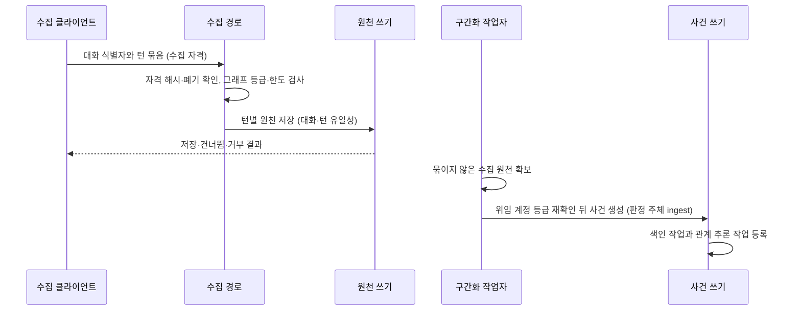

# 대화 수집

수집 경로, 수집 자격과 서버 구간화의 정본이다. 요구사항은 [SRS 대화 수집](../SRS.md#대화-수집)이, 대화·턴 유일성과 사건 생성 트랜잭션은 [대화 사건과 안내의 수명주기](context-lifecycle.md#대화-사건과-안내의-수명주기)가, 사건 저장 뒤의 관계 판정은 [서버 관계 추론](relation-inference.md)이 소유한다.

[설계 전체](../SDD.md) · [요구사항과 설계 대응](traceability.md)

설계 상태: 2026-11-14 요구사항 확정에 따른 설계 착수. 확정 요구사항에서 직접 따르는 경계만 담았다. 구간화 기준과 실행 에이전트는 2026-11-14 사용자 결정으로 확정했다. 수집 자격의 수명·범위·상한도 같은 날 확정했다. 설계 미정 `TBD-AGENT_CONTEXT-069`와 아래 설계 대기 항목을 정하기 전에는 구현 대상이 아니다.

## 처리 흐름

에이전트는 이 흐름에 참여하지 않는다. 에이전트의 `node_create`·`node_update` 경로와 [도구 정의](mcp.md#공개-도구-정의의-크기-예산)는 바뀌지 않는다.

## 수집 경로

- [HTTP 진입점](architecture.md#http-진입점)에 `/mcp`와 구분된 경로로 둔다. MCP 전송·도구 목록·서버 안내에 포함하지 않는다.
- 요청은 TLS 판정, 수집 자격 확인, 본문 상한, 그래프 등급, 저장의 순서로 처리한다. TLS 판정은 [배포 구성](operations.md#배포-구성)의 기존 규칙을 따른다.
- 원천 저장은 에이전트 쓰기와 같은 단일 접근 계층의 원천 생성을 사용한다. 등급·한도·본문 제약·색인 작업 등록·관리 연산 기록이 같은 경로에서 적용된다.
- 멱등성은 원천의 그래프·대화·턴 유일 제약으로 판정한다. 저장된 턴과 본문이 같으면 건너뛰고 다르면 그 턴을 거부한다. 쓰기 멱등성 저장의 `request_id`는 사용하지 않는다.
- 응답은 턴별로 저장·건너뜀·거부를 구분한다. 본문과 자격 원문을 되돌려주지 않는다.

## 수집 자격

- 발급·목록·폐기는 [연결 관리 화면](web.md#목표-연결-관리-화면)의 동작으로 추가하며 기존 웹 출처·세션 검사를 적용한다. 원문은 발급 응답에서 한 번만 표시한다.
- 서버는 해시와 계정 결합, 발급·폐기 시각만 저장한다. 다중 인스턴스가 같은 폐기 판정을 하도록 공유 DB에 둔다.
- 검증기는 [토큰 검증](authentication.md#토큰-검증)의 OAuth Bearer 검증기와 분리한다. 수집 경로는 OAuth 접근 토큰을 받지 않고 `/mcp`와 웹 경로는 수집 자격을 받지 않는다.
- 자격이 유효해도 권한은 요청 시점의 계정 등급으로 판정한다. 자격 자체는 등급을 부여하지 않는다.
- 발급 트랜잭션에서 그 자격에 결합한 에이전트 등록을 하나 만든다. [공통 행위자](mcp.md#공통-행위자도구쓰기-안전성)의 계정당 활성 등록 상한에 포함하며 상한을 넘으면 발급을 거부한다. 자격 폐기는 등록 폐기를 함께 수행하고 과거 기여와 감사 기록은 남긴다.
- 이 등록은 `agent_register`로 조회하거나 만들 수 없고 MCP 쓰기의 `agent_id`로 받아들이지 않는다.
- 자격은 그래프에 결합하지 않는다. 요청이 지정한 그래프의 등급을 매번 판정한다.
- 만료는 요청 시점에 판정한다. 비활동 기준은 발급 시각과 마지막으로 성공한 수집 요청 시각 중 늦은 쪽에서 30일, 절대 기준은 발급 시각에서 1년이다. 정리 작업의 실행 여부로 판정을 바꾸지 않는다.
- 계정당 활성 자격은 20개이며 발급 트랜잭션에서 판정한다. 만료·폐기한 자격은 세지 않는다.
- 발급할 때 받는 구분용 이름은 연결 관리 화면의 표시에만 쓰고 권한이나 식별 판정에 쓰지 않는다.

## 서버 구간화

- 원천 저장과 분리해 요청 경로 밖에서 실행한다. 실패는 저장한 원천을 되돌리지 않는다.
- 사건 생성은 에이전트 경로와 같은 사건 쓰기 트랜잭션을 사용한다. 최소 구성·범위 검증·색인 작업과 관계 추론 작업 등록이 같은 조건으로 적용된다.
- 위임 계정은 턴을 전송한 수집 자격의 계정이다. 반영 시점에 편집자 이상인지 다시 확인하고 등급이 없으면 반영하지 않는다.
- 관리 연산 기록의 판정 주체는 `ingest`다. 에이전트가 만든 원천과 사건은 구간화 대상에서 제외한다.
- 수집 원천·사건의 `created_by_agent`와 관리 연산 기록의 실행 에이전트는 수집 자격에 결합한 등록이다.

### 구간화 규칙

같은 그래프·대화의 수집 원천을 `turn_index` 오름차순으로 본다. 앞 턴과의 `occurred_at` 간격이 간격 상한을 넘거나 현재 사건의 턴 수가 턴 수 상한에 이르면 그 턴부터 새 사건이다. 모델을 호출하지 않으며 같은 입력은 같은 구간을 만든다.

| 구성 | 시작값 | 비고 |
|---|---|---|
| 간격 상한 | 30분 | 측정 근거가 없는 시작값이다 |
| 턴 수 상한 | 40턴 | 측정 근거가 없는 시작값이다 |

- 사건의 시간 범위는 구성원 턴의 가장 이른 `occurred_at`과 가장 늦은 `occurred_at`이다.
- 늦게 도착한 턴은 서버가 만든 사건의 구성원·시간 범위 갱신으로 반영한다. 에이전트가 갱신하거나 폐기한 사건은 서버가 더 바꾸지 않으며, 그 사건에 들어갈 턴의 처리는 작업 큐 설계에서 정한다.
- 같은 대화에서 서버가 만든 직전 사건이 있으면 [사건 생성 시 앞 사건 지정](context-lifecycle.md#대화-사건과-안내의-수명주기)과 같은 트랜잭션 경로로 `precedes`를 확정한다. `confirmed_source`는 `ingest`이고 `proposed_by`는 `system`이다. 에이전트가 만든 사건과는 잇지 않는다.
- 구성 값을 바꿔도 이미 만든 사건을 다시 나누지 않는다.

## 설계 대기 항목

| 항목 | 선행 조건 |
|---|---|
| 경로 이름, 요청·응답 스키마, 본문·턴 수 상한, 묶음 안의 부분 성공 처리 | 없음 |
| 수집 자격의 원문 형식·저장 열과 마지막 사용 시각의 갱신 주기 | 없음 |
| 에이전트 등록의 저장 열 변경. 현재 유일 키는 OAuth client 결합을 전제한다 | 없음 |
| 서버가 만든 사건의 본문 구성 | `TBD-AGENT_CONTEXT-069` |
| 구간화 작업의 등록 시점·큐·리스·재시도와 에이전트가 고친 사건에 속할 턴의 처리. 색인·추론 큐와 같은 계약을 우선 검토한다 | 없음 |
| 구간화 상한의 배포 구성 키와 검증 범위 | 없음 |
| 활성 여부를 정하는 배포 구성 키와 기본값 | 없음 |
| 진단 이벤트·지표와 금지 필드 | 없음 |
| 수집 클라이언트의 배치와 호스트별 대화 기록 형식. 공급자 공식 문서로 확인한다 | 없음 |

## 다른 분야와의 경계

- 대화·턴 속성과 유일 제약의 저장은 [대화 순서와 안내 저장](data.md#대화-순서와-안내-저장)이 소유한다.
- 등급 판정과 한도는 [권한·한도](authorization.md), 외부 전송 경계는 [운영](operations.md)이 소유한다. 대화 수집은 새 경계 밖 전송을 만들지 않으며, 수집한 원천의 임베딩 전송은 기존 색인 구성을 따른다.
- 검증 범위는 상세 계약을 확정할 때 [테스트 설계](testing.md)에 추가한다.
