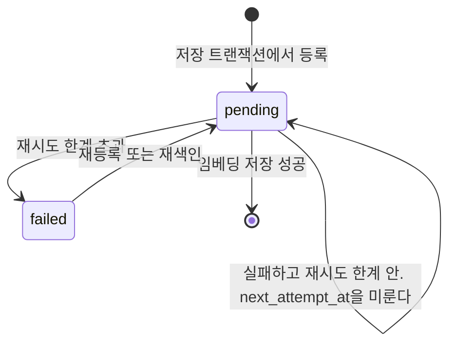

# 임베딩과 비동기 색인

작업 등록·확보·리스·결과 반영·재시도, 임베딩 제공자 구성과 재색인의 정본이다. 물리 벡터 스키마는 data.md를 따른다.

[설계 전체](../SDD.md) · [요구사항과 설계 대응](traceability.md)

## 컨텍스트 저장과 색인

`node_create`와 `body`를 바꾼 `node_update`가 같은 흐름을 지난다. SRS의 본문 계약에 따라 공백만인 본문도 저장·색인 대상이며 trim하거나 제외하지 않는다. 문서 호출은 빈 문자열만 거부하고 공백 본문을 기존 문서 접두사 뒤에 그대로 보내며, 질의의 공백 거부·UTF-8·길이 상한은 유지한다.

공백 본문 자체를 로컬 제공자 장애로 만들지 않는다. 제공자가 실제 HTTP/응답 오류를 반환하면 기존 실패 분류·재시도 계약을 적용한다. 이미 failed인 작업을 이번 변경으로 자동 재등록하지 않으며, 기존 본문 갱신·수동 재색인 경로로 다시 처리한다. 기존 저장 값과 조회·복구 계약은 변경하지 않는다.

| 단계 | 동작                                                                              | 트랜잭션 |
|------|-----------------------------------------------------------------------------------|----------|
| 1    | 계층별 필수 속성과 참조 대상의 존재를 검증한다                                    | 안       |
| 1a   | 원천이면 같은 그래프에 같은 `source_ref`가 있는지 본다                            | 안       |
| 2    | 정점을 만들거나 갱신하고 참조 간선을 잇는다                                       | 안       |
| 3    | 색인 작업을 `pending`으로 등록한다. 같은 컨텍스트의 행이 있으면 upsert로 되돌린다 | 안       |
| 4    | 관리 연산 기록을 남긴다                                                           | 안       |
| 5    | 커밋하고 응답한다                                                                 | 경계     |
| 6    | 색인 작업자가 작업을 꺼내 임베딩을 만들고 저장한다                                | 밖       |

6단계가 요청 경로 밖이라는 것이 핵심이다. [SRS 색인 처리](../SRS.md#색인-처리)가 확정한 대로 임베딩 생성 실패는 컨텍스트 저장을 되돌리지 않으며, 실패한 작업은 재시도하고 한계를 넘기면 `failed`로 남는다.

색인이 끝나지 않은 컨텍스트는 의미 유사도 채널에서만 빠지고 키워드·시간 필터·그래프 경로는 정상 동작한다. 응답에 색인 미완료를 표시하지 않으며 미색인 수는 관측 지표로만 드러난다.

`node_update`가 `body`를 바꾸지 않으면 3단계를 건너뛴다. 임베딩의 입력이 `body`뿐이므로 다른 속성만 바뀌면 벡터가 달라지지 않는다.

1a단계에서 기존 원천을 찾으면 폐기·삭제 상태도 포함하여 그것을 반환하고 2~4단계를 건너뛴다. 색인 작업도 등록하지 않는다. 활성 원천은 기존 색인 상태를 유지하고 폐기·삭제 원천은 검색·근거 대상에서 계속 제외한다. 새 생성이나 자동 복구로 취급하지 않으며 [MCP 생성 응답](mcp.md#폐기삭제-원천의-중복-생성-응답)의 상태·복구 안내를 함께 반환한다.

조회만으로는 같은 `source_ref`를 동시에 보내는 두 요청을 막지 못하므로 [인덱스](data.md#인덱스)가 부분 유일 인덱스를 함께 건다. 조회는 흔한 경우를 싸게 처리하고 인덱스가 경합을 막는다. `login_id`에 유일 인덱스를 건 것과 같은 분담이다.

## 색인 작업 상태

`failed`에서 작업을 지우지 않는 이유는 [SRS 측정](../SRS.md#측정)이 미색인 컨텍스트 수를 지표로 요구하기 때문이다. 셀 대상이 남아 있어야 한다.

`pending`에서 자기 자신으로 돌아오는 전이가 백오프를 나른다. 실패하면 `attempts`를 올리고 `next_attempt_at`을 뒤로 미루므로, 같은 상태에 머물러도 다음에 꺼내지는 시각이 달라진다. 처리 중을 나타내는 상태를 두지 않는 이유는 [색인 작업 큐](indexing.md#색인-작업-큐)에 있다.

`failed`에서 `pending`으로 돌아오는 길이 둘인 이유는 등록이 upsert이기 때문이다. 재색인이 그래프 전체를 다시 등록할 때도, 같은 컨텍스트의 `body`가 다시 바뀌어 등록될 때도 같은 행이 `pending`으로 되돌아간다.

모델이나 압축을 바꾸면 그래프 전체를 재색인한다. 해당 그래프의 컨텍스트 전부를 `pending`으로 다시 등록하고, 끝날 때까지 `model_id`가 다른 옛 벡터를 의미 유사도 채널에서 제외한다.

## 색인 작업 큐

색인 대기 작업을 데이터베이스 테이블에 둔다. 이것으로 `TBD-AGENT_CONTEXT-043`을 확정한다.

| 열                | 설명                                                  |
|-------------------|-------------------------------------------------------|
| `task_id`         | UUIDv7. 기본 키다                                     |
| `context_id`      | 색인 대상. 컨텍스트마다 한 행만 두므로 유일하다       |
| `graph_id`        | 그래프 단위 재색인에 쓴다                             |
| `attempts`        | 시도 횟수                                             |
| `state`           | `pending`, `failed` 중 하나                           |
| `last_error`      | 마지막 실패 사유                                      |
| `enqueued_at`     | 등록 시점                                             |
| `next_attempt_at` | 이 시각 이후에 꺼낸다. 등록 시점에는 등록 시각과 같다 |
| `correlation_id`  | 작업을 등록한 요청의 상관 식별자                      |

외부 큐를 쓰지 않는 이유는 트랜잭션 경계 때문이다. [SRS 색인 처리](../SRS.md#색인-처리)가 컨텍스트 저장과 색인 작업 등록을 하나의 트랜잭션으로 처리한다고 확정했는데, 외부 큐는 데이터베이스 트랜잭션에 참여할 수 없다. 큐에 먼저 넣으면 저장이 실패해도 작업이 남고, 나중에 넣으면 저장 후 큐 전송이 실패해 색인이 누락된다. 같은 데이터베이스의 테이블이면 이 문제가 생기지 않는다.

재시도 한계를 넘긴 작업은 지우지 않고 `failed`로 남긴다. [SRS 색인 처리](../SRS.md#색인-처리)가 실패 상태로 남기기로 확정했고, 미색인 컨텍스트 수는 [SRS 측정](../SRS.md#측정)의 지표이므로 셀 대상이 남아 있어야 한다.

컨텍스트마다 행을 하나만 두고 등록을 upsert로 처리한다. 같은 컨텍스트의 `body`를 여러 번 고치면 등록이 여러 번 일어나는데, 행을 그때마다 만들면 같은 벡터를 여러 번 만들게 되고 앞선 작업이 뒤의 판을 덮어쓸 수도 있다. 기존 행이 있으면 `next_attempt_at`을 지금으로, `attempts`를 0으로, `state`를 `pending`으로 되돌린다. `failed`였던 작업도 이 경로로 되살아난다.

등록·재등록의 두 시각은 해당 SQL 명령의 DB `statement_timestamp()`로 함께 정한다. 확보·리스·재시도·준비 검사와 같은 시계를 사용하여 애플리케이션 호스트와 DB의 시계 차이로 새 작업이 미래의 재시도로 분류되지 않게 한다. 트랜잭션 시작 시각은 긴 쓰기와 잠금 대기 뒤의 재등록 세대를 구분하지 못하므로 사용하지 않는다.

재색인도 같은 등록을 쓴다. [재색인](indexing.md#재색인)이 그래프의 컨텍스트 전부를 다시 등록하는데, 그중에 이미 대기 중인 작업이 있어도 upsert가 하나로 합쳐 준다. 재색인 전용 경로를 두지 않는다.

컨텍스트 복구도 같은 트랜잭션에서 현재 색인 대상 계층의 작업을 다시 등록한다. 차원 전환이 삭제된 컨텍스트의 임베딩을 비우고 활성 컨텍스트만 재등록했더라도 이후 복구 시 색인을 재생성한다.

등록 조건에 계층을 둔다. [SRS 색인 대상 비교](../SRS.md#색인-대상-비교)가 원천을 포함한 색인과 파생·사건만 색인한 구성을 비교하라고 확정했고, 비교가 성립하려면 등록 조건만 달라지고 저장·간선·기록은 그대로여야 한다. 그래서 범위를 배포 구성 `INDEX_TARGET_LAYERS`로 두고 값이 `without_source`이면 원천 계층의 등록을 건너뛴다. 저장 트랜잭션의 나머지 단계는 어느 값에서나 같다.

| 값              | 등록 대상        | 쓰임                        |
|-----------------|------------------|-----------------------------|
| `all_layers`    | 원천·파생·사건   | 측정 전 기본값이다          |
| `without_source`| 파생·사건        | [SRS 색인 대상 비교](../SRS.md#색인-대상-비교)의 대조군 |

기본값이 원천 포함인 이유는 그 판정을 아직 하지 않았기 때문이다. [SRS 색인 대상 비교](../SRS.md#색인-대상-비교)가 재현율 손실이 유의하지 않을 때 원천 제외를 기본으로 삼으라고 했으므로, 측정 결과가 나오기 전에 기본값을 바꾸면 하지 않은 판정을 구성이 먼저 내리는 셈이 된다.

값을 바꾼 뒤에는 재색인이 필요하다. 등록 조건만 바꾸면 예전 구성이 이미 저장한 원천 임베딩이 남아 의미 유사도 채널에 계속 올라오고, 두 구성이 등록 조건 말고도 달라진다. 그래서 [재색인](indexing.md#재색인)은 대상인 계층을 다시 등록하면서 대상에서 빠진 계층의 대기 작업과 임베딩을 같은 트랜잭션에서 이 순서로 지운다. 결과 저장과 잠금 순서를 맞춰 교착을 피하고, 제거된 작업의 이전 확보분이 임베딩을 되살리지 못하게 한다. 정점과 간선은 지우지 않으므로 `derived_from`으로 근거를 따라가는 경로는 그대로 남는다.

작업자는 `state`가 `pending`이고 `next_attempt_at`이 지난 행을 `enqueued_at` 순으로 꺼내며, 꺼낼 때 `FOR UPDATE SKIP LOCKED`로 잠근다. 다른 작업자가 이미 잡은 행은 건너뛰므로 작업자를 여럿 두어도 같은 작업을 중복 소비하지 않는다. 확보 상태를 나타내는 열은 두지 않는다. 상태 열을 쓰면 작업자가 처리 중에 죽었을 때 그 행이 영원히 `processing`으로 남아, 시간 초과로 되돌리는 주기 작업과 그 시간 초과 값을 함께 정해야 한다.

한 회차는 트랜잭션 두 개로 나눈다. 첫 트랜잭션이 행을 잠가 확보하고 `next_attempt_at`을 2분 뒤로 미룬 뒤 커밋하며, 제공자 호출은 그 밖에서 하고, 두 번째 트랜잭션이 결과를 저장하고 작업을 지운다. 잠금을 쥔 채 제공자를 부르면 [SRS 색인 처리](../SRS.md#색인-처리)가 임베딩 생성을 트랜잭션 밖으로 빼기로 한 것이 성립하지 않는다. 같은 컨텍스트의 저장이 등록 upsert에서 그 행 잠금을 기다리므로, 대역이 응답을 늦추면 저장 지연이 함께 늘어난다.

대기 작업이 없는 회차에는 다음 조회까지의 간격을 두 배로 늘리고 최대 30초에서 멈춘다. 작업을 처리한 회차 뒤에는 기다리지 않고 바로 다음 작업을 찾으며, 그 뒤의 빈 회차는 최소값인 1초부터 다시 늘린다. 처리했지만 확보·결과 공개에 실패한 회차는 같은 오류의 연속 재시도를 막도록 1초를 기다린다. 처리량을 조회 간격에 묶으면 작업자 하나가 초당 한 건만 처리해 10만 건 재색인에 약 28시간이 걸린다. 회차마다 트랜잭션을 열어 대기 작업을 찾으므로 간격이 고정이면 유휴 상태에서도 초당 한 트랜잭션이 영구히 남는다. 등록 시점에 작업자를 깨우지 않는 이유는 알림 경로가 트랜잭션 밖의 수단을 하나 더 요구하는데, 색인은 요청 응답에 실리지 않아 최대 30초의 시작 지연이 계약을 어기지 않기 때문이다.

미뤄 둔 `next_attempt_at`이 확보를 나타내는 값이다. 대기 조건이 이미 이 열이므로 열을 더하지 않고, 작업자가 처리 중에 죽어도 그 시각이 지나면 저절로 다시 대기가 되어 회수 작업이 필요 없다. 2분은 제공자 호출 상한인 30초보다 넉넉한 값이다.

성공 결과와 실패를 반영할 때는 작업 행의 `task_id`, 확보 시점의 `enqueued_at`과 확보하면서 미룬 `next_attempt_at`을 모두 대조한다. 성공 경로는 [공통 잠금 순서](context-lifecycle.md#판정의-직렬화)에 따라 그래프 행을 먼저 잠근 뒤 이 조건에 맞는 작업 행을 삭제해 잠그고, 같은 트랜잭션에서만 임베딩 교체와 내용 판 증가를 수행한다. 저장 실패 시 작업 삭제도 롤백한다. 실패 경로는 같은 조건으로만 시도 횟수·실패 사유·상태·다음 시도 시각을 갱신하며 그래프나 정점을 추가로 잠그지 않는다.

재색인도 같은 그래프 행을 대상 목록 조회 전에 잠그고 작업 등록·제외 작업 삭제·임베딩 삭제를 수행한다. 사건·파생 갱신과 모든 계층의 복구가 그래프 행을 가진 채 작업을 재등록하므로 결과 저장이나 재색인이 작업 행을 먼저 잠그면 교착할 수 있다. 그래프 잠금 대기 뒤 조건부 삭제는 현재 작업 세대를 대조하여 이전 확보분을 무시한다. 임베딩 제공자는 이 잠금 밖에서 호출하고, 다른 그래프를 전역 잠금으로 묶거나 교착 자동 재시도로 순서 역전을 숨기지 않는다.

확보한 뒤 본문이 바뀌면 등록 upsert가 `enqueued_at`과 `next_attempt_at`을 새로 쓴다. 리스 만료 뒤 다른 작업자가 재확보하면 `next_attempt_at`이 바뀐다. 대조가 어긋나거나 작업 행이 이미 사라졌으면 이전 확보분의 성공 결과와 실패를 모두 무시하고, 임베딩·내용 판·작업 상태를 바꾸지 않는다. 이 회차는 작업을 찾았지만 성공 결과를 저장하지 않은 것으로 보고한다. 재등록된 작업은 새 본문으로 처리되며, 재확보된 작업은 새 리스를 가진 작업자가 처리한다.

`correlation_id`를 두는 이유는 [지표 수집 지점](observability.md#지표-수집-지점)이 요청 경로 밖에서 처리된 색인을 그것을 만든 요청과 이으라고 요구하기 때문이다. 요청 진입점에서 만든 값을 등록 시점에 함께 넣는다.

## 색인 재시도

[`SRS.md`](../SRS.md)의 [복구](operations.md#복구)가 재시도 한계를 상세 설계로 넘겼다. 여기에서 정한다.

| 항목        | 확정                                                                  |
|-------------|-----------------------------------------------------------------------|
| 한계        | 5회                                                                   |
| 간격        | 지수 백오프를 쓰고 상한을 두며 다음 시각을 `next_attempt_at`에 남긴다 |
| 한계 초과   | `failed`로 남기고 지우지 않는다                                       |
| 재시도 대상 | 색인 대상 조회 실패, 임베딩 제공자 호출 실패와 결과 저장 실패        |
| 즉시 실패   | 차원 불일치·잘못된 응답/입력·인증/권한 등 비일시적 HTTP 오류는 바로 `failed`로 둔다 |

한계의 목적은 결국 성공시키는 것이 아니라 일시적 실패와 지속적 실패를 갈라내는 것이다. 제공자의 시간 초과나 요청량 제한은 몇 초에서 몇 분 안에 풀리므로 지수 백오프 몇 번이면 지나가고, 그것으로 풀리지 않는 실패는 더 시도해도 같다. `failed`가 관측 지표로 드러나고 재색인 요청으로 다시 `pending`이 되므로 한계를 넘겨도 잃는 것이 없다.

차원 불일치, 인증·입력·응답 계약 위반을 재시도하지 않는 이유는 같은 요청으로 해결되지 않기 때문이다. HTTP 408·429·5xx와 네트워크·timeout은 기존 예산으로 재시도하고 다른 HTTP 상태는 즉시 실패한다. 상세 제공자 경계는 [임베딩 제공자 전환](indexing.md#임베딩-제공자-전환)이 정한다.

5회와 백오프 상한은 시작값이며 측정 근거는 아직 없다. [SRS 검색 품질 평가](../SRS.md#검색-품질-평가)가 정할 색인 지연 목표를 보고 다시 검토한다.

색인 대상 조회 전에 작업 확보를 커밋하며 조회·결과 저장 실패도 확보 세대를 대조해 시도 횟수와 백오프에 반영한다. 빈 임베딩이나 모델 식별자 누락은 잘못된 처리 결과이므로 즉시 실패한다.

### 제공자 장애 중 작업 확보 차단

작업자 하나가 HTTP 401·403·408·429·5xx 또는 요청 취소와 구분되는 전송/timeout 장애를 한 번 관측하면 그 Worker의 새 작업 확보를 중단한다. 처음 실패한 확보분의 상태·시도 횟수는 위 작업별 계약대로 반영한다. 입력·응답/차원 계약 위반이나 다른 비일시적 상태는 작업별 실패이며 차단을 새로 열지 않는다. 요청 취소도 차단 원인으로 삼지 않는다. 종료·작업 context 취소로 끊긴 문서 호출은 진단에 제공자 장애 대신 `canceled`(마감은 `deadline_exceeded`)로 남기고 ERROR 제공자 실패 로그를 내지 않는다. 취소된 context로는 실패 기록도 커밋되지 않으므로 확보분은 리스가 지난 뒤 다시 대기가 된다.

차단 동안 큐를 확보하지 않으며, 회복 확인 시각이 되면 고정 합성 문자열로 같은 모델·차원의 문서 임베딩을 한 번 호출한다. 탐침은 작업·세대를 확보하거나 재시도 예산을 쓰지 않는다. 유효 벡터가 돌아오면 차단을 해제하고 작업 확보를 재개한다. 실패하면 차단을 유지하고 다음 탐침을 미룬다. 탐침 실패를 다른 대기 작업에 반영하지 않는다. 이 탐침도 정상 제공자 호출이므로 실제 운영에서는 요청량·비용에 포함된다.

탐침 간격은 상한 1·2·4·8·15분의 지수 백오프에 각 상한의 50~100% 지터를 적용한다. 유효한 Retry-After의 초/HTTP-date 지연이 더 길면 그 값을 하한으로 사용하되 최대 24시간으로 제한한다. 잘못된 값·과거 날짜는 무시한다. 루프의 최대 30초 유휴 조회 간격만큼 탐침이 늦게 시작할 수 있다. 취소 가능한 기존 루프를 유지하고 차단 대기를 위한 별도 goroutine은 만들지 않는다.

차단/탐침 실패는 `provider_blocked`, 회복은 `provider_resumed` 진단 원인으로 제공자 상태와 함께 기록하며, 구조화 로그에는 다음 대기 초를 남긴다. 본문·API 키·응답 원문은 포함하지 않는다. 작업 확보·탐침은 Worker별로 한 회차만 진행하고, 검색의 질의 임베딩·직접 임베딩 호출은 이 큐 차단을 적용하지 않는다. 상태는 Worker 메모리에 두므로 여러 프로세스는 각자 장애를 감지하고 재시작 때 초기화된다. 환경의 자격 증명 변경은 새 Worker/프로세스 구성을 따른다. 기존 failed 작업을 자동 부활시키지 않으며 수동 재색인 계약은 유지한다.

## 임베딩 제공자 전환

2026-10-04 사용자가 DB 차원 변경을 포함한 구현을 승인했다. 이미 준비된 Oracle Cloud A1 Flex 서버의 인프라·배포는 변경하지 않는다. 관련 작업은 [GitHub #41](https://github.com/Alpha-gone/agent-context-sharing/issues/41)이다. 이 절은 승인된 구현 계약이며 실제 API의 검색 품질·비용 평가나 운영 적용 승인을 뜻하지 않는다.

근거 요구사항은 `FR-AGENT_CONTEXT-098`·`104`·`141`과 SRS [SRS 임베딩 모델](../SRS.md#임베딩-모델)이다. 초기 구현 제공자는 Gemini로 제한하며 SRS의 본문·질의 상한, 그래프 격리, 비동기 색인과 부분 검색 계약을 바꾸지 않는다.

| 항목 | 계약 |
|------|------|
| 전환 기본값 | Gemini Developer API의 `gemini-embedding-2`, 텍스트 입력만 사용 |
| 출력·저장 | 권장 차원 중 저장·검색 부담이 작은 768차원과 `vector`를 개발 기본값으로 쓴다. 품질 최적값의 확정은 아니며 실제 검색·관계 제안 임계값은 별도 평가한다 |
| 구성 | `EMBEDDING_PROVIDER=gemini`를 반드시 명시한다. 생략·빈 값·다른 제공자는 기동 전에 거부한다. HTTPS·사용자 정보/질의/fragment 없는 URL, 해당 모델, 128~3072차원과 호출용 `GEMINI_API_KEY`를 요구한다. HNSW 상한은 vector 2000·halfvec 4000이다 |
| 제공자 호출 | `internal/index`의 `EmbedDocument`는 본문, `Embed`는 질의를 처리한다. Gemini 문서는 `title: none \| text: {body}`, 질의는 `task: search result \| query: {work_context}` 형식이다 |
| 요청·응답 | HTTPS `v1beta/models/{model}:embedContent`에 단일 content를 보내고 `embedContentConfig.outputDimensionality`와 `autoTruncate=false`를 명시한다. 벡터 하나의 구성 차원·유한 수치·0이 아닌 크기·응답 크기를 검증한다. 여러 본문을 하나로 합쳐 보내지 않는다 |
| 인증·비밀 | API 키는 `x-goog-api-key` 헤더로만 보내며 URL·로그·오류·공개 응답에 넣지 않는다. 제공자 응답 본문과 원문 요청도 로그에 남기지 않는다 |
| 전송 | TLS 인증서 검증, 유한 timeout·취소·응답 상한을 유지하고 인증 헤더를 다른 위치로 보낼 수 있는 자동 redirect를 금지한다. 2xx가 아닌 응답은 본문을 해석하지 않되 최대 64 KiB까지 비워 HTTP/1.1 연결을 재사용하고, 넘으면 연결을 닫는다 |
| 장애 | 네트워크·408·429·5xx는 기존 색인 재시도 예산을 사용한다. 다른 HTTP 상태, 잘못된 응답·입력·차원은 즉시 failed로 두며 질의 실패는 의미 유사도 채널만 제외한다. URL·제공자 본문을 담는 오류는 고정 사유로 대체하되 취소·timeout 식별은 유지한다 |
| 입력 한도 | 공급자의 8192토큰 상한과 SRS의 8000자 상한은 다르다. 8000자·UTF-8을 호출 전에 검사하고 토큰 초과는 제공자가 `autoTruncate=false`로 거부하도록 한다. 실패를 조용히 잘린 성공으로 취급하지 않는다. 청크 저장·컨텍스트 변경은 이번 범위 밖이다 |
| 색인 식별 | Gemini는 `gemini:{model}:retrieval-v1:{type}:{dimension}`으로 제공자·입력 형식 판을 구분한다. |

서버 구성과 평가 실행기는 제공자·주소·모델·벡터 계약 및 호출용 키를 DB 연결·외부 호출 전에 검증한다. 읽기 전용 감사도 `EMBEDDING_BASE_URL`을 포함한 같은 제공자 메타데이터를 DB 연결 전에 검증하되 외부 호출을 하지 않으므로 API 키를 요구하지 않는다. 구성 오류는 원문 URL·비밀값을 포함하지 않는 사유로 보고한다. 차원이 같은 잘못된 제공자 구성도 DB 열 검사와 별개로 거부한다.

질의 호출은 공유 HTTP 클라이언트의 상한과 별개로 [검색 전용 마감](search.md#작업-컨텍스트-흐름-조회)을 적용한다. 전용 마감의 만료는 의미 채널 장애로 처리하고 호출자 취소·요청 마감은 전체 요청에 전파한다. 비동기 본문 색인의 HTTP 상한·재시도 정책에는 이 질의 전용 마감을 적용하지 않는다.

### 전환·복귀 경계

기존 마이그레이션 파일과 checksum은 수정하지 않는다. 실행기는 적용별 치환 구성(`render_config`)을 이력에 보존해 저장소에 있는 과거 파일을 당시 구성으로 대조하고 새 파일만 현재 구성으로 치환한다. 기존 이력에 구성 기록이 없으면 현재 DB의 벡터 타입·차원·콜드 tablespace와 요청 그래프 이름으로 원래 구성을 복원해 기존 checksum이 일치할 때만 기록한다. 복원할 수 없거나 원본 파일이 이미 달라진 경우 자동 수용하지 않고 중단한다. 현재 파일 목록에 없는 과거 버전의 이력은 기존 실행기처럼 그대로 보존한다.

새 DB는 `001_init.sql`이 현재 구성의 벡터 타입·차원과 HNSW 인덱스로 임베딩 테이블을 만들므로 별도 전환이 필요 없다. 개발 중 1024→768 전환에 쓴 `007_embedding_dimensions.sql`은 새 DB에서 아무것도 바꾸지 않아 `migrations/`에서 제거했고, 그 절차는 `internal/migrate/testdata/007_embedding_dimensions.sql`에 시험 고정 자료로 남긴다. 이후 운영 데이터 보존 전 통합으로 `001_init.sql`이 바뀌었으므로 그 전에 만든 개발·시험 DB는 볼륨을 다시 만든다.

기존 DB의 벡터 타입·차원 전환은 `012_embedding_configuration.sql`이 담당한다. 달라지는 경우 서비스와 색인 작업자를 먼저 정지한 뒤 적용한다. HNSW 제거·전체 그래프의 본문 재색인 등록·호환되지 않는 파생 색인 제거·파티션 부모 열 변경·HNSW 재생성을 한 트랜잭션에서 수행한다. `INDEX_TARGET_LAYERS=without_source`이면 원천의 등록을 건너뛰고 남은 원천 작업도 제거한다. 요청 없는 재등록은 이전 상관 ID를 NULL로 초기화한다. 원본 컨텍스트·사건·관계는 보존하고 실패하면 열·벡터·작업 등록을 모두 되돌린다. 타입·차원이 같으면 벡터·작업·내용 판을 바꾸지 않는다. 012 적용 후의 추가 전환·복귀도 같은 절차를 다음 번호로 추가하며 구성 변경만으로 적용 파일을 재실행하지 않는다. 서버와 평가 실행기는 구성과 DB 열이 일치하지 않으면 제공자 호출 전에 중단한다. 차원 전환은 옛 벡터 행을 없애므로 재색인 진행은 옛 모델 행 수뿐 아니라 미색인·대기·실패 작업 수로 확인한다.

차원이 같아도 모델의 좌표계는 다르므로 전체 재색인이 필요하다. 새 구성과 다른 색인은 검색과 의미 관계 제안에서 사용하지 않고 기존 등록·작업 큐·진행률 경로로 다시 만든다. 벡터 구성을 바꿀 때에도 해당 구성으로 재색인해야 하며 이전 벡터를 새 구성의 벡터로 취급하지 않는다. 운영 설정 적용·재색인·데이터 외부 전송은 이 설계 승인만으로 실행하지 않는다.

외부 제공자에 `body`와 `work_context`를 보내는 정책과 API 이용 계층·비용 한도는 실제 API 검증 전에 확인한다. 로컬 제공자 계약 시험에는 합성 데이터만 사용한다. 모델 품질·지연 향상과 API 무료 운영 가능성을 가정하지 않는다.

재색인 진행률은 같은 SQL 스냅숏에서 대상의 옛 모델 물리 행·현재 모델 미색인·남은 작업의 pending/failed를 집계한다. 정점의 context_id·graph_id 속성은 targets CTE에서 UUID로 한 번 변환하고 임베딩 UUID 열 자체를 비교한다. 정점 속성은 기존 UUIDv7 저장 계약을 전제로 하며 삭제된 정점·색인 제외 계층의 보관 벡터는 대상 집계에서 뺀다. 남은 작업의 대기·실패 집계 범위는 유지한다.

대상이 64건 이하이면 UUID 배열로 hot/cold 임베딩을 한 번 조회한 materialized vectors 집합을 옛 모델·미색인 계산에 재사용한다. 작은 대상 집합의 조회가 전체 보관 벡터를 해시 집계하지 않게 하며, 각 파티션의 context_id 유일 인덱스로 후보를 읽고 최종 비교에서 graph_id도 대조한다. 64건을 넘으면 CASE의 다른 경로에서 UUID 집합 조인·NOT EXISTS를 실행하여 큰 UUID 배열이나 대상별 반복 조회를 만들지 않는다. 이 경우 vectors CTE는 실행하지 않고 플래너의 대량 집계 선택을 유지한다. 64는 최적 분기점의 보장이 아니라 작은 UUID 묶음의 내부 고정 상한이며 배포 설정으로 열지 않는다. 반복 실행의 generic prepared plan이 유휴/대량 상태의 선택도 차이를 숨기지 않도록 이 질의만 pgx의 캐시하지 않는 Exec 모드로 실행한다. 다른 질의의 연결·statement cache 정책은 유지한다.

작업자의 진행률 관측은 기동과 1분 주기를 유지한다. 옛 모델 행이 0이거나 모든 항목이 0인 유휴 상태도, 새 미색인·대기·실패를 다시 발견해야 하므로 집계를 생략하거나 주기를 늘리지 않는다. UUID 조인 최적화는 전체 활성 대상·작업의 열거를 없애거나 저장소 크기와 무관한 실행 시간을 보장하지 않는다. 활성 대상이 많으면 대상 열거와 대량 집계 비용이 남으며, 비대상 보관 행이 많은 표본과 활성 대상이 대부분인 표본·63/64/65건 경계의 계획·행·버퍼를 구분해 검증한다.

### 검증 경계

제공자 대역으로 요청 형식·키 비노출·redirect 거부·timeout·429·오류 응답·차원 불일치·토큰 한도 실패를 검증한다. 실제 DB에서 기존 이력의 구성 복원·768차원 전환·원본 보존·작업 등록·반복 실행과 트랜잭션 실패 복구를 확인한다. 실제 API 품질·비용 비교 및 운영 전환은 전송 가능한 데이터·자격 증명·호출 비용과 별도 실행 허용을 확보한 뒤 수행한다.

## 재색인

기동 보충과 명시적 재색인을 구분한다. 기동은 현재 대상인 활성 컨텍스트 중 현재 모델 임베딩이 없고 작업 행도 없는 대상만 등록한다. 같은 그래프의 다른 컨텍스트가 옛 모델이라는 이유로 현재 모델인 대상을 다시 등록하지 않는다. 기존 작업은 상태와 무관하게 작업 ID·시도 횟수·실패 사유·등록 세대·다음 시도 시각·리스·상관 ID를 보존한다. 그래프 잠금 뒤 누락을 다시 판정하고 삽입 충돌에서도 기존 행을 변경하지 않는다. 여러 작업자의 반복 기동은 같은 결과로 수렴한다.

아래 전체 재색인은 명시적 요청의 동작이며 기존 작업을 새 세대로 재등록하여 실패·백오프를 초기화한다. 기동 보충도 대상 계층에서 제외된 원천의 작업·임베딩은 기존 정리 계약에 따라 제거하지만, 나머지 활성 대상의 작업은 초기화하지 않는다.

| 단계 | 동작                                                                                     |
|------|------------------------------------------------------------------------------------------|
| 1    | 새 구성 값을 적용한다                                                                    |
| 2    | 그 그래프의 활성 컨텍스트 중 현재 대상 계층을 `pending`으로 등록한다. 대기 중이던 작업은 upsert로 합쳐진다 |
| 3    | 작업자가 소비하며 새 `model_id`로 임베딩을 덮어쓴다                                      |
| 4    | 옛 `model_id`를 가진 행이 남아 있는 동안 의미 유사도 채널에서 제외한다                   |

4단계가 [SRS 임베딩 모델](../SRS.md#임베딩-모델)이 확정한 "재색인이 끝날 때까지 이전 벡터를 사용하지 않는다"의 구현이다. 그래프 단위로 판정하므로 재색인 중인 그래프만 영향을 받고 다른 그래프의 검색은 그대로다.

재색인 중이라는 표시를 따로 두지 않는다. 현재 대상인 활성 컨텍스트의 옛 모델 임베딩·현재 모델 누락과 그래프의 `pending`·`failed` 작업 수를 같은 읽기 스냅숏에서 계산한다. 삭제되었거나 대상에서 제외된 계층의 보존 벡터는 대상 집계에서 제외하며, 큐에 남은 리스·재시도·실패는 숨기지 않는다. 상태 표시를 따로 저장하면 시작·종료 갱신 중 하나가 빠졌을 때 실제 상태와 어긋난다.

재색인 중에는 의미 유사도 채널이 불완전하다. 이를 실패 채널이 아니라 관측 지표로 드러낸다. [타입·차원 전환](#전환복귀-경계)은 옛 벡터를 비우므로 옛 모델 행이 0이라는 이유만으로 완료로 판단하거나 진행 관측을 멈추지 않는다. 네 집계는 서로 겹칠 수 있어 합계를 컨텍스트 수나 완료율로 취급하지 않는다. 삭제 컨텍스트는 복구 트랜잭션에서 현재 대상 계층의 작업을 다시 등록한다.

## 진단 상관 메타데이터

목표 추가 `index_task.correlation_id`는 nullable UUIDv7이며 원래 요청의 서버 상관 ID만 담는다. 새 등록·재등록 때 해당 값도 갱신하고 확보 시 등록 시각·리스 시각과 같이 가져온다. 기존 작업·주기 재색인의 요청 없는 등록은 NULL이며 자체 `job_id`로 추적한다. 세대가 무효한 결과는 새 등록의 상관 ID를 덮어쓰지 않는다. 적용 마이그레이션은 [데이터 이행](data.md#직접-연결진단-저장-변경의-이행)을 따른다.
