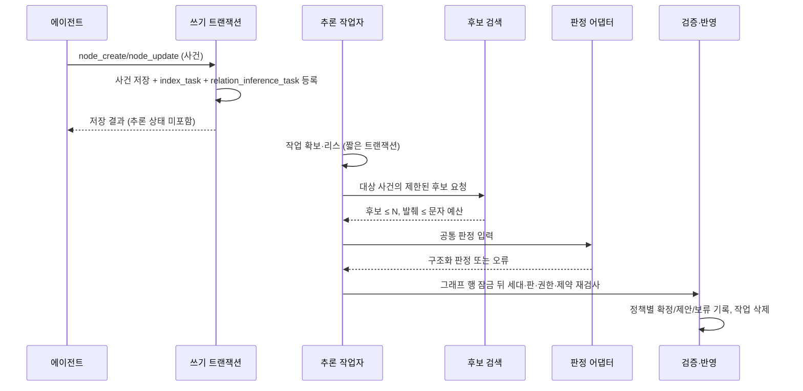

# 서버 관계 추론

변경된 사건의 관계 후보 검색, 교체 가능한 모델 판정, 서버 검증·반영, 추론 작업 큐와 판정 기록의 정본이다. 요구사항은 [SRS 서버 관계 추론](../SRS.md#서버-관계-추론)이, 관계의 상태·제약·잠금은 [관계 후보 제안과 확정](context-lifecycle.md#관계-후보-제안과-확정)이, 모델 비교 실행은 [관계 추론 모델 비교](evaluation.md#관계-추론-모델-비교)가 소유한다.

[설계 전체](../SDD.md) · [요구사항과 설계 대응](traceability.md)

설계 상태: 2026-11-09 #311 설계 반영. 구현·모델 호출·품질/비용 측정은 수행하지 않았다. 채택 모델은 2026-11-09 사용자 결정으로 `gpt-6-luna`이며 자동 확정 합격선은 `TBD-AGENT_CONTEXT-065`로 남는다.

## 처리 흐름

에이전트는 사건 저장 뒤 관계를 찾기 위해 `relation_list`·`node_get`을 반복하지 않는다. 서버는 저장 응답 이후 비동기로 관계를 판정하며 결과는 이후 조회·탐색에서 보인다. 에이전트의 명시적 관계 지정·수정 경로는 [에이전트 경로](#에이전트-경로와-기존-연산)에 남는다.

## 동작 모드

배포 구성 `RELATION_INFERENCE_MODE`로 그래프 전체 동작을 정한다. 그래프별 모드는 두지 않는다.

| 모드 | 작업 등록·후보·모델 호출 | 그래프 반영 | 쓰임 |
|---|---|---|---|
| `off` | 하지 않는다 | 없다 | 기본값. 기존 규칙 제안과 에이전트 확정만 동작 |
| `shadow` | 한다 | 없다. 판정 기록만 남긴다 | 실제 사건 분포에서 후보·판정·비용 측정 |
| `propose` | 한다 | 통과한 판정을 `proposed`(`proposed_by=inference`)로 기록 | 자동 확정 전 에이전트·사용자 검토 |
| `apply` | 한다 | 자동 확정 허용 유형은 `confirmed`, 나머지는 `propose`와 같다 | 합격 프로필의 운영 |

`apply`라도 현재 추론 프로필의 지문이 `RELATION_INFERENCE_ACCEPTED_PROFILE`과 다르면 자동 확정하지 않고 `propose`로 낮춘다. 모델·프롬프트·스키마·후보 구성 중 하나만 바뀌어도 지문이 바뀌므로 재평가 없이 교체한 모델이 관계를 확정하지 못한다. 낮춘 사실은 기동 시 시스템 진단과 판정 기록의 `policy_downgraded` 사유로 남긴다.

`off`에서 다른 모드로 바꿔도 기존 사건을 소급 등록하지 않는다. 그래프 전체 재추론은 이번 범위가 아니다.

## 관계 유형별 정책

| 유형 | 후보 출처 | 판정 | 반영 상한 |
|---|---|---|---|
| `relates_to` | 의미·키워드·구성원·대화 신호 | 모델 | `apply`의 자동 확정 허용 유형에 있을 때 확정, 아니면 제안 |
| `part_of` | 기존 진부분집합 신호와 시간 포함이 맞는 쌍 | 규칙이 방향을 정하고 모델은 포함 의미를 판정한다. 모델이 방향을 뒤집을 수 없다 | `relates_to`와 같다 |
| `precedes` | 기존 시간 인접 제안과 에이전트의 `previous_event_id` | 모델 판정 대상이 아니다 | 기존 규칙 제안·에이전트 확정을 유지한다. 시간만으로 확정하지 않는다 |
| `causes` | 모델이 두 끝의 명시 인과 근거를 인용한 경우만 | 모델 | 자동 확정하지 않는다. 근거 검증을 통과하면 제안, 아니면 보류 |

`derived_from`·`member_refs`·`navigation_refs`는 에이전트가 생성 시 명시하는 방식을 유지하며 추론 대상이 아니다. 자동 확정 허용 유형 구성 `RELATION_INFERENCE_AUTO_CONFIRM_TYPES`는 `relates_to`·`part_of`의 부분집합만 받고 기본값은 빈 집합이다. `precedes`·`causes`를 넣으면 기동을 거부한다.

한 쌍에서 여러 유형이 동시에 성립할 수 있으므로 판정은 쌍×유형 단위다. 같은 쌍의 `relates_to`와 `part_of`는 각각 판정·반영한다. 모델이 관계를 억지로 만들지 않도록 판정 입력은 `none`과 `abstain`을 정상 출력으로 명시한다.

## 후보 검색

후보 검색은 대상 사건 하나에 대해 같은 그래프의 활성 사건만 찾는다. 서버 모델에 그래프 전체나 전체 사건 목록을 보내지 않는다.

| 채널 | 입력 | 범위 |
|---|---|---|
| 의미 | 대상 사건의 현재 임베딩 | 같은 그래프의 사건 임베딩 근접 이웃. 최근 집합으로 제한하지 않는다 |
| 키워드 | 대상 사건 `body`의 검색 용어 | 기존 키워드 채널과 같은 구성의 사건 한정 질의 |
| 구성원 | 대상의 `member_refs` | 구성원을 하나 이상 공유하는 사건. 공유 수 순 |
| 규칙 | 기존 시간 인접·진부분집합 신호 | [저장 후 신호의 입력 상한](context-lifecycle.md#관계-후보-제안과-확정)을 그대로 쓴다 |
| 대화 | 대상의 `conversation_id` | 같은 대화의 앞뒤 사건 |

채널별 상위 후보를 순위 역수 합으로 합치고 상위 `RELATION_INFERENCE_CANDIDATE_LIMIT`개만 남긴다. 의미·키워드 채널이 그래프 전체 색인을 쓰므로 최근 집합 밖의 오래된 관련 사건도 후보가 될 수 있다. 각 후보에는 기여 채널과 채널별 순위를 기록하여 [모델 비교](evaluation.md#관계-추론-모델-비교)가 후보 누락과 판정 오류를 분리하게 한다.

다음 쌍은 후보에서 뺀다.

- 판정 대상 유형이 모두 `confirmed`이거나 `discarded`인 정체성. 일부 유형만 정해졌으면 남은 유형만 판정한다.
- 같은 대상 판·후보 판·추론 프로필 지문으로 이미 판정한 쌍. 같은 입력의 재호출 비용을 막는다.
- 폐기·삭제된 사건, 대상 자신, 다른 그래프의 사건.

모델 입력은 사건 `body`의 앞부분 발췌만 쓴다. 대상은 `RELATION_INFERENCE_TARGET_CHARS`, 후보는 `RELATION_INFERENCE_CANDIDATE_CHARS`, 전체는 `RELATION_INFERENCE_INPUT_CHARS` 이하이며 전체 상한을 넘으면 순위가 낮은 후보부터 뺀다. 원천·파생 본문과 구성원 본문은 보내지 않는다. 문자 상한은 입력 크기의 사전 통제이고 실제 토큰은 제공자 사용량으로 따로 기록한다.

의미 채널은 대상의 색인이 끝나야 동작한다. 대상의 `index_task`가 `pending`이면 작업을 미루고, `RELATION_INFERENCE_INDEX_WAIT`가 지나거나 색인이 `failed`이면 의미 채널 없이 진행하며 `semantic_unavailable`을 판정 기록에 남긴다.

## 판정 계약

모델·제공자마다 다른 호출은 판정 어댑터 뒤에 둔다. 후보 검색·검증·권한·저장 경로는 어댑터를 알지 못하며 아래 공통 입출력만 사용한다.

| 입력 필드 | 내용 |
|---|---|
| `schema_version` | 판정 입출력 스키마 판 |
| `target` | 요청 지역 별칭 `T`, 시간 범위, 대화 유무, 본문 발췌 |
| `candidates` | 지역 별칭 `C1`…`Cn`, 시간 범위, 진부분집합 방향 등 규칙 신호, 본문 발췌 |
| `allowed` | 후보별 판정할 유형과 `part_of`의 고정 방향 |

UUID 대신 지역 별칭을 써서 입력 크기를 줄이고 모델이 입력 밖 식별자를 만들지 못하게 한다. 본문 발췌는 구분된 데이터 영역에 넣고, 프롬프트는 그 안의 지시를 따르지 않는다고 명시한다. 이것은 방어의 한 겹일 뿐이며 실제 차단은 아래 서버 검증이 맡는다.

| 출력 필드 | 내용 |
|---|---|
| `candidate` | 입력의 별칭 하나 |
| `relation_type` | `allowed`에 있는 유형 |
| `decision` | `relation`, `none`, `abstain` |
| `direction` | `causes`의 `T_to_C`·`C_to_T`. `relates_to`는 방향 없음, `part_of`는 입력 방향만 허용 |
| `evidence` | `relation`일 때 대상·후보 발췌에서 그대로 인용한 짧은 구간 각 1개 |
| `reason` | 선택. 짧은 설명이며 판정에 쓰지 않는다 |

자기 확신 점수는 받지 않는다. 제공자가 확률 값을 주더라도 기록만 하고 반영 판단에 쓰지 않는다. 어댑터는 제공자의 구조화 출력 기능이 있으면 쓰고 없으면 JSON 파싱으로 같은 계약을 만든다. 첫 제공자 어댑터는 채택 모델 `gpt-6-luna`용이다. API 모델 식별자·엔드포인트·구조화 출력·사용량 필드는 구현 전에 공급자 공식 문서로 확인하고 [외부 근거](../reference.md)에 기록하며, 확인 전에는 지원을 가정하지 않는다. 시험용 결정적 대역 어댑터는 처음부터 둔다.

추론 프로필은 제공자·모델 식별자·프롬프트 판·`schema_version`·후보 구성(채널, 상한, 문자 예산)·생성 매개변수의 정규화 묶음이며, 지문은 그 묶음의 SHA-256이다. 판정 기록은 지문과 각 판 값을 함께 남겨 평가와 운영 판정을 재현할 수 있게 한다.

## 반영 검증

판정은 모두 서버 코드가 검증한 뒤에만 그래프에 닿는다. 하나라도 실패한 판정은 반영하지 않고 사유를 남긴다.

| 순서 | 검사 | 실패 사유 |
|---|---|---|
| 1 | 출력이 스키마에 맞고 별칭·유형이 입력 안에 있다 | `output_invalid` |
| 2 | `relation`의 인용이 실제로 보낸 두 발췌의 부분 문자열이다 | `evidence_unverified` |
| 3 | 작업 세대가 확보 시점과 같다 | 결과 전체 `stale` |
| 4 | 대상·후보가 활성이고 판이 입력 시점과 같다 | `target_changed`, `candidate_changed`, `endpoint_inactive` |
| 5 | 위임 계정이 아직 편집자 이상이고 그래프가 활성이다 | `delegation_invalid` |
| 6 | 같은 그래프·사건 끝점, 유형별 시간·순환·중복 제약 | [관계 확정](context-lifecycle.md#관계-후보-제안과-확정)의 기존 사유 |
| 7 | 같은 정체성이 그사이 `confirmed`·`discarded`가 되지 않았다 | `identity_settled` |
| 8 | 모드·자동 확정 허용 유형·프로필 지문 | `policy_proposed`, `policy_downgraded` |

`none`·`abstain`은 실패가 아니라 정상 판정이며 관계를 만들지 않는다. 출력 전체가 계약을 어기면 재시도 대상이고, 일부 판정만 어기면 그 판정만 `output_invalid`로 남긴다. 검사 3~7은 그래프 행을 잠근 결과 트랜잭션 안에서 다시 읽은 값으로 판단한다.

에이전트가 폐기한 정체성은 서버가 다시 제안하거나 확정하지 않는다. 서버는 에이전트가 확정한 관계를 폐기·변경하지 않으며 추론으로 생긴 관계를 스스로 폐기하지도 않는다. 사건 폐기·병합이 관계를 함께 폐기하는 기존 경로는 그대로다.

## 행위자와 감사

서버 판정은 에이전트 판단으로 기록하지 않는다.

| 기록 | 에이전트 확정 | 서버 추론 확정·제안 |
|---|---|---|
| 관계 `proposed_by` | `agent` 또는 `system` | `inference` |
| 관계 `confirmed_source` | `agent` | `inference` |
| 관계 `confirmed_by` | 요청 계정 | 위임 계정 |
| 관계 `confirmed_by_agent` | 등록 에이전트 | 비운다 |
| 관계 `inference_decision_id` | 추론 제안을 확정했으면 그 판정, 아니면 비운다 | 필수 |
| `operation_log` 판정 주체 | `agent` | `inference` |
| `operation_log` 판단 입력 | 요청 `judgment_input` 또는 인자 묶음 | 판정 ID와 프로필 지문. 본문·근거 인용은 넣지 않는다 |

위임 계정은 추론 작업을 등록한 사건 쓰기의 인증 계정이다. 같은 사건에 여러 계정이 차례로 쓰면 마지막 등록 계정이 위임 계정이 된다. 서버는 이 계정의 권한 범위 밖에서 행동하지 않으며 반영 시점에 등급을 다시 확인한다. 위임 계정의 등급이 없어졌으면 반영하지 않는다.

에이전트가 추론 제안을 `relation_confirm`으로 확정하면 `confirmed_source=agent`가 되고 `inference_decision_id`는 제안 출처로 남는다. 추론이 확정한 관계를 에이전트가 폐기하면 기존 폐기 기록과 함께 해당 판정이 잘못 만든 관계의 운영 표본이 된다.

## 추론 작업 큐

[색인 작업 큐](indexing.md#색인-작업-큐)와 같은 설계를 쓴다. 외부 큐를 두지 않고 같은 DB 테이블에 사건 저장과 함께 등록한다.

| 열 | 설명 |
|---|---|
| `task_id` | UUIDv7 기본 키 |
| `graph_id` | 대상 그래프 |
| `context_id` | 대상 사건. 사건마다 한 행이며 유일하다 |
| `target_version` | 등록 시 사건 판 |
| `trigger_account_id` | 위임 계정 |
| `attempts`, `output_attempts` | 제공자 실패 시도 수, 출력 계약 위반 시도 수 |
| `state` | `pending`, `failed` |
| `last_error` | 고정 사유 코드 |
| `enqueued_at`, `next_attempt_at` | DB 시계 기준 등록 시각과 다음 확보 시각 |
| `correlation_id` | 등록 요청의 상관 식별자 |

등록 시점은 모드가 `off`가 아닐 때 사건 생성, 구성원 집합·시간 범위·`body`를 바꾼 사건 갱신, 사건 복구다. 같은 행이 있으면 upsert로 세대와 판·위임 계정을 새로 쓴다. 원천·파생 쓰기와 구성원 순서만 바꾼 갱신은 등록하지 않는다. 사건 폐기는 등록하지 않고, 남은 작업은 반영 단계에서 `endpoint_inactive`로 끝난다.

작업자는 `FOR UPDATE SKIP LOCKED`로 확보하고 `next_attempt_at`을 리스 시각으로 미룬 뒤 커밋한다. 후보 검색은 읽기 스냅숏에서, 모델 호출은 트랜잭션 밖에서 한다. 결과 트랜잭션은 [공통 잠금 순서](context-lifecycle.md#판정의-직렬화)에 따라 그래프 행을 먼저 잠그고 `task_id`·`enqueued_at`·`next_attempt_at`이 확보 시점과 같을 때만 반영·작업 삭제·내용 판 증가·관리 기록을 한 번에 커밋한다. 세대가 다르면 판정은 `stale`로만 기록하고 그래프를 바꾸지 않는다. 새 세대는 새 판으로 다시 처리된다.

| 실패 | 처리 |
|---|---|
| 제공자 408·429·5xx·네트워크·timeout | 지수 백오프 재시도, 한계 5회 뒤 `failed` |
| 제공자 인증·권한·기타 비일시 상태 | 즉시 `failed` |
| 출력 전체 계약 위반 | 같은 입력으로 1회 재시도, 다시 위반이면 `failed` |
| 후보 조회·결과 저장 실패 | 제공자 실패와 같은 재시도 |

제공자 장애 중에는 [색인의 확보 차단](indexing.md#제공자-장애-중-작업-확보-차단)과 같은 방식으로 작업 확보를 멈추고 탐침으로 회복을 확인한다. 추론 실패는 사건 저장·색인·관계 규칙 제안을 되돌리지 않으며 응답에 추론 상태를 싣지 않는다. 작업자 배치는 색인 작업자와 같은 `INDEX_WORKER_PLACEMENT`를 따른다.

## 판정 기록

| 테이블 | 담는 것 | 보존 |
|---|---|---|
| `relation_inference_run` | 작업 한 회차: 그래프·대상·대상 판, 프로필 지문과 각 판, 후보 목록(사건·판·채널·순위), 결과 상태, 시도 수, 입력·출력 토큰, 지연, 제공자 상태 코드 | 아래 판정 중 가장 긴 보존을 따른다 |
| `relation_inference_decision` | 쌍×유형 판정: 회차, 후보 사건·판, 유형, 방향, `decision`, 근거 인용, 검증 결과·사유, 반영한 `relation_id` | 반영한 판정은 관계와 적용 연산 기록 이상, 나머지는 거부된 연산 기록과 같은 기간 |

근거 인용과 `reason`은 본문에서 나온 값이므로 DB 안에만 두고 진단 로그·지표·평가 결과 파일에 싣지 않는다. 그래프 삭제·영구 정리는 [소프트 삭제 수명주기](context-lifecycle.md#소프트-삭제-수명주기)의 대상 그래프 기록과 함께 처리한다. 원시 모델 응답은 저장하지 않는다.

토큰·지연을 회차마다 남기는 이유는 서버 추론 비용을 에이전트 토큰 절감과 같은 단위로 비교하기 위해서다. 제공자가 사용량을 주지 않으면 `unmeasured`로 남기고 문자 수에서 추정하지 않는다.

## 에이전트 경로와 기존 연산

| 경로 | 역할 |
|---|---|
| `relation_confirm` | 에이전트의 명시적 관계 지정. 추론 제안 확정, 근거가 있는 `causes`, 추론이 놓친 관계 |
| `relation_discard` | 잘못된 추론 관계·제안과 에이전트 관계의 폐기. 폐기한 정체성은 추론에서 제외된다 |
| `relation_list` | 상태·유형 필터와 함께 `proposed_by`·`confirmed_source`를 돌려준다 |
| `node_create`의 `previous_event_id` | 같은 대화 앞 사건의 명시 연결. 변경 없음 |

도구 이름·입력은 바꾸지 않는다. 서버 안내는 모드가 `propose`·`apply`일 때만 관계 탐색을 서버가 맡는다는 한 문장을 추가하고, 도구 정의 크기 예산은 [MCP 계약](mcp.md#공개-도구-정의의-크기-예산)을 따른다.

## 외부 전송과 구성

추론 제공자로 가는 것은 같은 그래프 사건의 본문 발췌뿐이다. 임베딩 제공자 전송과 별개의 경계 밖 경로이며 모드가 `off`이면 존재하지 않는다. 자체 호스팅 엔드포인트를 쓰면 경계 밖 전송이 없지만 구성으로만 판단하고 서버가 위치를 추정하지 않는다. 구성 키는 [목표 추가 구성](operations.md#목표-추가-구성)이 소유한다.

## 관측

작업 등록·확보·제공자 호출·차단/회복은 `index.jsonl`에, 반영·거부 결과는 `management.jsonl`에 [허용 필드](observability.md#기록기와-소유-경계)만으로 남긴다. 단계 값은 `relation_inference_` 접두사를 쓴다. 지표는 대기·실패 작업 수, 결과·사유별 판정 수, 토큰·지연이다. 본문·발췌·근거 인용·`reason`·프롬프트·원시 응답은 기록하지 않는다.
