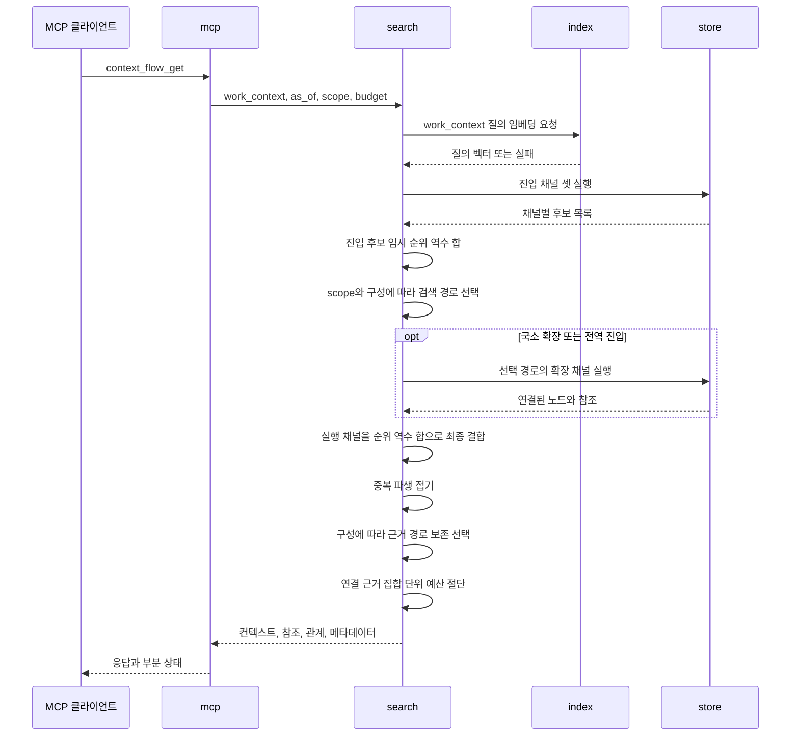

# 검색·홉 조회와 흐름 응답

채널 실행, 일관 읽기, 홉 조회 보호, 라우팅·결합·접기·예산과 흐름 응답의 정본이다.

[설계 전체](../SDD.md) · [요구사항과 설계 대응](traceability.md)

## 검색 채널 실행기

`search`가 네 채널을 실행하고 결합한다. `FR-AGENT_CONTEXT-128`이 요구한 병렬과 순차는 진입 채널 셋을 실행하는 방식의 차이이며 구성 값으로 고른다.

| 단계 | 동작                                                                 |
|------|----------------------------------------------------------------------|
| 1    | 진입 채널 셋을 구성 값에 따라 병렬 또는 순차로 실행한다              |
| 2    | 진입 채널 후보를 순위 역수 합으로 임시 결합해 초기 순위를 만든다       |
| 3    | 명시적 `scope` 또는 질의 적응형 정책으로 직접·국소 확장·전역 진입을 고른다 |
| 4    | 선택한 경로가 요구할 때만 확장 채널을 실행한다                       |
| 5    | 실행한 채널의 후보 목록을 순위 역수 합으로 최종 결합한다              |
| 6    | 중복 파생을 접고 구성에 따라 근거 경로를 선택한다                    |
| 7    | 선택 단위 전체를 예산까지 자르고 흐름 구성에 넘긴다                  |

두 방식이 같은 결과를 내는 근거는 2단계의 입력이 같다는 것이다. 임시 결합, 라우팅과 최종 결합은 채널별 순위 목록만 보고 실행 순서를 보지 않으므로, 진입 채널을 어떤 순서로 돌리든 같은 검색 경로와 결합 결과를 만든다. 실행 방식은 지연과 동시 자원 사용량만 바꾼다.

진입 채널이 모두 실패하면 확장 채널은 시작 노드를 받지 못한다. 이때 `진입점 없음`을 사유로 실패한 채널에 넣는 것은 [SRS 채널](../SRS.md#채널)이 확정했으며, 실행기가 3단계에서 판정한다.

## 요청 단위 일관 읽기 구현 비교

운영 검색은 읽기 전용 `REPEATABLE READ` 동기화 스냅숏을 사용한다. 아래 표는 채택 당시 비교한 설계를 설명한다. `Read Committed`는 평가 기준선이며 내용 판 재시도는 채택하지 않았다. 일관 읽기의 운영 방식을 배포 구성이나 공개 MCP 입력으로 열지 않는다.

| 후보 | 구현 |
|------|------|
| 동기화 스냅숏 | 조정 연결이 읽기 전용 `REPEATABLE READ` 트랜잭션을 열고 `pg_export_snapshot()`으로 식별자를 만든다. 각 병렬 채널과 후속 홉 확장·출처 조립은 첫 질의 전에 자기 읽기 전용 `REPEATABLE READ` 트랜잭션에서 `SET TRANSACTION SNAPSHOT`을 실행한다. 조정 트랜잭션은 모든 읽기가 끝날 때까지 열린 상태를 유지한다. |
| 내용 판 재시도 | `context_graph`에 낙관적 잠금용 `version`과 별도인 `content_revision`을 둔다. 컨텍스트 상태, 참조·사건 관계 상태 또는 임베딩이 검색에 공개되는 트랜잭션이 이 값을 증가시킨다. 검색은 시작 판과 조립 완료 뒤 판을 대조하고 다르면 응답을 버린 뒤 전체 흐름을 다시 실행한다. |

두 후보 모두 의미 후보 식별자와 본문 조회를 같은 요청 읽기 경계 안에 둔다. 동기화 스냅숏은 채널 수만큼 연결을 동시에 점유하고 조정 연결도 유지하므로 연결 수와 보유 시간을 측정한다. 내용 판 방식은 읽기 연결을 오래 잡지 않는 대신 동시 쓰기에서 검색 전체를 반복하므로 재시도율과 연속 재시도 횟수를 측정한다. 비교 실행기는 정해진 시간 안에 결과를 만들지 못한 요청을 지연 상한 위반으로 기록하며 무한 재시도하지 않는다.

비교 당시 두 후보는 마이그레이션을 포함한 실험 구현으로 대조했다. 동시 쓰기가 없을 때 현행 병렬·순차 실행과 컨텍스트·관계·출처·정렬·부분 상태가 같고, 동시 쓰기 중 결과 전체가 한 커밋 상태로 설명되며, 검색 서비스 수준 목표를 지키는 후보만 운영 승격 대상으로 삼는다. 조건을 만족한 후보가 여럿이면 연결 점유와 재시도 비용이 더 작은 것을 고른다.

2026-09-27 비교에서 두 후보는 동시 쓰기가 없을 때 현행과 같은 결과를 냈다. 현행 검색은 동시 쓰기 중 요청의 최대 35%가 두 커밋 상태를 섞어 읽었다. 동기화 스냅숏은 불일치 없이 현행과 같은 수준의 지연을 냈다. 내용 판 재시도는 초당 10회 이상의 쓰기에서 요청 대부분이 재시도 상한 안에 결과를 얻지 못했다. 그래서 서버는 동기화 스냅숏을 쓰고 배포 구성으로 열지 않는다. 검색이 부르는 여섯 읽기는 요청 컨텍스트에 실린 스냅숏을 자기 읽기 전용 트랜잭션에서 가져오고, 접근 시각 갱신 같은 쓰기 부작용은 각 읽기 트랜잭션을 닫은 뒤, 그 읽기 자리를 유지한 채 경계 밖 연결 하나로 실행한다. 조정 연결을 열기 전에 [데이터베이스 연결](architecture.md#데이터베이스-연결)이 정한 대로 연결 4개를 예약하고, 경계 안의 읽기 트랜잭션은 동시에 3개까지만 연다. 내용 판 열과 증가 지점은 [테이블 열 정의](data.md#테이블-열-정의)의 계약이라 유지하지만, 운영 검색은 읽지 않고 채택하지 않은 재시도 구현은 제거했다. 측정 조건과 값은 `reviews/2026-09-27-consistent-read.md`에 있다.

## 채널 구현

[SRS 채널](../SRS.md#채널)이 각 채널의 입력과 동작을 확정했지만, 순위 역수 합은 채널마다 순위가 매겨진 목록을 요구한다. 무엇으로 순위를 매기고 몇 개까지 넘기는지를 정한다.

| 채널        | 질의                                        | 순위 기준             | 상한             |
|-------------|---------------------------------------------|-----------------------|------------------|
| 의미 유사도 | 임베딩 벡터의 근접 이웃                     | 거리 오름차순         | 채널별 후보 상한 |
| 키워드      | `websearch_to_tsquery('simple', work_context)` | `ts_rank_cd` 내림차순 | 채널별 후보 상한 |
| 시간 필터   | `as_of` 시점에 유효한 활성 컨텍스트         | `recorded_at` 내림차순 | 채널별 후보 상한 |
| 그래프 경로 | [SRS 홉 범위 조회](../SRS.md#홉-범위-조회) 규칙                       | 최단 홉 거리 오름차순 | 홉 조회 결과 상한 |

시간 필터의 순위를 `recorded_at` 내림차순으로 두는 근거는 [SRS 결합과 재순위화](../SRS.md#결합과-재순위화)가 동점 처리에 이미 같은 기준을 쓰는 것이다. 이 채널은 조건을 만족하는 것을 전부 고르므로 다른 세 채널과 달리 순위가 자연히 나오지 않고, 최근 것을 앞에 두는 것이 다른 기준을 새로 만들지 않는 선택이다.

채널별 후보 상한이 특히 이 채널에 필요하다. `FR-AGENT_CONTEXT-086`이 상한을 확정한 이유가 결합 단계의 계산량 제한인데, 시간 필터는 조건이 넓어 그래프의 활성 컨텍스트 대부분이 걸릴 수 있다. 상한과 정렬이 함께 있어야 "`as_of` 시점에 유효한 가장 최근 N개"로 정해진다.

상한 값은 [배포 구성](operations.md#배포-구성)이 정하고 플랜 항목으로 두지 않는다. 이 값이 계정의 이용 조건이 아니라 결합 단계의 계산량 제한이고, `FR-AGENT_CONTEXT-113`이 이 값을 [SRS 검색 품질 평가](../SRS.md#검색-품질-평가)에서 정하기로 이미 확정했기 때문이다.

의미 유사도 하한도 배포 구성으로 두고 [SRS 검색 품질 평가](../SRS.md#검색-품질-평가)에서 정한다. 하한은 의미 후보를 검색 결과에서 제거하지 않고 `scope=auto`의 전역 전환 여부만 판정한다. 최상위 의미 후보가 하한을 넘거나 키워드 후보가 있으면 관련 국소 결과가 있다고 본다. 이 방식은 낮은 점수의 의미 후보도 결합에는 보존하면서, 그것만으로 전역 전환을 막지는 않는다. 전역 요약은 의미 유사도·키워드·시간 필터의 국소 후보에서 제외한다. 시간 필터도 최종 결합 후보로 남지만 질의 관련성이 없으므로 전환 판정에는 쓰지 않는다. 전역 전환이 일어나면 전역 요약이 존재하는 경우 그 요약만 그래프 확장의 시작점으로 삼아, 광범위한 시간 후보가 홉 결과 상한을 먼저 채우지 않게 한다.

그래프 경로 채널만 다른 상한을 쓴다. 이 채널은 [SRS 홉 범위 조회](../SRS.md#홉-범위-조회) 규칙을 그대로 따르기로 확정했고 그 규칙이 이미 결과 상한과 절단을 갖고 있으므로, 상한을 두 개 겹쳐 두면 어느 것이 잘랐는지 알 수 없게 된다.

통합 점수는 순위 역수의 정확한 유리수 합으로 비교한다. 수학적으로 같은 합은 채널의 누적 순서나 부동소수 반올림과 무관하게 동점으로 처리하고, `recorded_at` 내림차순과 식별자 오름차순을 차례로 적용한다. 이 순서는 초기 라우팅 신호와 최종 접기·예산 절단에도 동일하게 적용한다. 근사 오차 허용값으로 서로 다른 점수를 동점 취급하지 않는다.

## 홉 탐색 구현 비교

### 고연결 노드의 조회·적재 보호

단일 홉 조회는 시작 노드 확인부터 후보 선택·본문·내부 간선·참조 조립까지 하나의 읽기 전용 `REPEATABLE READ` 트랜잭션에서 실행한다. 탐색 상태는 첫 읽기의 커밋 상태를 기준으로 판정하므로 그 뒤 다른 트랜잭션이 이웃을 폐기해도 이전 상태의 완전한 부분 그래프를 반환하고, 새 조회에서는 폐기된 이웃을 제외한다. 첫 읽기에 시작 노드가 없거나 폐기되어 있으면 기존 `not_found`를 유지한다. `HopContextsFrom`을 스냅숏 없이 직접 부를 때도 같은 경계를 열고 제공된 시작 식별자의 현재 본문을 그 안에서 다시 읽는다. 검색의 후속 홉 확장은 새 상태를 만들지 않고 기존 요청 단위 동기화 스냅숏을 가져온다. 다른 직접 읽기 전체에 이 경계를 확대하지 않는다.

스냅숏 없는 홉 조회는 연결 하나만 점유하고, 읽기 트랜잭션을 닫아 연결을 반환한 다음 임베딩 접근 기록을 처리한다. 연결을 쥔 채 추가 연결을 기다리지 않으므로 별도 예약이나 조정 연결을 추가하지 않는다. 검색 경로의 예약 수 4개와 읽기 자리·접근 기록 종료 경계는 그대로 유지한다. 읽기 종료 또는 접근 기록 실패는 빈 결과와 오류로 전파하고 불완전한 결과를 성공이나 절단 표시로 바꾸지 않는다.

동시 폐기 회귀는 양수 상한의 후보·본문 사이와 한도 없음의 확장·참조 사이에 별도 폐기 트랜잭션의 커밋을 완료한 뒤 노드·본문·참조·내부 간선·거리·순서·절단을 이전 결과와 대조한다. 시작 부재·폐기와 검색 스냅숏 유지도 별도로 검사하고, 최소 풀에서 풀 상한보다 많은 단일 홉 요청의 완료·연결 회복을 확인한다. 재현과 설계 선택의 근거는 [홉 동시 폐기 검토](../reviews/2026-10-11-hop-concurrent-discard.md)에 기록한다.

`FR-AGENT_CONTEXT-024`의 결과 상한은 응답 노드 수이며 데이터베이스의 스캔·정렬 작업량 상한과 다르다. 양수 상한에서는 깊이·label별로 미방문·활성 이웃 식별자만 선택한다. 같은 이웃의 최초 기준 정점 식별자를 기준으로 묶어 기준 정점·이웃 식별자 순서를 유지하고, 남은 자리와 초과 확인용 식별자 하나까지만 반환한다. 초과 확인용 식별자의 본문은 읽지 않는다. 선택한 노드의 본문은 마지막에 묶음 조회하고, 그 노드 사이의 요청 label·확정 상태를 만족하는 간선을 별도로 모두 읽는다. 마지막 홉에서는 새 이웃을 조회하지 않는다. 이를 통해 응답에 없는 수만 개 이웃의 본문과 간선을 애플리케이션에 적재하지 않으며, 상한에 도달한 뒤에도 부분 그래프의 간선을 빠뜨리지 않는다.

양수 상한 `L`의 애플리케이션 방문 집합·식별자 후보는 `O(L)`이고 본문 적재는 반환 노드에 한정된다. 내부 간선은 조밀한 그래프에서 `O(L²)`이므로 노드 상한이 간선 수의 선형 상한이라고 주장하지 않는다. `limit=0`은 기존 한도 없음 계약을 유지하며 유한 노드·본문 메모리 상한을 추가하지 않는다. 후보 집계에는 식별자만 투영해 정점 전체가 정렬에 실리지 않게 한다. 최초 기준 정점의 UUID 문자열은 `C` 정렬로 대조한다. 정렬과 중복 제거가 데이터베이스에서 많은 간선을 읽을 수 있으므로 단순 `LIMIT`을 DB 스캔 행 수 상한으로 해석하지 않는다.

두 공개 홉 진입점은 시작 조회·읽기 자리 확보·후보 조회·본문·간선 조립까지 30초의 공통 시간 예산을 적용하고 호출자의 더 짧은 취소·마감은 우선한다. 예산이 끝나면 질의를 취소하고 오류를 전파한다. 간선 완전성을 확인하지 못한 결과를 정상 부분 응답이나 `truncated`로 위장하지 않는다. 정상 절단 여부와 최초 잘린 홉 경계는 기존 결과 상한 판정을 유지한다. 예약 연결과 스냅숏 종료 경계는 변경하지 않으며 DB 취소·정리의 정확한 벽시계 상한을 보장하지 않는다.

작업량은 애플리케이션이 받은 행으로 측정한다. 양수 상한의 `identifierRows`는 후보 질의의 초과 확인 행을 포함하고, `bodyRows`·`bodyBytes`는 새로 선택한 정점의 본문 행·UTF-8 바이트만 센다. 호출자가 제공한 시작 노드와 `HopContexts`의 선행 단일 노드 조회는 이 지표에서 제외한다. `edgeRows`는 반환 노드 사이의 요청 label 간선 질의가 돌려준 행이며 최종 중복 제거 전 값이다. `referenceRows`는 별도의 근거·구성원·대체 참조 묶음 질의 세 개가 읽은 행을 합산한다. 시작 노드의 참조 재적재와 응답 노드 집합 밖을 가리키는 참조도 포함하며, 내부 간선과 같은 참조가 양쪽 질의에서 읽히면 각 지표에 한 번씩 센다. 참조 대상의 본문, 임베딩 접근 기록과 그 밖의 질의는 이 지표에 포함하지 않는다. 정상 입력의 파생 근거는 노드당 최대 100개, 사건 구성원은 최대 1,000개이므로 정상 참조 적재를 무제한으로 보지 않으며 응답 노드 상한을 이유로 참조 목록을 절단하지 않는다.

검증은 같은 허브 표본에 기존 전체 본문 적재와 식별자 선택을 번갈아 실행하여 반환 결과를 대조하고, 식별자·본문·간선·참조 행 수, 본문 바이트, 할당량과 지연을 측정한다. 전체 본문 기준선의 본문·간선 지표는 반복 방문·제외 후보까지 포함한 이웃 질의 행으로, 양수 상한 구현의 새 정점·내부 간선 지표와 구분한다. 참조 지표는 두 구현 모두 같은 묶음 질의를 측정한다. DB 내부 작업은 실행 계획의 실제 행·버퍼로 따로 관측한다. 해당 수치를 혼동하거나 측정하지 않은 개선폭을 보장하지 않는다.

구현 비교에는 같은 시작점 재조회·읽기 전용 스냅숏·접근 기록 경계를 적용한다. 확장 질의 수와 별개로 실제 실행한 SQL 명령 수를 왕복 지표로 남기며, 여기에는 트랜잭션 시작/종료와 접근 기록이 포함된다. 네트워크 패킷 수를 의미하지 않는다. 실행 계획은 같은 불변 표본의 읽기 질의만 별도 재실행하여 얻고, 각 질의 root의 버퍼를 합산하며 관계 접근 행은 실제 행·필터 제외 행과 loops로 계산한다. AGE C 내부 캐시·인접 탐색처럼 실행 계획에 드러나지 않는 작업은 이 합계에 포함되지 않는다. 가변 길이 후보의 미계측 본문/간선 작업량은 0으로 개선을 주장하지 않고 미측정으로 표시한다. warm-cache의 소수 반복은 조건별 관측값이며 독립 표본의 신뢰구간·운영 지연 목표나 공개 품질 평가를 대신하지 않는다.

시간 예산 회귀는 실제 질의에 전달한 마감이 진입부터 조립까지 같은지 관찰하고, 호출자의 더 짧은 마감·취소와 실제 30초 내부 예산 소진을 잠금 대기로 검증한다. 오류 시 빈 결과를 대조하고, 후속 조회 성공과 별개로 풀의 획득 연결 수가 유한 대기 안에 기준값으로 회복되는지 검사한다. 스냅숏 경로에서는 읽기 자리와 활성 트랜잭션도 회복되어야 하며 조정 연결은 스냅숏 종료 전까지 기준값에 포함한다. 최대 정상 참조 표본의 완전성·작업량과 실행 결과·제한은 [홉 보호 검증 보완 검토](../reviews/2026-10-11-hop-protection-verification.md)에 기록한다.

간선 스캔 축소는 관계 판정을 openCypher에 유지한 채 SQL 외피의 후보 선택 순서를 바꾼다. 기준 정점마다 `max(64, 남은 자리 + 1) + 1`행까지 정렬 없는 식별자 표본을 물질화한다. 표본이 전환 기준 이하이면 전체 인접 집합을 읽은 것이므로 중복 제거·정렬하고, 그보다 크면 같은 그래프의 활성 정점을 식별자 순서로 읽으며 Cypher 관계의 존재를 확인한다. 64는 성능 전략의 전환 기준이지 탐색 결과를 자르는 상한이 아니다. 정수 최댓값의 초과 확인 덧셈은 포화 처리한다.

기준 정점별로 남은 자리와 초과 확인 한 행까지 선택한 뒤 최초 기준 정점·이웃 순서로 합친다. 각 기준 정점의 첫 K개 밖에서 누락된 이웃보다 같은 기준 정점에서 먼저 발견되는 서로 다른 K개가 있으므로 전체 발견 순서의 첫 K개는 이 합집합에 포함된다. 전체 집계·정렬을 그대로 적용하여 다중 시작점·중복 경로의 순서와 절단 판정을 보존한다. 양방향은 방향별 Cypher 질의를 하나의 SQL `UNION ALL`로 합쳐 무방향 끝점 조건의 비선택적 조인 비용을 피한다. 왕복은 여전히 label당 하나이며 중복 이웃은 최종 집계에서 제거한다. 남은 자리가 0이면 정렬 없이 미방문 이웃의 존재만 확인한다.

내부 간선은 선택 정점 집합의 Cypher 질의를 유지하며 끝점 복합 인덱스를 제공한다. 이는 임의 간선 절단이 아니라 같은 발견 순서와 간선 완전성을 보존하는 조회 전략이다. 후보가 희소하거나 삭제·미확정 간선이 많으면 잔여 스캔이 클 수 있으며 내부 간선도 통계·조인 순서에 따라 전체 인접 집합을 읽을 수 있어 기존 30초 예산을 유지한다. 기준 정점 수에 비례하는 표본과 후보의 DB 집계 비용까지 `O(L)`이라고 해석하지 않는다. 채택 비교와 잔여 경로는 [간선 스캔 축소 검토](../reviews/2026-10-11-hop-edge-scans.md)에 기록한다.

현재 기본 구현은 깊이별 frontier와 관계 label 순서로 방문 집합·최단 거리를 구성하는 너비 우선 탐색이다. 양수 상한에는 앞 절의 식별자 선택과 내부 간선 조립을 적용한다. 한도 없음의 전체 이웃 구현은 마지막 깊이의 인접 간선까지 읽어 반환 노드 사이의 간선을 남기며, 같은 구현을 시험 전용 기준선으로 실행해 양수 상한의 최적화도 대조한다. 별도 비교 후보는 AGE의 가변 길이 간선 질의 한 번으로 시작점에서 `k`홉 안의 정점과 인접 간선을 가져온 뒤 같은 너비 우선 규칙을 메모리에서 재현한다. 방향·label 순서·확정 상태·삭제 제외·상한은 같아야 한다. 왕복을 줄이는 대신 경로 나열 비용과 전송량이 늘 수 있으며, 후보를 위한 별도 MCP 입력이나 배포 구성은 열지 않는다.

최단 경로 함수는 현재 홉 조회를 직접 대체하는 후보로 채택하지 않았다. 고정한 `apache/age:release_PG18_1.8.0`의 Cypher 패턴 구문인 `shortestPath`·`allShortestPaths`는 파서가 거부하지만, snake_case 함수 `shortest_path`·`all_shortest_paths`와 SQL `age_shortest_path`·`age_all_shortest_paths`는 별도로 존재한다. 2026-10-25 재확인에서 함수의 label 문자열·배열 필터는 동작했으며 알 수 없는 label은 경로를 반환하지 않았다. label 목록을 무시한다는 이전 설명을 이 관측으로 정정한다.

이 함수는 두 정점 사이의 경로를 구하며 간선의 `state`나 중간 정점의 `deleted_at`을 제한하는 인자를 제공하지 않는다. 실제 표본에서도 `proposed` 관계와 삭제된 중간 정점을 통과했다. 반환된 최단 경로를 나중에 제외하는 것만으로는 더 긴 유효 경로를 복구하지 못한다. 일반 `all()` 술어는 지원되지만 이번 이미지의 `all(n IN nodes(p) ...)` 예제는 실행 계획 오류(`XX000`)로 끝났으므로 경로 정점 필터의 적합성을 확인하지 못했다. 그래서 확정 관계·활성 중간 정점·도달 범위 전체와 완전한 내부 간선이라는 결과 조건의 대체 근거로 쓰지 않는다. 가변 길이 간선 후보는 label 없이 `graph_id` 속성 조건만 걸어 도달 가능한 정점의 상위 집합을 모으고, 조건 판정은 기준선과 같은 규칙으로 메모리에서 한다.

후보 구현은 다음 결과 조건을 모두 기준선과 같게 재현해야 한다.

| 조건 | 동등성 기준 |
|------|-------------|
| 그래프 격리 | 시작점, 중간 정점, 결과 정점과 간선의 `graph_id`가 모두 요청 값과 같다 |
| 탐색 범위 | 요청 방향과 `traversal_filter`를 지키고 사건 관계는 `confirmed`만 따른다 |
| 노드 상태 | `deleted_at`이 있는 노드를 경로 중간점과 결과에서 모두 제외한다 |
| 순환과 거리 | 노드를 한 번만 반환하고 가장 가까운 시작점까지의 최단 홉 거리를 보존한다 |
| 결과 상한 | 시작점 우선과 홉 거리 순서를 유지하고 같은 경계에서 절단 사실을 표시한다 |
| 부분 그래프 | 반환 노드를 잇는 확정 참조·관계의 집합과 정렬 결과가 같다 |

통합 검증은 같은 그래프 표본에 두 구현을 실행해 컨텍스트, 최단 거리, 간선, 절단 여부와 경계를 대조한 뒤 데이터베이스 왕복 횟수와 전체 지연을 잰다. 결과가 하나라도 다르면 성능과 무관하게 후보를 채택하지 않는다. 결과가 같고 왕복 횟수와 지연이 개선될 때만 내장 경로 구현으로 대체하며, 그 전에는 현재 너비 우선 탐색을 기본으로 유지한다.

첫 비교는 개발 이미지가 고정한 `apache/age:release_PG18_1.8.0`에서 수행한다. 개발 이미지는 태그와 함께 다중 아키텍처 인덱스 digest를 고정해, 태그가 다시 게시되어도 비교가 같은 이미지에서 재현되게 한다. 이후 PG18 호환 공식 안정판으로 올릴 때마다 같은 표본과 조건으로 다시 비교한다. 변경 가능한 `dev_snapshot_*` 태그는 기본 개발·운영 이미지로 사용하지 않으며, 사전 검증이 필요하면 이미지 digest로 고정한 격리된 실험에서만 사용한다.

2026-09-27 첫 비교에서 가변 길이 간선 후보는 기준선과 결과가 같았고 확장 질의를 한 번으로 줄였지만, 측정한 모든 조건에서 지연이 늘었다. 상한 없는 탐색은 경로 나열의 임시 파일로 디스크를 채워 실행하지 못했다. 그래서 너비 우선 탐색을 유지한다. 비교 후보와 동등성 테스트·벤치마크는 다음 안정판에서 같은 비교를 반복하려고 저장소에 남기며 운영 경로는 호출하지 않는다. 측정 조건과 값은 `reviews/2026-09-27-hop-traversal-comparison.md`에 있다.

의미 유사도 채널은 벡터 인덱스 질의를 짧은 트랜잭션에 넣고 그 안에서만 pgvector의 반복 탐색을 `strict_order`로 켠다. HNSW는 조건을 보지 않고 전역 근접 이웃을 먼저 꺼내므로, `graph_id`·`model_id`와 삭제·유효 기간 조건이 뒤에서 걸러내면 상한을 채우지 못하거나 0건이 될 수 있다. [격리 강제의 구현](data.md#격리-강제의-구현)이 여러 그래프를 한 테이블에 논리로 격리했고 그래프가 작을수록 이 손실이 잘 나타난다. 반복 탐색은 상한을 채울 때까지 인덱스를 이어 훑고 `strict_order`가 거리 순서를 정확히 지킨다. 반복 탐색은 pgvector 0.8.0에 들어왔으므로 [버전 요구](architecture.md#버전-요구)의 하한인 0.7.0 배포에서는 설정이 없고, 없으면 아무것도 하지 않도록 두어 그 배포의 동작을 그대로 남긴다. 설정을 트랜잭션 범위로 두는 이유는 풀의 연결에 남으면 같은 연결을 쓰는 다른 질의까지 바뀌기 때문이다.

같은 이유로 [관계 후보 제안과 확정](context-lifecycle.md#관계-후보-제안과-확정)의 임베딩 유사도 신호도 대상 벡터를 먼저 한 행으로 읽어 파라미터로 넘기고 유사도 하한을 질의의 조건으로 내린다. 임베딩끼리 조인해 두 열의 연산으로 정렬하면 정렬 기준이 열이 아니라 벡터 인덱스를 쓸 수 없고, 하한을 애플리케이션에서 판정하면 상한까지 뽑은 후보가 모두 미달일 때 기준을 넘는 후보를 놓친다.

키워드 채널은 PostgreSQL의 전문 검색을 쓰며 텍스트 검색 구성을 `simple`로 둔다. 색인과 질의가 같은 구성을 써야 하므로 [인덱스](data.md#인덱스)의 전문 검색 인덱스도 같은 값이다.

`simple`을 고르는 이유는 대안이 배포 의존을 늘리기 때문이다. PostgreSQL이 기본으로 제공하는 구성 중 한국어를 다루는 것이 없고, 형태소 분석을 붙이려면 확장을 하나 더 요구해 [버전 요구](architecture.md#버전-요구)의 호환 범위를 그 확장까지 넓혀 다시 확인해야 한다.

대신 한계를 분명히 적는다. `simple`은 형태소 분석도 어간 추출도 하지 않고 공백과 문장 부호로만 나누므로, 조사가 붙은 한국어 표기는 조사가 없는 표기와 다른 어휘로 다뤄져 일치하지 않는다. `컨텍스트 그래프를 조회한다`는 `컨텍스트`·`그래프를`·`조회한다` 세 어휘로 색인되어 `그래프`로 찾으면 걸리지 않고 `그래프를`로 찾아야 걸린다. 영어처럼 공백이 곧 어휘 경계인 언어에서는 이 문제가 드러나지 않는다.

이 채널의 재현율이 낮다는 뜻이며, 나머지 세 채널이 같은 컨텍스트를 찾아내는 만큼 결합 결과에서 가려진다. 순위 역수 합이 한 채널이 빠져도 성립하게 두었으므로 이 채널의 약한 재현율이 다른 채널의 결과를 밀어내지 않는다.

질의 구성은 어휘를 OR로 묶는다. `plainto_tsquery`나 `websearch_to_tsquery`나 기본 결합은 AND인데 `work_context`는 문장 단위의 자연어라 어휘가 몇 개만 넘어도 그 전부를 담은 문단이 없어 후보가 나오지 않는다. 시험 측정이 이를 확인했는데 검색 1,272회 중 키워드 채널이 후보를 낸 회차는 24회였다. 그래서 실행 계층이 질의의 어휘를 나눠 `OR`로 조립하고 구문 해석은 `websearch_to_tsquery`에 맡긴다. 사용자 텍스트를 그대로 질의 함수에 넘겨도 안전하고 따옴표 구문과 `-` 제외 표현도 그 함수가 다루며, 텍스트 검색 구성은 색인·질의 모두 `simple`을 그대로 쓴다.

형태소 분석 도입은 `TBD-AGENT_CONTEXT-061`이 소유한다. 지금 정하지 않는 이유는 판단 근거가 될 값이 이미 설계에 있기 때문이다. [SRS 측정](../SRS.md#측정)이 채널별 기여를 재고 있으므로, 이 채널이 실제로 얼마나 기여하는지를 보고 확장을 더할지 정할 수 있다.

## 질의 적응형 라우팅

`search`는 `scope=auto`이고 `SEARCH_QUERY_ADAPTIVE_ROUTING_ENABLED=true`일 때만 규칙 기반 라우터를 실행한다. `scope=local`과 `scope=global`은 구성과 무관하게 호출자 지정 경로를 실행하고, 구성이 `false`이면 기존의 관련 국소 후보 유무에 따른 전역 전환을 그대로 수행한다.

라우터의 입력은 진입 채널 실행 결과뿐이다. 별도 모델을 호출하거나 `work_context`의 어휘 목록을 언어별 규칙으로 분류하지 않는다. 같은 후보와 임계값이면 항상 같은 경로를 고른다.

진입 채널이 모두 실패하면 라우터를 실행하지 않고 기존 실패 처리를 따른다. 후보가 0건인 성공과 채널 실패를 같은 `no_relevant_local`로 합치면 저장소나 제공자 장애가 전역 진입으로 감춰지므로 두 상태를 먼저 나눈다.

| 순서 | 조건 | 검색 경로 | 이유 코드 |
|------|------|-----------|-----------|
| 1 | 유사도 하한을 넘은 의미 후보와 키워드 후보가 모두 없다 | 전역 진입 | `no_relevant_local` |
| 2 | 통합 순위 1위가 사건이다 | 국소 확장 | `event_anchor` |
| 3 | 통합 순위 1위가 의미·키워드 양쪽 후보에 있다 | 직접 | `cross_channel_agreement` |
| 4 | 의미 후보 1위가 직접 충분성 하한을 넘고 2위와의 차이가 분리 폭 이상이다 | 직접 | `semantic_separation` |
| 5 | 관련 국소 후보는 있으나 위 직접 조건을 충족하지 않는다 | 국소 확장 | `ambiguous_local` |

2번 조건은 1위 후보의 계층만 본다. 계층은 진입 채널이 이미 돌려준 컨텍스트 속성이므로 라우터 입력을 넓히지 않는다. 사건 관계는 사건끼리만 이으므로, 1위가 사건이면 답이 한 홉 떨어진 다른 사건일 수 있어 직접 경로 조건보다 먼저 판정한다.

전역 진입에서 전역 요약이 없으면 직접 경로로 되돌리고 이유 코드를 `global_summary_absent`로 바꾼다. 의미 유사도 채널이 실패하거나 후보가 하나뿐이라 분리 폭을 계산할 수 없으면 4번 조건은 성립하지 않는다. 의미 후보 하나만 있을 때도 근거 없는 무한 분리로 보지 않아 학습 자료가 없는 첫 규칙을 보수적으로 유지한다.

직접 경로는 진입 채널 결과만 결합하고 그래프 경로 채널을 실행하지 않는다. 이 채널은 조회 실패가 아니므로 구성으로 끈 채널과 같은 `disabled`로 표시해 모든 채널 실패 판정과 실패 집계에서 뺀다. 국소 확장은 유사도 하한을 넘은 의미 후보와 키워드 후보만 시작점으로 삼는다. 시간 필터 후보는 질의 관련성이 없어 결합에는 남지만 시작점에서 뺀다. 확장은 `SEARCH_GRAPH_STAGE`가 허용한 확정 참조와 사건 관계를 사용하되 최대 1홉으로 제한한다. 적응형 구성을 켰는데 `SEARCH_GRAPH_STAGE=baseline`이면 국소 확장이 직접 경로와 같아지므로 기동 검증에서 거부한다. 전역 진입은 전역 요약만 시작점으로 삼아 `derived_from`을 따라가며, 근거 경로 보존 선택 값은 세 경로에서 동일하게 적용한다.

직접 충분성 하한 `SEARCH_ADAPTIVE_DIRECT_SIMILARITY_THRESHOLD`와 분리 폭 `SEARCH_ADAPTIVE_DIRECT_MARGIN_THRESHOLD`는 배포 구성으로 두고 `cmd/eval`의 질의 적응형 비교가 정한다. `SEARCH_QUERY_ADAPTIVE_ROUTING_ENABLED`의 기본값은 `false`다. 운영 로그에는 `selected_route`, `route_reason`과 집계 지표만 남기고 질의문·본문·경로 원문은 남기지 않는다.

적응형 라우팅을 거치지 않은 요청도 실제로 실행한 경로를 같은 이름으로 기록한다. 기존 `auto`는 전역 전환이 적용되면 전역 진입, 국소 그래프 확장이 실행되면 국소 확장, 그 밖에는 직접 경로이며 이유 코드는 `legacy_auto`다. 호출자가 `scope`를 지정하면 이유 코드는 `explicit_scope`다. 기존 정책의 경로 오선택률을 적응형과 같은 기준으로 재려면 이 표시가 필요하다.

평가 실행기는 검색 구성의 강제 경로 값으로 세 경로를 같은 질의에 실행한다. 이 값은 적응형 라우팅이 켜진 `scope=auto`에서만 효력이 있고 배포 구성으로 열지 않는다. 라우터 입력이 진입 채널 결과뿐이므로 평가기는 흐름 결과에 실린 라우터 신호로 임계값 후보마다 고를 경로를 다시 계산하고, 그 경로의 강제 실행 결과로 후보를 견준다. 후보마다 검색을 다시 돌리지 않아도 결과가 같다.

2026-09-27 통제 비교에서 사건 세트의 연상 질의는 모든 질의가 채널 간 일치로 직접 경로를 타 관계 근거를 잃었고, 직접 충분성 하한과 분리 폭의 어느 조합도 이를 바꾸지 못했다. 품질 비악화 조건을 넘지 못했으므로 운영 기본값은 `false`로 유지하고 두 임계값을 정하지 않는다. 측정 조건과 값은 `reviews/2026-09-27-adaptive-routing.md`에 있다.

## 근거 경로 보존 선택

`search`는 통합 순위를 산정하고 중복 파생을 접은 뒤, `SEARCH_EVIDENCE_PATH_SELECTION_ENABLED=true`일 때만 근거 경로 보존 선택을 실행한다. 입력은 이미 결합된 후보와 그 후보 사이에서 조회된 확정 참조·확정 사건 관계다. 선택을 위해 저장소를 다시 탐색하거나 후보 밖 노드를 가져오지 않으므로 저장 질의의 폭과 MCP 응답 구조는 바뀌지 않는다.

선택기는 다음 순서로 동작한다.

1. 의미 유사도·키워드·시간 필터의 직접 후보, 전역 요약 진입점과 후보에 포함된 원천을 진입점 집합으로 표시한다.
2. 통합 순위 순서대로 후보를 대표 후보로 꺼낸다. 이미 다른 집합에 포함된 후보는 건너뛴다.
3. 대표 후보가 진입점이면 후보 하나로 집합을 만든다. 그렇지 않으면 후보 부분 그래프에서 가장 가까운 진입점까지 최단 경로를 찾는다.
4. 최단 경로가 여럿이면 새로 필요한 연결 노드 수, 경로 노드의 후보 부분 그래프 차수 합, 경로의 `context_id` 배열 사전순으로 하나를 고른다.
5. 경로가 없으면 대표 후보를 제외한다. 경로가 있으면 대표 후보와 아직 선택되지 않은 경로 노드를 하나의 연결 근거 집합으로 만든다.
6. 연결 근거 집합을 대표 후보의 통합 순위로 정렬하고, 집합 전체의 `body` 문자 수가 남은 예산에 들 때만 담는다. 처음 들지 않는 집합에서 멈추며 뒤 집합으로 채우지 않는다.
7. 선택된 노드 양 끝이 모두 남은 참조와 관계만 MCP의 평면 목록으로 직렬화한다.

4단계의 차수 합은 같은 길이의 경로에서 허브를 덜 거치는 경로를 고르기 위한 결정적 보조 기준이다. 이 값으로 새 관련성 점수를 만들거나 통합 순위를 바꾸지 않는다. 마지막 `context_id` 비교까지 같을 수 없으므로 같은 후보 그래프와 구성은 항상 같은 결과를 낸다.

구성이 `false`이면 후보 하나를 선택 단위 하나로 보아 기존 통합 순위 절단을 수행한다. 기본값도 `false`다. 어느 구성이든 응답의 `rank`는 선택 전 통합 순위이므로, 선택이 경로 노드를 함께 담거나 단절 후보를 빼면 순위 사이에 빈 번호가 생길 수 있다. [`SRS.md`](../SRS.md)의 [SRS 그래프 효과 비교](../SRS.md#그래프-효과-비교) 4단계가 같은 후보·예산·모델에서 `false`와 `true`를 비교하고, 근거 완전성·경로 연속성·예산 효율 개선과 검색 서비스 수준 목표의 지연 상한 충족을 모두 확인한 뒤에만 운영 기본값을 `true`로 바꾼다.

2026-09-27 통제 비교에서 선택은 사건 세트의 단절 근거 비율을 유의하게 없앴지만 근거 완전성·경로 연속성·예산 효율은 세 세트 모두에서 유의하게 바뀌지 않았다. 그래서 운영 기본값은 `false`로 유지한다. 측정 조건과 값은 `reviews/2026-09-27-evidence-path-selection.md`에 있다.

## 작업 컨텍스트 흐름 조회

`context_flow_get`의 내부 단계다. [SRS 검색](../SRS.md#검색)이 확정한 채널 구성과 [SRS 예산 적용과 절단](../SRS.md#예산-적용과-절단)이 확정한 절차를 순서로 옮긴다.

진입 채널 셋의 실행 방식은 구성 값이 정하며 결합 입력이 같으므로 결과가 같다. 확장 채널은 진입 결과를 받으므로 어느 방식에서든 뒤에 실행된다.

운영 `Search`는 진입 채널 실행 전에 동기화 스냅숏 경계를 열고 출처 조립이 끝난 뒤 닫는다. 스냅숏 식별자를 모든 `Store` 읽기에 전달하며 내용 판 대조·전체 재시도는 하지 않는다. 질의 임베딩 제공자 호출은 데이터베이스 트랜잭션 밖에 둔다. 외부 호출이 끝난 뒤 읽기 경계를 열어 스냅숏과 연결 보유 시간을 검색 읽기에만 한정한다.

질의 임베딩이 이 흐름의 첫 단계인 이유는 의미 유사도 채널이 그 벡터를 입력으로 받기 때문이다. [`SRS.md`](../SRS.md)의 [SRS 검색](../SRS.md#검색)이 채널의 입력을 `work_context` 텍스트로 확정했으므로 채널을 실행하기 전에 벡터가 있어야 한다. [외부 경계](architecture.md#외부-경계)가 밝힌 대로 이 호출만 요청 경로 안에 있고 본문 임베딩은 밖에 있다.

이 호출이 실패해도 요청은 실패하지 않는다. 의미 유사도 채널만 빼고 나머지 세 채널로 진행하며 [SRS 정상 응답의 부분 상태](../SRS.md#정상-응답의-부분-상태)가 확정한 대로 실패한 채널을 알린다. `FR-AGENT_CONTEXT-066`이 일부 채널 실패를 정상 응답으로 두었고 순위 역수 합이 한 채널이 빠져도 성립하므로 새로 만들 처리가 없다. 네 채널이 모두 실패하면 그때만 `internal`이다.

`scope`가 `local`이면 전역 요약을 제외한 진입 채널 결과만 시작점으로 삼는다. `auto`는 적응형 구성이 꺼져 있으면 유사도 하한을 넘은 의미 후보와 키워드 후보가 모두 없을 때만 전역 요약으로 전환하고, 켜져 있으면 [질의 적응형 라우팅](search.md#질의-적응형-라우팅)이 세 경로 중 하나를 고른다. 전역 요약이 있으면 그 요약만 그래프 확장의 시작점으로 삼고, 없으면 국소 채널 결과를 그대로 쓴다. `global`이면 `summary_scope`가 `global`인 요약 파생만 시작점으로 삼아 `derived_from`을 따라 내려간다. 전역 진입점은 속성 필터로 찾으므로 진입 채널을 거치지 않는다.

그래프 효과 비교에는 `SEARCH_GRAPH_STAGE`를 쓴다. `baseline`은 국소 그래프 경로를 끄고, `references`는 확정 참조만, `relations`와 `global`은 참조와 확정 사건 관계를 누적으로 켠다. 평가 실행기는 `global` 단계에서만 `auto`의 전역 요약 전환도 켜 이전 단계와 비교한다.

4단계의 근거 경로 보존 선택은 `SEARCH_GRAPH_STAGE=global`에 `SEARCH_EVIDENCE_PATH_SELECTION_ENABLED=true`를 더해 구성한다. 3단계와 같은 채널 후보를 사용하므로 비교 사이에 입력이나 표현을 바꾸지 않고 선택과 절단의 효과만 분리해 잴 수 있다.

질의 적응형 검색 비교는 그래프 효과 비교와 분리한다. 그래프 관계 범위와 근거 경로 보존 선택 값을 고정한 채 `SEARCH_QUERY_ADAPTIVE_ROUTING_ENABLED`만 바꿔 기존 `auto`와 규칙 기반 라우팅을 대조한다. 평가기는 같은 질의에 직접·국소 확장·전역 진입을 모두 실행해 오프라인 최적 경로를 계산하므로 선택 결과와 경로 오선택률을 재현할 수 있다.

운영 구성에서는 `SEARCH_GLOBAL_FALLBACK_ENABLED`가 `auto`의 전역 요약 전환을 국소 그래프 단계와 독립적으로 제어한다. 본 측정에서 국소 참조·사건 관계 확장은 검색 품질을 유의하게 개선하지 않으면서 사건 세트의 단계 평균 지연을 약 42% 늘렸고, 자동 전역 전환은 전역 질의의 재현율과 순위 품질을 유의하게 개선했다. 따라서 기본 운영 구성은 `SEARCH_GRAPH_STAGE=baseline`, `SEARCH_GLOBAL_FALLBACK_ENABLED=true`로 두어 관련 국소 후보가 없을 때만 전역 요약의 `derived_from`을 확장한다. 비교 단계와 운영 채택 구성을 분리해야 개선 없는 국소 확장을 켜지 않고 채택된 전역 전환만 사용할 수 있다.

이 단계가 끄는 전역 요약은 `auto`의 되돌림뿐이고 호출자가 명시한 `scope`는 끄지 않는다. `FR-AGENT_CONTEXT-083`이 `scope`를 호출자의 강제 수단으로 확정했으므로 전역 진입점 선택과 근거 탐색은 배포 구성이 아니라 요청의 계약이다. `scope=global`은 `SEARCH_GRAPH_STAGE`와 `SEARCH_GLOBAL_FALLBACK_ENABLED`의 값과 무관하게 전역 요약에서 `derived_from`을 따라 탐색한다. 비그래프 기준선 평가는 `scope=auto`와 전역 전환 비활성 구성을 사용하므로 이 명시적 요청의 예외가 비교 기준선을 바꾸지는 않는다.

확장 채널은 진입점을 모아 홉 조회를 한 번만 수행한다. 진입점마다 따로 물으면 왕복이 진입점 수만큼 늘고, [채널 구현](search.md#채널-구현)이 하나로 두기로 한 결과 상한이 진입점마다 겹쳐 어느 것이 잘랐는지 알 수 없게 된다. 상한이 자른 경계는 [부가 정보의 출처](mcp.md#부가-정보의-출처)가 홉 경계에 확정한 이름으로 흐름 응답에 실어 예산 절단과 구분한다.

접기, 근거 경로 선택과 절단을 결합 뒤에 이 순서로 두는 이유는 순위와 연결성을 함께 보존하기 위해서다. 접기를 결합 전에 하면 어느 파생이 대표가 될지 순위 없이 정해야 하고, 절단을 접기나 선택보다 먼저 하면 접혀서 자리가 생겼을 컨텍스트가 이미 빠지거나 선택한 경로가 다시 끊긴다.
